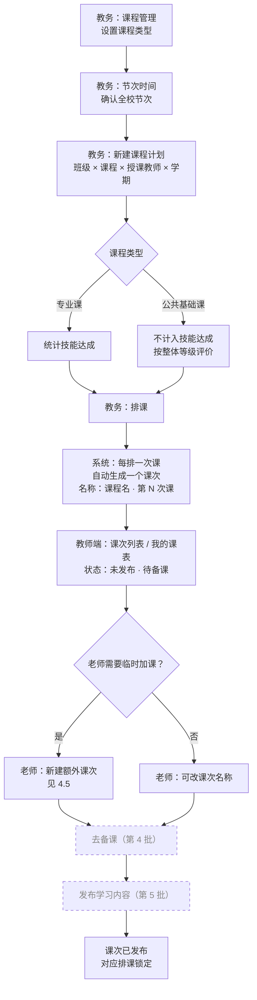
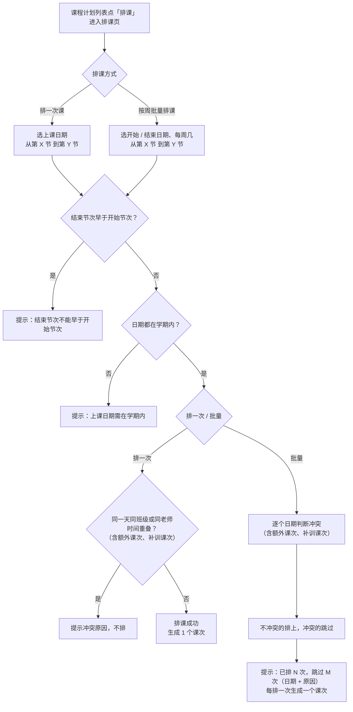
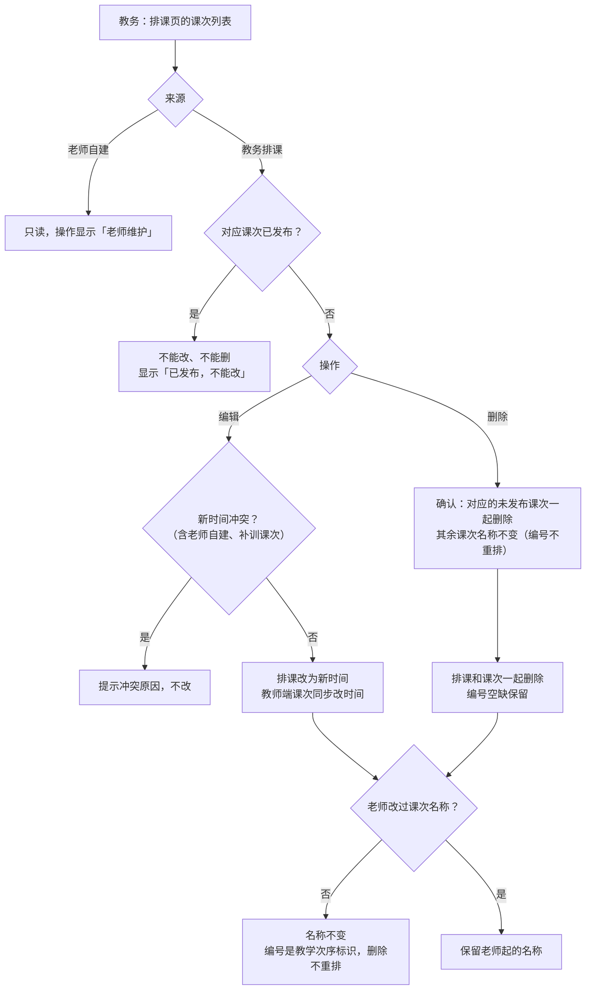
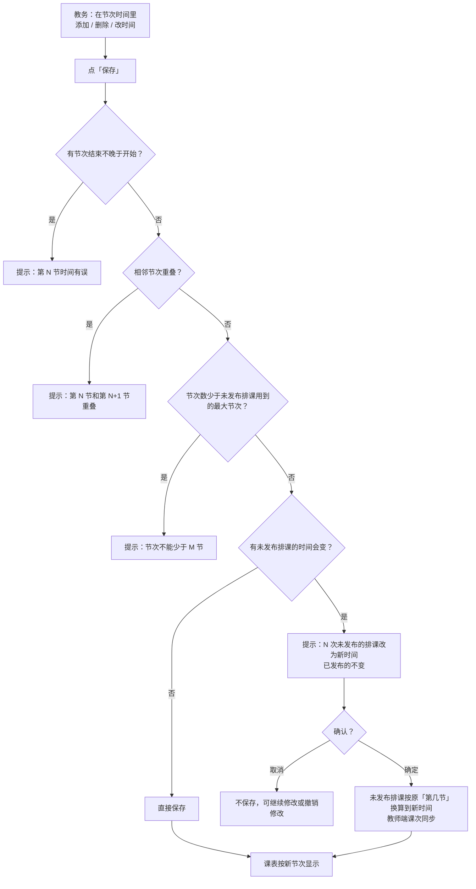
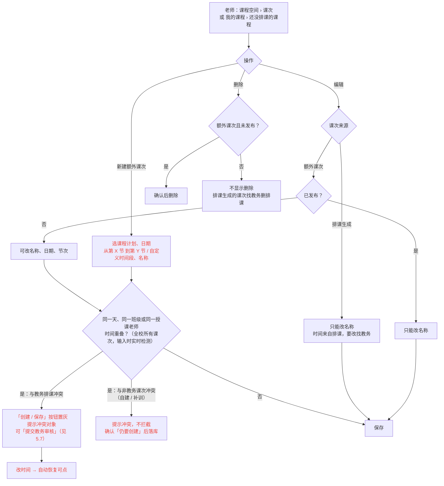
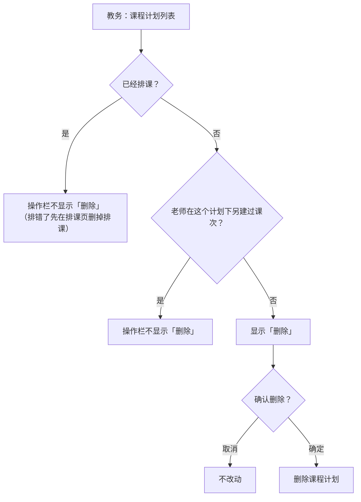

# PRD · 课程与排课

版本：v1.5（课次冲突审核链路：教师端实时拦截 + 提交教务审核，教务四动作处理；已排课计划禁编辑；排课列表次序展示收缩）

日期：2026-11-18

所属：AIGC 智慧课堂平台
演示对照：管理端 `周教务`（教务管理、课程计划）；教师端 `李老师`（智慧课堂 › 我的课程 / 我的课表）

> v1.5 变更（2026-11-18）：
> ① 教师端新建 / 编辑课次与**教务排课**冲突改为**实时拦截**：输入时间即检测，冲突时「创建 / 保存」按钮置灰，可「提交教务审核」（5.6、新增 5.7）；
> ② 管理端课程计划新增**「课次审核」页签**（红点角标显示待审数），教务四个动作处理：调整时间后通过 / 直接通过（允许重叠）/ 替换排课 / 驳回（5.7）；
> ③ 新增**待审核课次**状态：时间线独立分组、不计入教学进度等统计、老师只能撤回（5.6）；
> ④ 课程计划**已经排课后不允许编辑**：列表与详情抽屉不显示「编辑」（替代 v1.4 的「编辑锁定」口径，5.3）；
> ⑤ 排课详情**隐藏「次序」列与「按时间顺序重新编号」按钮**：稳定编号逻辑（删除不重排、新增取最大+1）全部保留，仅收缩展示层（5.4）；
> ⑥ 课程空间「＋ 新建课次」**锁定本课程计划**；时间字段一行两列，文案统一为「授课开始时间 / 授课结束时间」，去掉排课自动生成的提示文案（5.6）。
> ⑦ **补训 / 辅导功能本期隐藏（v1.5.1，2026-11-19）**：老师发起补训 / 个别辅导的入口不露出，排课列表与课表中已有定向课次统一显示「老师自建」「额外课次 · 老师自建」（不再分标「补训」「辅导」）；数据层保留，详见第三批 v1.3 变更。

---

## 1. 背景与目标

第一阶段要跑通「排课 → 备课 → 发布 → 评价 → 学习证据 → 学情」的闭环。闭环的起点是**课次**：每一次课都要能回答「哪个班、哪门课、什么时间、讲什么、学得怎么样」。

本批只解决「课从哪来、什么时候上」：

- 课程分专业课和公共基础课，决定后面是否统计技能达成；
- 学校自定义节次时间，排课按节次选；
- 教务排课后，教师端自动生成课次，老师不用重复建；
- 管理端、教师端课表按节次显示。

**分工原则：教务只管排课时间，每节课讲什么由任课老师定。**排课时不预选任务；老师在备课时确定内容（第 4 批），发布时确认考查技能（第 5 批）。

## 2. 范围

| 本批包含                      |
| ------------------------- |
| 课程管理：课程类型                 |
| 教务管理 › 节次时间管理（新增）         |
| 课程计划：排课（新增）、排课即课次（新增）     |
| 管理端班级课表 / 教师课表（按节次）       |
| 教师端：课次列表、编辑课次、新建额外课次、我的课表 |
| 教师端：课次与教务排课冲突实时拦截 + 提交教务审核（v1.5） |
| 管理端课程计划「课次审核」页签：调整时间后通过 / 直接通过 / 替换排课 / 驳回（v1.5） |

专业、年级、班级、学生、学期、课程的基础维护和课程计划的增删改沿用线上已有功能，本批只写改动点。

## 3. 角色与权限

| 角色                              | 本批能做什么                                  |
| ------------------------------- | --------------------------------------- |
| 教务 / 组织管理员 / 超管（权限：教务管理与课程计划维护） | 维护课程类型、节次时间；建课程计划、排课；看班级 / 教师课表；审核老师提交的冲突课次（v1.5，5.7） |
| 任课教师                            | 只看自己负责的课程计划下的课次；改课次名称；新建 / 删除额外课次；看我的课表；与教务排课冲突的课次可提交教务审核、可撤回（v1.5，5.6） |

## 4. 业务流程

### 4.1 整体流程

从教务准备基础数据，到老师拿到课次。虚线框是后续批次的功能，本批只到「课次待备课」。

### 4.2 排课

### 4.3 排课变更与课次同步

### 4.4 节次时间修改

### 4.5 教师端：编辑课次与额外课次

### 4.6 课程计划删除

## 5. 功能需求

### 5.1 课程类型（教务管理 › 课程管理）

- 新增 / 编辑课程时必填「课程类型」：**专业课** / **公共基础课**。
- 所属专业：专业课必选；公共基础课可不选（全校通用课程）。
- 列表增加「课程类型」列（专业课、公共基础课用不同颜色标签）和筛选项。
- 规则：
  - 公共基础课（如思政、大学英语）**默认不计入技能达成**：老师照常建课次、备课、布置和评价，任务按整体等级评价，不记技能证据。
  - 公共基础课如果关联了知识体系，则按专业课处理（关联在第 2 批）。
- 课程计划新增 / 编辑时按课程类型给提示：
  - 公共基础课：「公共基础课，默认不计入技能达成：老师照常建课次、布置和评价，不记技能证据」；
  - 课程所属专业与班级专业不一致时提醒核对。

### 5.2 节次时间（教务管理 › 节次时间管理，新增菜单）

**页面**：位于「学年学期管理」之后。一张表，列：节次 / 开始时间 / 结束时间 / 时长 / 操作。右上「＋ 添加一节」，底部「撤销修改」「保存」。

| 规则    | 说明                                                                                                                           |
| ----- | ---------------------------------------------------------------------------------------------------------------------------- |
| 结构    | 全校一张节次表，每行「第 N 节 + 开始 / 结束时间」；不分上午 / 下午 / 晚上，不分夏冬作息                                                                          |
| 默认值   | 10 节：08:00–08:45、08:55–09:40、10:00–10:45、10:55–11:40、14:00–14:45、14:55–15:40、16:00–16:45、16:55–17:40、19:00–19:45、19:55–20:40 |
| 添加    | 新的一节默认接在最后一节结束 10 分钟后，时长 45 分钟，可改                                                                                            |
| 校验    | 结束须晚于开始；相邻两节不能重叠；至少保留一节；保存时按开始时间自动排序并重新编号                                                                                    |
| 时长    | 自动计算显示（分钟）；时间有误时显示「时间有误」                                                                                                     |
| 修改的影响 | 未发布课次对应的排课按原「第几节」换算到新时间；已发布课次的时间不变。有影响时保存前提示「保存后，N 次未发布的排课（及教师端对应课次）改为新的节次时间；已发布的课次不变」                                       |
| 删除限制  | 未发布的排课用到的节次不能删（如有课排到第 10 节，节次不能少于 10 节），提示原因                                                                                 |
| 撤销修改  | 放弃未保存的修改，恢复为当前生效的节次表                                                                                                         |

### 5.3 课程计划与排课（课程计划管理 › 课程计划）

**课程计划**（已有功能，改动点）：

- 列表增加「排课 / 已发布」列：排了几次课、其中已发布几次；还没排课的显示「未排课」。
- **不设「停用」操作，也不设「计划状态」列和筛选**：学期结束计划自然结束；学期中撤课，在排课页逐个删除还没发布的排课。
- 列表操作：**详情 / 排课 / 编辑**，能删除时再显示「删除」；已经排课（有排课或老师已建课次）的课程计划不显示「编辑」（v1.5，见下「编辑」）。
- **详情**（右抽屉）：只看基础信息——学年学期、专业、年级、班级（含人数）、课程（含类型）、授课老师、排课 / 已发布；不显示知识体系和排课明细。底部按钮「编辑」「排课」可直接跳转，「编辑」同样仅未排课的计划显示（v1.5）。
- **编辑 / 新增**（右抽屉）：学年学期、班级、课程、授课老师；班级、课程、授课老师为带搜索的下拉（辅助说明分别是专业 · 年级 · 人数、所属专业 · 课程类型、所属组织）。
- **编辑（v1.5 调整，替代 v1.4「编辑锁定」口径）**：课程计划**已经排课**（有排课或老师已在下面新建了课次）后，列表操作项与详情抽屉底部的「编辑」**均不显示**——已排课计划不允许编辑；要改先在排课页删掉全部排课（老师自建课次也要删）。列表脚注给一行说明。未排课的计划照常编辑。
- **删除**：已经排课的、或老师已在下面新建过课次的课程计划，操作栏**不显示「删除」**；只有没排课也没有课次的才能删，删除前确认。
- 同一班级同一学期同一门课只能有一个课程计划。

**排课（新增，独立页面）**

- 列表点「排课」进入排课页，顶部「‹ 返回课程计划」和课程 · 班级 · 学期 · 授课老师；页面上方「＋ 排一次课」「按周批量排课」。

- 两种方式：
  - **排一次课**：上课日期 +「从第 X 节 到第 Y 节」；
  - **按周批量排课**：开始日期、结束日期、每周几 +「从第 X 节 到第 Y 节」。
- 节次下拉显示「第 N 节 HH:MM–HH:MM」，时间按节次时间自动带出；结束节次不能早于开始节次。
- 上课日期须在学期起止日期内。
- **冲突**：同一天、同一班级或同一授课老师，与已有课次时间有重叠即冲突（已有课次包括排课生成的、老师另建的额外课次、补训 / 辅导课次）。排一次课时直接提示（「该时间班级已有《××》/ ××已有课」）；批量时跳过冲突日期，完成后提示「已排 N 次课，跳过 M 次：日期（原因）…」。
- **课次列表**：教务排课和老师自建的课次放在**同一个列表**里，按日期排序。标题写「课次（共 N 次：教务排课 a、老师自建 b；已发布 m）」。
  - 列：日期 · 星期 / 节次（如「第 3–4 节」）/ 时间 / 课次名称 / **来源** / **状态** / 操作。
  - 来源：「教务排课」「老师自建」；老师发起的补训、辅导课次本期统一显示「老师自建」（补训 / 辅导分类标签已隐藏，v1.5.1）。
  - 状态：「已发布」「未发布」单独一列，课次名称里不再带状态。
  - 操作：教务排的、未发布的可「编辑」「删除」（删除提示「教师端对应的未发布课次会一起删除」）；教务排的、已发布的显示「已发布，不能改」；老师自建的显示「老师维护」（教务不能改，老师自建时已按全校规则做过冲突检查）。

**导入 / 导出**

- **导入**（右抽屉）：第 1 步下载模板（.xlsx），第 2 步上传填好的文件；抽屉里列出导入规则。系统逐行校验后导入，结果按行列出成功和失败原因，失败明细可下载修改后重新导入。
- **模板**（下载时按系统实时数据生成）：
  - 「填写说明」页：怎么填、导入规则。
  - 「课程计划」页：学年学期 *、班级 *、课程 *、授课老师 *、备注；一行一个课程计划。
  - 「排课（可选）」页：学年学期 *、班级 *、课程 *、排课方式 *（单次 / 按周）、上课日期（单次）、开始日期 / 结束日期 / 每周（按周）、开始节次 *、结束节次 *。
  - 「参考数据」页：系统当前可选的学年学期、班级（含专业、年级）、课程（含类型）、授课老师、节次（含时间）；前几页对应列都从这里下拉选择。
  - 必填列表头深色带 *，选填列浅色；第 2 行为示例行，导入时自动跳过。
- **导入校验规则**：学年学期须启用；班级、课程须启用，授课老师须为状态正常的教师账号，名称与系统一致；同一学年学期同一班级同一门课只能有一个课程计划（已有的提示重复并跳过）；排课日期在学期起止日期内；节次按节次时间管理，结束节次不早于开始节次；时间冲突的排课不导入并写明原因。
- **导出**：按当前筛选条件导出 CSV，列为学年学期、专业、年级、班级、课程、授课老师、学生人数、排课次数、已发布次数。

### 5.4 排课即课次（新增）

| 规则    | 说明                                                |
| ----- | ------------------------------------------------- |
| 自动生成  | 每排一次课，教师端立即生成一个课次，时间 = 排课时间，状态「未发布」               |
| 默认名称  | 「课程名 · 第 N 次课」，N 为课次的**稳定编号**（教学次序标识，2026-11-18 v1.1 定）：删除排课后其余课次**不重排**（编号空缺保留）；新增排课取当前最大编号 + 1（补排不撞号）；老师没改过名称（自动命名）的仅随编号初次分配、课程改名更新 |
| 重新编号  | 排课列表提供「按时间顺序重新编号」：只调整**未发布且未改名**的课次，已发布 / 手动命名的编号保留占号，其余按时间顺序补空缺（v1.5：该按钮与「次序」列已在排课详情**隐藏**，编号规则原样保留在数据层，后续需要纠偏时再放开入口） |
| 跟随    | 课次未发布时，管理端改时间 → 课次跟着改；删排课 → 课次一起删                 |
| 锁定    | 课次发布后，对应排课不能改时间、不能删                               |
| 老师不能删 | 排课生成的课次老师不能删除，要调整找教务改排课                           |
| 内容为空  | 排课生成的课次不带任务和技能，显示「待备课」；讲什么由老师备课时定                 |

### 5.5 管理端课表（课程计划管理 › 课表页签）

- 切换「班级课表 / 教师课表」，选学年学期、班级或老师，按周翻页（上一周 / 下一周 / 本周）。
- 网格：列 = 周一至周日（今天高亮），行 = 节次时间里的每一节（左侧显示「第 N 节」+ 起止时间）。
- 一次课占几节就**跨几行显示**；同一天同一时段的课放在一起。
- 课块内容：课程名、授课老师（班级课表）或班级（教师课表）、节次与时间（如「第 3–4 节 · 10:00–11:40」）、课次名称和状态（未发布 / 已发布）。
- 除排课生成的课次外，也显示老师另建的额外课次、补训 / 辅导课次（只读），课块统一标「额外课次 · 老师自建」，左边框用虚线区分。「补训」「辅导」分类标签本期隐藏（v1.5.1）。
- 底部统计：本周 N 次课，其中已发布 M 次。

### 5.6 教师端：课次与我的课表

**入口**：智慧课堂 › 我的课程 › 进入课程 › 课次页签；智慧课堂 › 我的课表。只显示本人负责的课程计划。

**我的课程里的课程状态**

- 没排课的课程（课程计划下还没有任何课次）：教学进度处显示「还没排课」，说明「管理端排课后，课次会自动出现在这里；也可以先新建额外课次」，并提供「＋ 新建额外课次」按钮（课程计划自动选好且锁定为该计划，不能给别的计划建课次（v1.5））。不显示「本学期课次已结束」。
- 课都上完的课程（所有课次的结束时间都已过）：不再出现在主列表，收进底部「已结束的课程（N）」折叠区，每门课一行：课程、班级、学期、课次数、待评价数量，可以进入课程、看学情、评价没评完的作业。
- 其余课程正常显示；「下次课」处没有未上的课时显示「排过的课都已上完」。

**课次列表（时间线）**

- 分「即将上课」「已上课」两组；已上课默认收起，没有即将上课的课时自动展开；有提交教务审核待处理的课次时，另有「待教务审核」独立分组置顶展示（v1.5，见下「提交教务审核与待审核课次」）。
- 每节课一行：日期 · 星期 · 时间（今天高亮并标「今天」）/ 课次名称 + 标签（额外课次）/ 涉及任务或技能（没有时显示「待备课」）/ 进度 / 操作。
- 进度条四步「备课 → 发布 → 提交 → 评价」，当前步高亮。去备课、发布的具体功能在第 4、5 批，本批先显示进度状态。
- 顶部筛选：全部 / 待发布 / 已过期（v1.5 补）/ 待评价 / 已发布（带数量）。计数口径（v1.5）：统计范围**排除待教务审核的课次**（独立分组展示）；「待评价」= 已布置任务课次中「已提交」待确认的提交数（全局统一口径，见第三批 PRD 5.2 / 6）；「已过期」= 未发布且上课开始时间已过（待审核不算过期）。
- 操作：编辑；未发布的额外课次可删除。

**编辑课次**

- 可改：**课次名称**。
- 排课生成的课次：显示授课时间（来自管理端排课），说明「要改时间请联系教务调整排课」；课程计划不可改。
- **不选知识体系任务和技能**。表单内说明：「这节课讲什么在备课时确定：备课资源关联到课次后带上技能，发布任务时确认考查技能和知识点」；公共基础课说明「默认不计入技能达成：任务按整体等级评价，不记学习证据」。
- 老师改过名称后，该课次不再随排课顺序自动改名。

**新建额外课次**（临时加课）

- 入口：课程空间右上「＋ 新建课次」（v1.5：课程空间内入口锁定为当前课程计划，计划下拉不可改，不给别的计划建课次；我的课程里「还没排课」课程的入口同样锁定该计划）。
- 字段：课程计划（只列本人任教的计划，入口锁定时只有当前计划一项）、上课日期、时间（「按节次：从第 X 节 到第 Y 节」或「自定义时间段」两行并排：时间方式独占一行，「授课开始时间」「授课结束时间」同行两列（v1.5 文案统一，原「从 / 到」「开始 / 结束」废弃））、课次名称。弹框不再显示「管理端排的课会自动生成课次，不用在这里新建……」类提示文案（v1.5）。
- **冲突实时检测（v1.5）**：改动日期或时间即检测，不用等点「创建」：
  - 与**教务排课**的课次冲突（含排课生成的、教务后续调整的）：提示「与教务排课的课次时间冲突：〈冲突对象〉。请调整上课时间或提交教务审核。」，同时「创建课次 / 保存」按钮**置灰不可点**；改掉时间自动恢复可点；
  - 与**非教务课次**冲突（老师自建的额外课次、补训 / 辅导）：仅提示冲突对象不拦截，确认「仍要创建」后落库（课表重叠显示）；
  - 冲突判断按全校规则：同一天、同一班级或同一授课老师，时间段重叠即冲突（严格重叠，首尾相接不算）；排课生成的、别人另建的、补训课次互相检查。
- 建好的额外课次会出现在管理端的排课页（来源「老师自建」）和班级 / 教师课表里（只读）。
- 列表标「额外课次」；未发布前可删除，发布后不能删。

**提交教务审核与待审核课次**（v1.5 新增）

- 与教务排课冲突、且老师时间调不开时，在新建 / 编辑弹框里点「提交教务审核」：课次以**「待审核」**状态落库，同时生成一条审核单（课程、班级、授课老师、上课时间、冲突说明、冲突课次），流转到管理端「课次审核」页签（见 5.7）。
- 待审核课次在时间线**「待教务审核」独立分组**展示，行标「待教务审核」。
- 待审核课次**不计入任何教学统计**：教学进度（x/N 次课已上）、待发布、已过期、下次课等一律排除；发布后自然计入。
- 待审核课次**只能「撤回」**：撤回 = 删除该课次并撤销审核单（审核单标「已撤回」）；教务已处理（通过 / 替换 / 驳回）后不能再撤回。
- 审核结果回写课次：通过 / 替换通过 → 课次转为**未发布**正式课次（进入正常备课流程）；驳回 → 课次删除退回，老师可改时间后重新创建。

**我的课表**

- 按周显示本人所有课次，行 = 节次，跨节跨行，规则同 5.5；课块显示课程、班级、节次与时间、课次名称、状态（补训 / 辅导 / 额外课次加标签）。
- 点课块打开课次详情。
- 底部：本周 N 次课，已发布 M 次。

### 5.7 课次审核（课程计划管理 › 课次审核页签，v1.5 新增）

**入口与待办提醒**

- 课程计划页顶部设「课程计划 / 课表 / **课次审核**」三个页签；「课次审核」页签带**红点角标**显示待审核数量，数量为 0 时不显示角标。
- 页签内分两段：顶部说明文案（审核规则一句话）；「**待审核**」列表与「**已处理**」列表。

**待审核列表**

- 每行：课程 · 班级 · 授课老师 / 老师提交的上课时间 / 冲突说明（与哪门课、哪个班或哪位老师、几点冲突）/ 提交时间 / 操作。
- 教务对每条待审核记录有**四个动作**（每条只处理一次，处理后从待审核消失、进已处理）：
  1. **调整时间后通过**：在弹框里改日期与授课起止时间，保存时系统按全校规则复查冲突——无冲突才落库（记「教务已调整时间」）；仍有冲突则拦截，不改时间不能通过；
  2. **直接通过**：不改时间，**允许与冲突课次时间重叠**，课次直接转未发布（用于两边时间都动不了、接受同教室 / 同老师撞档的场景）；
  3. **替换排课**：老师的课次**顶替**引发冲突的原教务排课——原排课课次标记「已被替换课次顶替 · 不计入进度」（教师端、课表同步按排除口径展示），老师课次转为未发布正式课次；
  4. **驳回**：老师课次删除退回，审核单标「已驳回」，老师可调整时间后重新创建提交。
- 所有动作记审计日志（谁、何时、哪个动作、是否调整了时间）。

**已处理列表**

- 展示历史审核记录：课程 / 时间 / 处理动作 / 处理人 / 处理时间；老师撤回的单子标「已撤回」。

## 6. 数据口径与规则汇总

1. 节次编号 = 节次时间表按开始时间排序后的序号；一次课的节次 = 与它时间重叠的节次范围（如 10:00–11:40 为第 3–4 节）。
2. 冲突判断按时间段是否重叠，不是只比开始时间。
3. 改节次时间只影响未发布课次；已发布课次的时间永远不变。
4. 课程计划下「已发布」数量 = 已发布学习内容的课次数。
5. 公共基础课不计入技能达成（关联知识体系后按专业课处理）。
6. 课程计划不手动停用；是否已结束按课次判断：还有没上的课 = 进行中，所有课次都已上完 = 已结束（只用于教师端「我的课程」分组）。
7. 时间冲突对全校所有课次生效：排课、老师另建的额外课次、补训 / 辅导课次互相检查。
8. 待审核课次不计入任何教学统计（教学进度、待发布、已过期、下次课等）；审核通过 / 替换通过转未发布后自然计入（v1.5）。
9. 冲突处理分工：与教务排课冲突 → 老师端实时置灰拦截 + 可提交教务审核；与非教务课次冲突 → 仅提示不拦截，老师确认后可建（v1.5）。
10. 「替换排课」后，被顶替的原排课按排除口径展示（「已被替换课次顶替 · 不计入进度」），不再参与教学进度与冲突检查（v1.5）。

## 7. 显示 / 不显示

- 节次统一显示为「第 N 节」或「第 N–M 节」，不再显示「第 N 堂课」。
- 课表不分上午 / 下午 / 晚上分组。
- 课次没有内容时显示「待备课」，不显示「还没选任务或技能」。
- 编辑课次里不出现「知识体系任务与技能」选择。
- 课程计划没有「停用」操作，列表不显示「计划状态」列和筛选；不能删除的课程计划不显示「删除」。
- 课程计划详情不显示知识体系关联情况和排课明细。
- 排课详情不显示「次序」列与「按时间顺序重新编号」按钮，也不显示编号说明行（v1.5，稳定编号逻辑保留在数据层）。
- 已经排课的课程计划，列表操作与详情抽屉都不显示「编辑」（v1.5）。
- 新建 / 编辑课次弹框不显示「管理端排的课会自动生成课次……」提示文案；编辑态保留「老师自建的课次」相关说明（v1.5）。
- 页面不出现「示例数据」「待确认」类标注。

## 8. 验收标准

| #   | 场景                       | 预期                                                       |
| --- | ------------------------ | -------------------------------------------------------- |
| 1   | 新增课程选「公共基础课」不选所属专业       | 保存成功，列表显示公共基础课标签；建课程计划时出现「不计入技能达成」提示                     |
| 2   | 节次时间把第 2 节结束改成早于开始       | 保存被拦下，提示具体节次                                             |
| 3   | 把第 1 节改为 08:10–08:55 并保存 | 提示影响的未发布排课次数；确认后这些排课和教师端课次变为新时间，已发布课次不变                  |
| 4   | 已有课排到第 10 节时删到 9 节       | 保存被拦下，提示不能少于 10 节                                        |
| 5   | 排一次课，选第 4–5 节            | 时间自动为第 4 节开始到第 5 节结束；教师端立即出现该课次，名称「课程名 · 第 N 次课」，显示「待备课」 |
| 6   | 同一天同班级再排一次与之重叠的课         | 被拦下并说明冲突原因                                               |
| 7   | 按周批量排课，区间内有冲突日期          | 其余日期排上，冲突日期跳过并列出原因                                       |
| 8   | 管理端编辑一次未发布排课的时间          | 教师端课次时间同步；已发布课次对应的排课不能改                                  |
| 9   | 班级课表 / 教师课表 / 我的课表       | 行为节次，跨节的课跨行；今天高亮；统计数字正确                                  |
| 10  | 老师编辑排课生成的课次              | 只能改名称；看不到任务与技能选择；改名后不再随排课顺序改名                            |
| 11  | 老师新建额外课次并删除（v1.5 调整） | 未发布时可删；与非教务课次时间重叠时提示冲突、确认「仍要创建」后可建，与教务排课重叠则按钮置灰走教务审核（见 22）；提示写明冲突的课程、班级 / 老师和时间 |
| 12  | 专业负责人登录管理端               | 看不到教务管理和课程计划菜单                                           |
| 13  | 查看已经排课的课程计划的操作栏          | 不显示「删除」；把排课全部删掉（且没有老师自建课次）后才出现「删除」                           |
| 14  | 列表点「详情」「编辑」                  | 都在右抽屉打开；详情只有基础信息和排课 / 已发布，底部可进入编辑、排课                          |
| 15  | 老师新建一次额外课次后看管理端          | 排课页列表里出现这条课次，来源「老师自建」，操作显示「老师维护」；班级 / 教师课表里也能看到，标「额外课次 · 老师自建」 |
| 16  | 新建一个课程计划但不排课，老师登录        | 我的课程里显示「还没排课」，可以直接新建额外课次；不显示「本学期课次已结束」                   |
| 17  | 一门课的课都已上完                | 收进「已结束的课程」，仍可进入课程评价没评完的作业、看学情                            |
| 18  | 查看已经排课的课程计划的列表与详情（v1.5 调整） | 列表操作项与详情抽屉底部均不显示「编辑」，只有未排课的计划可编辑；列表脚注有说明 |
| 19  | 排课页                          | 教务排课和老师自建在一个列表里，按日期排序；来源、状态各一列；只有教务排的未发布课次可编辑、删除；可返回列表 |
| 20  | 导入：下载模板并上传                   | 模板含填写说明、课程计划、排课（可选）、参考数据 4 页，下拉值与系统一致；上传后逐行校验并列出成功 / 失败原因 |
| 21  | 导出                            | 按当前筛选导出 CSV，列与列表一致，另含排课次数、已发布次数，Excel 打开不乱码                    |
| 22  | 老师新建课次，输入与教务排课重叠的时间（v1.5） | 输入即提示「与教务排课的课次时间冲突：〈对象〉。请调整上课时间或提交教务审核。」，「创建课次」按钮置灰；改到无冲突时间自动恢复可点；与紧邻时段（如排课 10:00–12:00，新建 12:00–13:00）不算冲突 |
| 23  | 冲突时点「提交教务审核」（v1.5） | 课次以「待审核」落库并出现在时间线「待教务审核」分组；不计入教学进度 / 待发布统计；老师只能撤回，撤回后课次删除、审核单标已撤回 |
| 24  | 教务「调整时间后通过」（v1.5） | 改为无冲突时间才可保存，课次转未发布、记「教务已调整时间」；改后仍冲突则拦截 |
| 25  | 教务「直接通过」（v1.5） | 时间不变、允许重叠，课次转未发布 |
| 26  | 教务「替换排课」（v1.5） | 老师课次顶替原排课转未发布；原排课显示「已被替换课次顶替 · 不计入进度」，不计教学进度 |
| 27  | 教务「驳回」（v1.5） | 老师课次删除退回、审核单标已驳回；老师可改时间重新创建提交 |
| 28  | 课程空间「＋ 新建课次」（v1.5） | 课程计划下拉锁定为当前计划且不可改；时间字段「授课开始时间 / 授课结束时间」同行两列；弹框无「排课自动生成课次」提示 |
