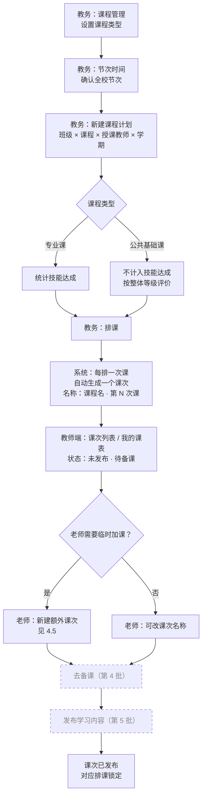
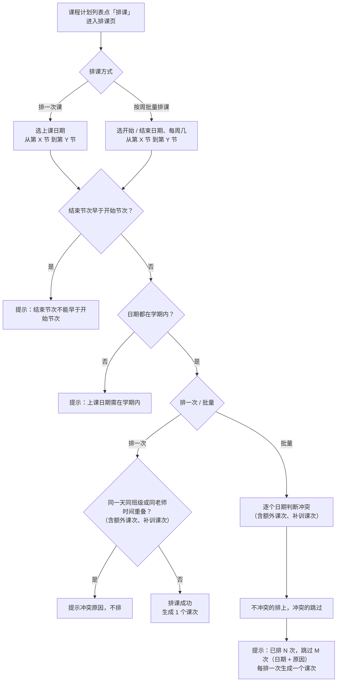
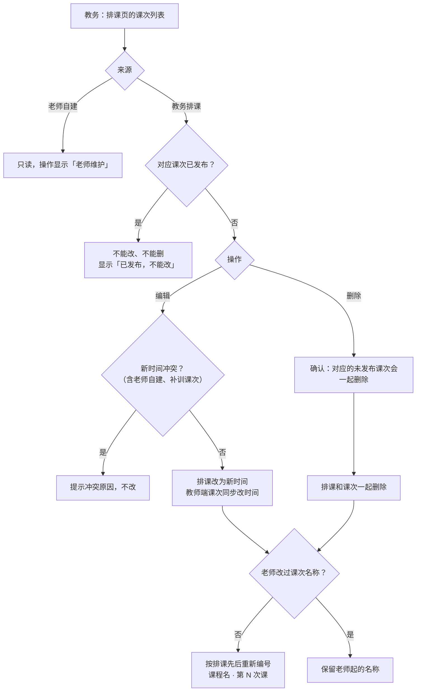
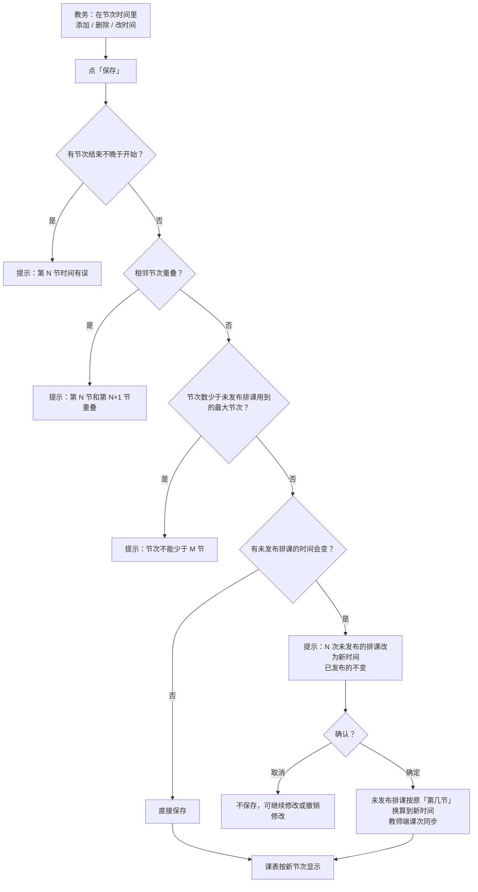
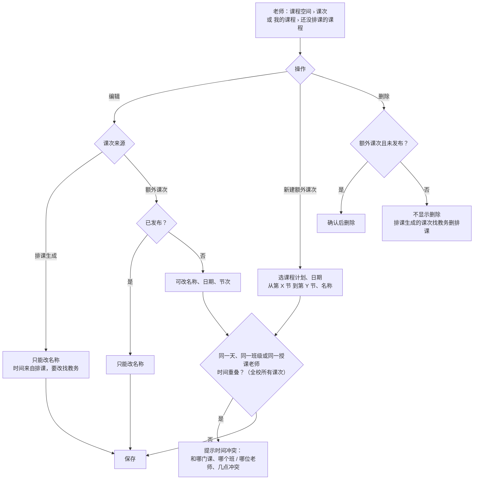
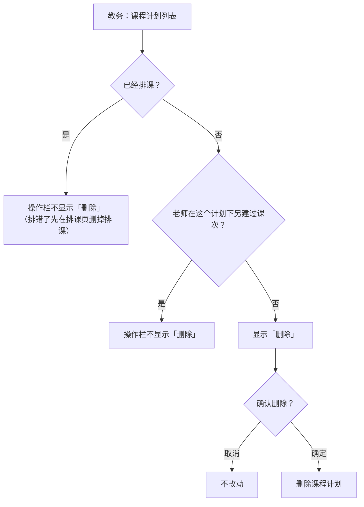

# PRD · 课程与排课

版本：v1.3（详情 / 排课 / 编辑拆分、排课页合并来源与状态、不能删除不显示删除、导入导出）　

日期：2026-11-11

所属：AIGC 智慧课堂平台
演示对照：管理端 `周教务`（教务管理、课程计划）；教师端 `李老师`（智慧课堂 › 我的课程 / 我的课表）

---

## 1. 背景与目标

第一阶段要跑通「排课 → 备课 → 发布 → 评价 → 学习证据 → 学情」的闭环。闭环的起点是**课次**：每一次课都要能回答「哪个班、哪门课、什么时间、讲什么、学得怎么样」。

本批只解决「课从哪来、什么时候上」：

- 课程分专业课和公共基础课，决定后面是否统计技能达成；
- 学校自定义节次时间，排课按节次选；
- 教务排课后，教师端自动生成课次，老师不用重复建；
- 管理端、教师端课表按节次显示。

**分工原则：教务只管排课时间，每节课讲什么由任课老师定。**排课时不预选任务；老师在备课时确定内容（第 4 批），发布时确认考查技能（第 5 批）。

## 2. 范围

| 本批包含                      |
| ------------------------- |
| 课程管理：课程类型                 |
| 教务管理 › 节次时间管理（新增）         |
| 课程计划：排课（新增）、排课即课次（新增）     |
| 管理端班级课表 / 教师课表（按节次）       |
| 教师端：课次列表、编辑课次、新建额外课次、我的课表 |

专业、年级、班级、学生、学期、课程的基础维护和课程计划的增删改沿用线上已有功能，本批只写改动点。

## 3. 角色与权限

| 角色                              | 本批能做什么                                  |
| ------------------------------- | --------------------------------------- |
| 教务 / 组织管理员 / 超管（权限：教务管理与课程计划维护） | 维护课程类型、节次时间；建课程计划、排课；看班级 / 教师课表         |
| 任课教师                            | 只看自己负责的课程计划下的课次；改课次名称；新建 / 删除额外课次；看我的课表 |

## 4. 业务流程

### 4.1 整体流程

从教务准备基础数据，到老师拿到课次。虚线框是后续批次的功能，本批只到「课次待备课」。

### 4.2 排课

### 4.3 排课变更与课次同步

### 4.4 节次时间修改

### 4.5 教师端：编辑课次与额外课次

### 4.6 课程计划删除

## 5. 功能需求

### 5.1 课程类型（教务管理 › 课程管理）

- 新增 / 编辑课程时必填「课程类型」：**专业课** / **公共基础课**。
- 所属专业：专业课必选；公共基础课可不选（全校通用课程）。
- 列表增加「课程类型」列（专业课、公共基础课用不同颜色标签）和筛选项。
- 规则：
  - 公共基础课（如思政、大学英语）**默认不计入技能达成**：老师照常建课次、备课、布置和评价，任务按整体等级评价，不记技能证据。
  - 公共基础课如果关联了知识体系，则按专业课处理（关联在第 2 批）。
- 课程计划新增 / 编辑时按课程类型给提示：
  - 公共基础课：「公共基础课，默认不计入技能达成：老师照常建课次、布置和评价，不记技能证据」；
  - 课程所属专业与班级专业不一致时提醒核对。

### 5.2 节次时间（教务管理 › 节次时间管理，新增菜单）

**页面**：位于「学年学期管理」之后。一张表，列：节次 / 开始时间 / 结束时间 / 时长 / 操作。右上「＋ 添加一节」，底部「撤销修改」「保存」。

| 规则    | 说明                                                                                                                           |
| ----- | ---------------------------------------------------------------------------------------------------------------------------- |
| 结构    | 全校一张节次表，每行「第 N 节 + 开始 / 结束时间」；不分上午 / 下午 / 晚上，不分夏冬作息                                                                          |
| 默认值   | 10 节：08:00–08:45、08:55–09:40、10:00–10:45、10:55–11:40、14:00–14:45、14:55–15:40、16:00–16:45、16:55–17:40、19:00–19:45、19:55–20:40 |
| 添加    | 新的一节默认接在最后一节结束 10 分钟后，时长 45 分钟，可改                                                                                            |
| 校验    | 结束须晚于开始；相邻两节不能重叠；至少保留一节；保存时按开始时间自动排序并重新编号                                                                                    |
| 时长    | 自动计算显示（分钟）；时间有误时显示「时间有误」                                                                                                     |
| 修改的影响 | 未发布课次对应的排课按原「第几节」换算到新时间；已发布课次的时间不变。有影响时保存前提示「保存后，N 次未发布的排课（及教师端对应课次）改为新的节次时间；已发布的课次不变」                                       |
| 删除限制  | 未发布的排课用到的节次不能删（如有课排到第 10 节，节次不能少于 10 节），提示原因                                                                                 |
| 撤销修改  | 放弃未保存的修改，恢复为当前生效的节次表                                                                                                         |

### 5.3 课程计划与排课（课程计划管理 › 课程计划）

**课程计划**（已有功能，改动点）：

- 列表增加「排课 / 已发布」列：排了几次课、其中已发布几次；还没排课的显示「未排课」。
- **不设「停用」操作，也不设「计划状态」列和筛选**：学期结束计划自然结束；学期中撤课，在排课页逐个删除还没发布的排课。
- 列表操作：**详情 / 排课 / 编辑**，能删除时再显示「删除」。
- **详情**（右抽屉）：只看基础信息——学年学期、专业、年级、班级（含人数）、课程（含类型）、授课老师、排课 / 已发布；不显示知识体系和排课明细。底部按钮「编辑」「排课」可直接跳转。
- **编辑 / 新增**（右抽屉）：学年学期、班级、课程、授课老师；班级、课程、授课老师为带搜索的下拉（辅助说明分别是专业 · 年级 · 人数、所属专业 · 课程类型、所属组织）。
- **编辑锁定**：课程计划**已经排课**（或老师已在下面新建了课次）后，学期、班级、课程不能再改，只能更换授课老师；表单顶部说明「这个计划已经排了 N 次课，学期、班级、课程不能再改，只能更换授课老师」。排错了要改，先在排课页删掉排课。
- **删除**：已经排课的、或老师已在下面新建过课次的课程计划，操作栏**不显示「删除」**；只有没排课也没有课次的才能删，删除前确认。
- 同一班级同一学期同一门课只能有一个课程计划。

**排课（新增，独立页面）**

- 列表点「排课」进入排课页，顶部「‹ 返回课程计划」和课程 · 班级 · 学期 · 授课老师；页面上方「＋ 排一次课」「按周批量排课」。

- 两种方式：
  - **排一次课**：上课日期 +「从第 X 节 到第 Y 节」；
  - **按周批量排课**：开始日期、结束日期、每周几 +「从第 X 节 到第 Y 节」。
- 节次下拉显示「第 N 节 HH:MM–HH:MM」，时间按节次时间自动带出；结束节次不能早于开始节次。
- 上课日期须在学期起止日期内。
- **冲突**：同一天、同一班级或同一授课老师，与已有课次时间有重叠即冲突（已有课次包括排课生成的、老师另建的额外课次、补训 / 辅导课次）。排一次课时直接提示（「该时间班级已有《××》/ ××已有课」）；批量时跳过冲突日期，完成后提示「已排 N 次课，跳过 M 次：日期（原因）…」。
- **课次列表**：教务排课和老师自建的课次放在**同一个列表**里，按日期排序。标题写「课次（共 N 次：教务排课 a、老师自建 b；已发布 m）」。
  - 列：日期 · 星期 / 节次（如「第 3–4 节」）/ 时间 / 课次名称 / **来源** / **状态** / 操作。
  - 来源：「教务排课」「老师自建」；老师发起的补训、辅导显示「老师自建 · 补训」「老师自建 · 辅导」。
  - 状态：「已发布」「未发布」单独一列，课次名称里不再带状态。
  - 操作：教务排的、未发布的可「编辑」「删除」（删除提示「教师端对应的未发布课次会一起删除」）；教务排的、已发布的显示「已发布，不能改」；老师自建的显示「老师维护」（教务不能改，老师自建时已按全校规则做过冲突检查）。

**导入 / 导出**

- **导入**（右抽屉）：第 1 步下载模板（.xlsx），第 2 步上传填好的文件；抽屉里列出导入规则。系统逐行校验后导入，结果按行列出成功和失败原因，失败明细可下载修改后重新导入。
- **模板**（下载时按系统实时数据生成）：
  - 「填写说明」页：怎么填、导入规则。
  - 「课程计划」页：学年学期 *、班级 *、课程 *、授课老师 *、备注；一行一个课程计划。
  - 「排课（可选）」页：学年学期 *、班级 *、课程 *、排课方式 *（单次 / 按周）、上课日期（单次）、开始日期 / 结束日期 / 每周（按周）、开始节次 *、结束节次 *。
  - 「参考数据」页：系统当前可选的学年学期、班级（含专业、年级）、课程（含类型）、授课老师、节次（含时间）；前几页对应列都从这里下拉选择。
  - 必填列表头深色带 *，选填列浅色；第 2 行为示例行，导入时自动跳过。
- **导入校验规则**：学年学期须启用；班级、课程须启用，授课老师须为状态正常的教师账号，名称与系统一致；同一学年学期同一班级同一门课只能有一个课程计划（已有的提示重复并跳过）；排课日期在学期起止日期内；节次按节次时间管理，结束节次不早于开始节次；时间冲突的排课不导入并写明原因。
- **导出**：按当前筛选条件导出 CSV，列为学年学期、专业、年级、班级、课程、授课老师、学生人数、排课次数、已发布次数。

### 5.4 排课即课次（新增）

| 规则    | 说明                                                |
| ----- | ------------------------------------------------- |
| 自动生成  | 每排一次课，教师端立即生成一个课次，时间 = 排课时间，状态「未发布」               |
| 默认名称  | 「课程名 · 第 N 次课」，N 按排课时间先后；老师没改过名称的，排课增删或改时间后自动重新编号 |
| 跟随    | 课次未发布时，管理端改时间 → 课次跟着改；删排课 → 课次一起删                 |
| 锁定    | 课次发布后，对应排课不能改时间、不能删                               |
| 老师不能删 | 排课生成的课次老师不能删除，要调整找教务改排课                           |
| 内容为空  | 排课生成的课次不带任务和技能，显示「待备课」；讲什么由老师备课时定                 |

### 5.5 管理端课表（课程计划管理 › 课表页签）

- 切换「班级课表 / 教师课表」，选学年学期、班级或老师，按周翻页（上一周 / 下一周 / 本周）。
- 网格：列 = 周一至周日（今天高亮），行 = 节次时间里的每一节（左侧显示「第 N 节」+ 起止时间）。
- 一次课占几节就**跨几行显示**；同一天同一时段的课放在一起。
- 课块内容：课程名、授课老师（班级课表）或班级（教师课表）、节次与时间（如「第 3–4 节 · 10:00–11:40」）、课次名称和状态（未发布 / 已发布）。
- 除排课生成的课次外，也显示老师另建的额外课次、补训 / 辅导课次（只读），课块分别标「额外课次 · 老师自建」「补训」「辅导」，左边框用虚线区分。
- 底部统计：本周 N 次课，其中已发布 M 次。

### 5.6 教师端：课次与我的课表

**入口**：智慧课堂 › 我的课程 › 进入课程 › 课次页签；智慧课堂 › 我的课表。只显示本人负责的课程计划。

**我的课程里的课程状态**

- 没排课的课程（课程计划下还没有任何课次）：教学进度处显示「还没排课」，说明「管理端排课后，课次会自动出现在这里；也可以先新建额外课次」，并提供「＋ 新建额外课次」按钮（课程计划自动选好）。不显示「本学期课次已结束」。
- 课都上完的课程（所有课次的结束时间都已过）：不再出现在主列表，收进底部「已结束的课程（N）」折叠区，每门课一行：课程、班级、学期、课次数、待评价数量，可以进入课程、看学情、评价没评完的作业。
- 其余课程正常显示；「下次课」处没有未上的课时显示「排过的课都已上完」。

**课次列表（时间线）**

- 分「即将上课」「已上课」两组；已上课默认收起，没有即将上课的课时自动展开。
- 每节课一行：日期 · 星期 · 时间（今天高亮并标「今天」）/ 课次名称 + 标签（额外课次）/ 涉及任务或技能（没有时显示「待备课」）/ 进度 / 操作。
- 进度条四步「备课 → 发布 → 提交 → 评价」，当前步高亮。去备课、发布的具体功能在第 4、5 批，本批先显示进度状态。
- 顶部筛选：全部 / 待发布 / 待评价 / 已发布（带数量）。
- 操作：编辑；未发布的额外课次可删除。

**编辑课次**

- 可改：**课次名称**。
- 排课生成的课次：显示授课时间（来自管理端排课），说明「要改时间请联系教务调整排课」；课程计划不可改。
- **不选知识体系任务和技能**。表单内说明：「这节课讲什么在备课时确定：备课资源关联到课次后带上技能，发布任务时确认考查技能和知识点」；公共基础课说明「默认不计入技能达成：任务按整体等级评价，不记学习证据」。
- 老师改过名称后，该课次不再随排课顺序自动改名。

**新建额外课次**（临时加课）

- 入口：课程空间右上「＋ 新建额外课次」；我的课程里「还没排课」的课程上也有入口。
- 字段：课程计划（只列本人任教的计划）、上课日期、「从第 X 节 到第 Y 节」、课次名称。
- **冲突检查按全校规则**：同一天、同一班级或同一授课老师，与任何已有课次（排课生成的、别人另建的、补训课次）时间重叠都不能建。提示写明冲突对象，如「时间冲突：李老师 这时在上《旅行社经营与管理》（导游 2024级 1班），11-17 08:55–11:40」。
- 建好的额外课次会出现在管理端的排课页（来源「老师自建」）和班级 / 教师课表里（只读）。
- 列表标「额外课次」；未发布前可删除，发布后不能删。

**我的课表**

- 按周显示本人所有课次，行 = 节次，跨节跨行，规则同 5.5；课块显示课程、班级、节次与时间、课次名称、状态（补训 / 辅导 / 额外课次加标签）。
- 点课块打开课次详情。
- 底部：本周 N 次课，已发布 M 次。

## 6. 数据口径与规则汇总

1. 节次编号 = 节次时间表按开始时间排序后的序号；一次课的节次 = 与它时间重叠的节次范围（如 10:00–11:40 为第 3–4 节）。
2. 冲突判断按时间段是否重叠，不是只比开始时间。
3. 改节次时间只影响未发布课次；已发布课次的时间永远不变。
4. 课程计划下「已发布」数量 = 已发布学习内容的课次数。
5. 公共基础课不计入技能达成（关联知识体系后按专业课处理）。
6. 课程计划不手动停用；是否已结束按课次判断：还有没上的课 = 进行中，所有课次都已上完 = 已结束（只用于教师端「我的课程」分组）。
7. 时间冲突对全校所有课次生效：排课、老师另建的额外课次、补训 / 辅导课次互相检查。

## 7. 显示 / 不显示

- 节次统一显示为「第 N 节」或「第 N–M 节」，不再显示「第 N 堂课」。
- 课表不分上午 / 下午 / 晚上分组。
- 课次没有内容时显示「待备课」，不显示「还没选任务或技能」。
- 编辑课次里不出现「知识体系任务与技能」选择。
- 课程计划没有「停用」操作，列表不显示「计划状态」列和筛选；不能删除的课程计划不显示「删除」。
- 课程计划详情不显示知识体系关联情况和排课明细。
- 页面不出现「示例数据」「待确认」类标注。

## 8. 验收标准

| #   | 场景                       | 预期                                                       |
| --- | ------------------------ | -------------------------------------------------------- |
| 1   | 新增课程选「公共基础课」不选所属专业       | 保存成功，列表显示公共基础课标签；建课程计划时出现「不计入技能达成」提示                     |
| 2   | 节次时间把第 2 节结束改成早于开始       | 保存被拦下，提示具体节次                                             |
| 3   | 把第 1 节改为 08:10–08:55 并保存 | 提示影响的未发布排课次数；确认后这些排课和教师端课次变为新时间，已发布课次不变                  |
| 4   | 已有课排到第 10 节时删到 9 节       | 保存被拦下，提示不能少于 10 节                                        |
| 5   | 排一次课，选第 4–5 节            | 时间自动为第 4 节开始到第 5 节结束；教师端立即出现该课次，名称「课程名 · 第 N 次课」，显示「待备课」 |
| 6   | 同一天同班级再排一次与之重叠的课         | 被拦下并说明冲突原因                                               |
| 7   | 按周批量排课，区间内有冲突日期          | 其余日期排上，冲突日期跳过并列出原因                                       |
| 8   | 管理端编辑一次未发布排课的时间          | 教师端课次时间同步；已发布课次对应的排课不能改                                  |
| 9   | 班级课表 / 教师课表 / 我的课表       | 行为节次，跨节的课跨行；今天高亮；统计数字正确                                  |
| 10  | 老师编辑排课生成的课次              | 只能改名称；看不到任务与技能选择；改名后不再随排课顺序改名                            |
| 11  | 老师新建额外课次并删除              | 未发布时可删；与本班或本人其他课程时间重叠时被拦下，提示写明冲突的课程、班级 / 老师和时间           |
| 12  | 专业负责人登录管理端               | 看不到教务管理和课程计划菜单                                           |
| 13  | 查看已经排课的课程计划的操作栏          | 不显示「删除」；把排课全部删掉（且没有老师自建课次）后才出现「删除」                           |
| 14  | 列表点「详情」「编辑」                  | 都在右抽屉打开；详情只有基础信息和排课 / 已发布，底部可进入编辑、排课                          |
| 15  | 老师新建一次额外课次后看管理端          | 排课页列表里出现这条课次，来源「老师自建」，操作显示「老师维护」；班级 / 教师课表里也能看到，标「额外课次 · 老师自建」 |
| 16  | 新建一个课程计划但不排课，老师登录        | 我的课程里显示「还没排课」，可以直接新建额外课次；不显示「本学期课次已结束」                   |
| 17  | 一门课的课都已上完                | 收进「已结束的课程」，仍可进入课程评价没评完的作业、看学情                            |
| 18  | 编辑一个已经排课、但还没发布任何课次的课程计划  | 学期、班级、课程不能改，只能换授课老师，顶部说明已排了几次课                           |
| 19  | 排课页                          | 教务排课和老师自建在一个列表里，按日期排序；来源、状态各一列；只有教务排的未发布课次可编辑、删除；可返回列表 |
| 20  | 导入：下载模板并上传                   | 模板含填写说明、课程计划、排课（可选）、参考数据 4 页，下拉值与系统一致；上传后逐行校验并列出成功 / 失败原因 |
| 21  | 导出                            | 按当前筛选导出 CSV，列与列表一致，另含排课次数、已发布次数，Excel 打开不乱码                    |
