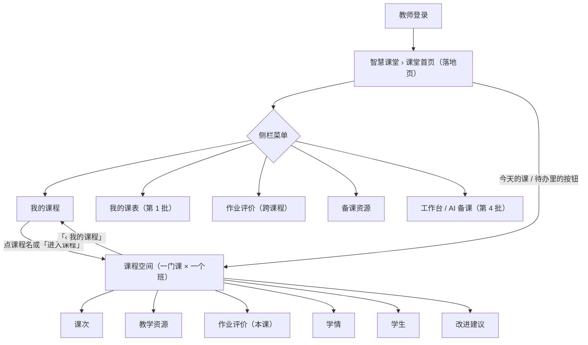
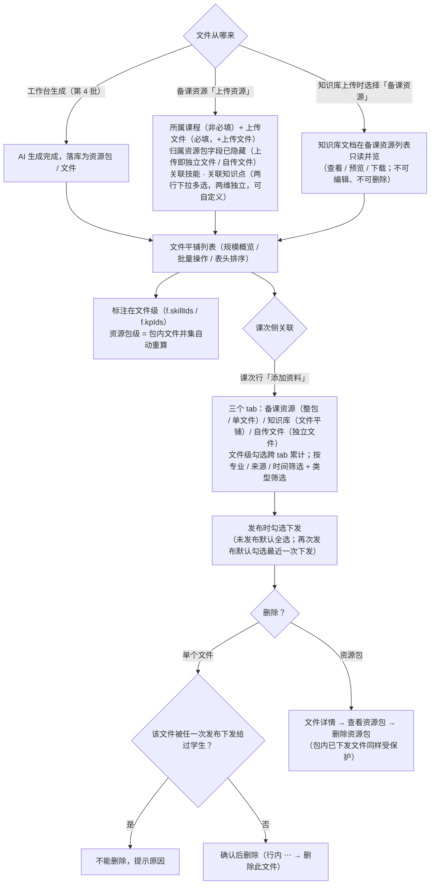
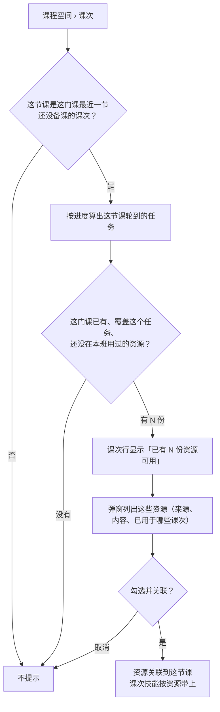

# PRD · 第三批：教师端「智慧课堂」框架

版本：v1.6　｜　日期：2026-11-25（v1.5：2026-11-25；v1.4 / v1.3：2026-11-19；v1.2 / v1.1 口径：2026-11-18；v1.0：2026-11-11）　｜　所属：AIGC 智慧课堂平台 · 第一阶段教学闭环
演示对照：教师端 `李老师`（三门课：旅行策划 1 班 / 2 班、旅行社经营与管理 1 班）；`王老师`（没有课程计划，看空状态）

> v1.1 口径（2026-11-18）：教师端「技能达成率」改为按已评价技能统计（详见 5.3 口径块）。
>
> v1.2 变更（2026-11-18）：智慧课堂**所有展示数据的数据点补充算法说明**（本节各红字标注 + 6. 数据口径 6-9 条）：待评价口径全局统一、已上 / 过期 / 下次课 / 教学进度三态的判定公式、课程空间顶部数字、作业评价状态分段补「超时未交」、学生页签各列算法；待教务审核的课次不进任何统计。各率（技能达成率 / 知识点掌握率 / 过程口径 / 标准达成率）的完整公式以《计算PRD.md》§4 为准。
>
> v1.3 变更（2026-11-19）：**补训 / 个别辅导功能本期隐藏**——「发起补训」「个别辅导」入口（学情待办、技能状态卡操作列、「看是谁」弹窗、学生页签技能名）、课程卡「补训 / 辅导还有学生未达成」待办、「补训进行中」提示与总览表「补训进行中」列全部不露出；已有定向课次（原补训 / 辅导）在课次列表、课表、管理端统一显示为「老师自建 / 定向课次」，发布抽屉显示「定向对象」。数据结构与发起逻辑保留（remedyForm 等不再可达），后续批次恢复时只还原展示层。工作台学情建议文案同步改为「建议在之后的课次里安排回顾与再评价」。
>
> v1.4 变更（2026-11-19，知识点两维独立口径）：学情知识点统计全面平铺——`kpModel` 每学生取范围内最近一次老师确认评价（跨课次全局最近），考查范围 = 各已发布课次 `kpIds` 并集，不再按技能分组 / `allowBySkill` 收窄；学情页「按技能分组看知识点掌握」分析视图移除，知识点「未掌握名单」展开、管理端教学质量知识点明细均去掉「所属技能」列；知识点掌握率 / 已评价人次等公式见《计算PRD.md》v1.1（§4.2）。完整公式与数据结构变更（提交级 `kpMarks`、平铺 `kpSnap`）详见《计算PRD.md》。
>
> v1.5 变更（2026-11-25，§5.7 备课资源整节重写，覆盖 §2 / §4.2 / §5.4 / §6 / §7 / §8 相关描述）：
> ① 定位收窄为「资料库」：只做资源管理（上传 / 标注 / 编辑 / 删除 / 预览下载 + 技能知识点展示）；「关联课次」列、「使用情况」列、「待关联 / 已关联」分组、资源侧复用提示、在线编辑全部移除；关联课次、复用入口在课次侧（课次页复用提示保留）。
> ② **备课资源与知识库统一为「资料库」**：知识库上传时选择「备课资源」的文件在备课资源列表**只读并览**（查看 / 预览 / 下载，不可编辑删除）；从备课资源「加入知识库」的反向入口移除（2026-11-25 定：方向统一为知识库上传时选择「备课资源」）。
> ③ 文件平铺列表：每文件一行；新增规模概览（共 N 个文件 / 知识库 N / 近 7 天新增 N）、批量选择 + 批量下载 / 批量删除、表头排序（时间 / 名称 / 类型，升 / 降序）；时间独立成列（不再混在文件名 meta 内）；技能 / 知识点两列独立，备课资源页各展示 2 个、其余进详情，空值显示「-」。
> ④ 标注下沉到文件级（`f.skillIds / f.kpIds`，2026-11-20）：资源包级 = 包内文件并集自动重算；上传 / 编辑表单「关联技能 · 关联知识点」= 上下两行**下拉多选**（体系下拉 + 搜索 + 全部分类 / 已选页签 + 多层递归树 + 自定义输入），自定义节点不进标准体系、天然算「拓展」。
> ⑤ 上传不强制进包：归属资源包留空 = 独立文件；无文件资源包仍占一行保住操作入口；包级操作（查看 / 编辑 / 删除资源包）收进详情。
> ⑥ 删除细化：文件级删除（行内 ⋯ 仅「删除此文件」）+ 资源包级删除（资源包详情头部）；已下发保护按「任一次发布下发文件并集」判断（配合第 5 批一课次多次发布）。
> ⑦ 课次侧「添加资料」改为**文件级**：可整包 / 单文件 / 引用知识库文件，按所属专业 / 来源 / 创建时间筛选 + 搜索。
>
> v1.6 变更（2026-11-25，教师端界面精简与口径对齐，覆盖 §2 / §4.2 / §5.4 / §5.7 / §6 / §7）：
> ① **我的课程卡**：教学进度栏去掉「已发布 / 未发布次数 · 已考查 x/N 标准技能 · 已评价 y/x 项」说明行，保留「已上 / 总课次」进度条与下次课；顶部筛选去掉「待评价」分类（待评价作业仍从作业评价页 / 首页待办进入）。
> ② **课次列表**：课次名称下的技能说明行（「技能 N 个：…」/「待备课」）移除，保留「已有 N 份资源可用」复用按钮；课次页签分类为 全部 / 待发布 / 已过期 / 已发布。
> ③ **添加资料弹窗**：改三个下划线式 tab「备课资源 / 知识库 / 自传文件」，弹窗宽度 680 不变、列表区固定高度（切换不跳高）；备课资源 = 有包名资源包（可展开微调），知识库 = 文档**按文件平铺**（不做按库分组），自传文件 = 上传时归属留空的独立文件；勾选仍文件级、跨 tab 累计。
> ④ **资料库筛选**：内容类型下拉「全部内容」→「全部类型」，选项改为 文档 / 图片 / 音频 / 视频（存量课件 / 教案 / 情景互动游戏归入「文档」，不改数据）；搜索拆为「搜索名称」+「搜索知识点、技能」两框（多词 AND、文件级标注优先回退包级）。
> ⑤ **上传表单**：「归属资源包」字段隐藏（上传即独立文件 / 自传文件），「文件」必填带红 `*`，上传按钮文案「+上传文件」。
> ⑥ **学情展示**：统计卡长说明（标准 / 拓展、人均）改独立小字行不拆字；「教学覆盖」与「人均达成」柱均改**标准（紫）+ 拓展（橙）堆叠**、柱顶标总数、共用图例；无拓展时回落单柱（真实数据差异，不造数）。

---

## 1. 背景与目标

原来老师的所有操作都挤在「任务中心」一个页面里：看课表、备课、发布、评价、看学情都在一起，老师不清楚从哪里开始。实际上，老师在平台上做的就是一个「智慧课堂」的事：看课程安排、准备资源、发布任务、评价作业、看学情。

本批把「任务中心」重组为「智慧课堂」：
- 拆成几个二级菜单，每个菜单只做一类事；
- 按「一门课 × 一个班」组织课程空间，进入一门课就能完成这门课的全部事情；
- 备课资源按课程整理，支持上传自己的资源，并提示在别的班复用。

## 2. 范围

| 本批包含 | 不在本批 |
|---|---|
| 智慧课堂菜单结构、教师登录落地页 | 课次时间线、编辑课次、新建额外课次、我的课表（第 1 批） |
| 课堂首页 | 去备课、工作台、备课范围（第 4 批） |
| 我的课程（课程面板） | 发布学习内容、评价抽屉、追加资源（第 5 批） |
| 课程空间框架与页签：课次 / 教学资源 / 作业评价 / 学情 / 学生 / 改进建议 | 学情、补训、改进建议的具体内容（第 6 批） |
| 作业评价列表（跨课程） | 知识库自身的文档管理与检索（备课资源只**只读并览**知识库文档，见 5.7②） |
| 学生页签 | |
| 备课资源（资料库）：文件平铺列表（含知识库文档只读并览）、规模概览、批量操作、排序、上传、文件标注 / 编辑、删除（文件级 + 资源包级）、文件 / 资源包详情、课次侧复用提示 | |

## 3. 角色与权限

| 角色 | 本批能做什么 |
|---|---|
| 任课教师 | 只看、只操作自己负责的课程计划及其下的课次、资源；备课资源里看到自己生成 / 上传的资源，以及关联在自己课次上的资源 |
| 没有课程计划的教师 | 能进入智慧课堂，各页面显示空状态说明「课程计划由管理端维护，排课后课次会自动出现」 |

## 4. 业务流程

### 4.1 页面结构与导航

### 4.2 备课资源（资料库）：从生成 / 上传到用到课次

### 4.3 课次上推荐已有资源

## 5. 功能需求

### 5.1 菜单与落地页

- 教师端侧栏：工作台 / 能力地图 / **智慧课堂**（课堂首页 / 我的课程 / 我的课表 / 作业评价 / 备课资源）/ 图谱中心 / 教师成长中心 / 教师档案。
- 教师登录后进入「课堂首页」；工作台仍放在菜单最上面，一键可达。
- 原「任务中心」的叫法全部改为「智慧课堂」。

### 5.2 课堂首页

- 标题「X的智慧课堂」，旁边「✦ AI 备课」按钮（到工作台）；右侧周期切换：本周 / 本月 / 本学期。
- **四个统计卡**：

| 卡片 | 口径 |
|---|---|
| 备课资源 | 周期内新生成（或上传）完成的资源数 |
| 发布学习内容 | 周期内发布的课次数 |
| 待评价作业 | 当前学生已提交、等老师评价的份数（不按周期） |
| 待查看课程反馈 | 当前未读的学生课程反馈条数（不按周期） |

> 统计卡算法（v1.2 补充）：
> ① **待评价作业**（全局统一口径，2026-11-18 定）：凡**已布置任务**（发布时勾选了考查内容，`task.on`）的课次中，提交状态为「已提交」（老师未确认，含退回后重交、待再次确认）的提交份数合计——不再只数「需老师评价」的任务。首页待办、课程卡待处理、课次行「待评价 N」标签、作业评价列表分段共用同一口径；未布置任务的课次提交不计。
> ② **待查看课程反馈**：学生课程反馈中 `read=false` 的条数；点击卡片深链到未读反馈所在课次的反馈页签（停留 3 秒自动标已读，另有「全部标已读」按钮）。
> ③ **发布学习内容**：周期内进入「已发布」状态的课次数；**待教务审核的课次不算**。
> ④ **备课资源**：周期内生成 / 上传完成（生成成功落库）的资源数。

- **今天的课**：按时间列出今天的课次（时间、课次名、课程 · 班级、状态、操作）；今天没课时写「今天没有课。下一次：X月X日 HH:MM《课次》」并列出那一节；今天与「下一次」均**排除待教务审核的课次**（未生效，不算日程）。
- **待办**（按类型标签）：
  - 评价：某课次 N 份作业待评价 → 去评价；
  - 发布：3 天内要上、还没发布的课次 → 发布；
  - 反馈：某课次 N 条课程反馈未读 → 查看；
  - 建议：专业负责人发来的课程改进建议 → 查看。
- 首页**不重复**「我的课程」「我的课表」的内容，不放问候语。
- 没有课程计划时显示空状态说明。

### 5.3 我的课程

- 一门课 × 一个班一整行面板（一个老师通常带 2～3 门课）。
- **标题行**：课程名 · 班级 · 人数 · 学期 · 知识体系关联标签（已关联 / 未关联 / 公共基础课）+ 快捷入口（课次 / 教学资源 / 作业评价 / 学生）+「进入课程 ›」。
- **三栏**：

| 栏 | 内容 |
|---|---|
| 教学进度 | 已上 / 总课次（进度条）、下次课（时间、名称、状态）+「去备课」「发布」；v1.6：原「已发布 / 未发布次数 · 已考查 x/N 项标准技能 · 已评价 y/x 项」说明行已移除（教学进度小字不再展示，口径仍在 §5.7 学情与数据层保留） |
| 学习效果 | 技能达成率、知识点掌握率（进度条，均带 ⓘ 悬停显示计算方式）、「看学情 ›」；不再展示「需关注的技能」提示行（v1.2.1 移除）；公共基础课显示「不统计技能和知识点，按任务完成和评价等级看」 |
| 待处理 | 待评价作业、3 天内上课未发布、补训 / 辅导还有学生未达成、改进建议有新动态、课程未关联知识体系；没有时写「没有待处理的事」 |

> v1.1 口径（2026-11-18）：教师端「技能达成率」= 达成人数 /（已评价技能数 × 班级人数），分母只含已评价技能——学习效果是学生层面成果，未教 / 未评价的技能不计入分母；标准技能的考查覆盖由教学进度数据层统计（v1.6：课程卡不再展示「已考查 x/N 项」小字，改在学情「教学覆盖」柱与指标卡呈现；「已考查未评价」同）。管理端（数据概览 / 教学质量）保留「标准达成率」= 达成人数 /（课程标准技能数 × 班级人数）的考核口径，未教技能计入分母；两个名字并存以示口径不同。知识点掌握率 = 掌握的知识点 /（已评价的知识点），按每个学生最近一次老师确认的评价判断（含退回）。

> 三栏数据算法（v1.2 补充，统计范围一律**排除待教务审核的课次**）：
> ① **教学进度 · 已上 x / 总 N**：x = 「已发布 且 下课时间已过 且 老师未标『未上』」的课次数（调课 / 停课 / 自习由老师标「未上」剔除，不强制逐节确认）；N = 同范围内全部课次数（含未发布）。
> ② ~~**已发布 / 未发布次数**：同范围内按课次状态计数。~~（v1.6：课程卡不再展示，数据层口径保留）
> ③ ~~**已考查 x / N 项标准技能**：x = 有已发布课次考查（发布勾选）过的技能数，N = 课程标准技能总数。~~（v1.6：课程卡不再展示；学情「教学覆盖」仍按此口径）
> ④ ~~**已评价 y / x 项**：y = 已考查技能中已产生评价结果的技能数。~~（v1.6：课程卡不再展示，口径仍用于学情评价状态）
> ⑤ **过期未发布**（不计入教学进度，单独提醒）：未发布 且 非待审核 且 上课开始时间已过；**待审核课次不算过期**。
> ⑥ **下次课**：范围内开始时间最早的未上课次（排除待审核）。
> ⑦ **待处理 · 待评价作业**：本课次 `pending` 合计（口径见 5.2 统计卡算法①）；3 天内上课未发布 = 未来 3 天内开始且未发布的课次；补训 / 辅导未达成 = 该补训（辅导）对象最近一次证据仍为空或「需改进」；改进建议有新动态 = 负责人新发出或老师未回的建议。
> ⑧ ~~学习效果 · 需关注的技能~~（v1.2.1 移除：学习效果栏不再显示「需关注：xx（x 人未达成）/ 评价过的技能都已达成 / 还没有老师确认的评价」提示行）
> ⑨ 技能达成率 / 知识点掌握率的完整公式见上方 v1.1 口径块与《计算PRD.md》§4；学情页「教学已覆盖」「过程口径」同源（教学层面 / 已评价人次口径），仅学情页展示。

- 没排课、课都上完两种状态见第 1 批 PRD 5.6（「还没排课」「已结束的课程」）。

### 5.4 课程空间

- 入口：我的课程的课程名 /「进入课程」、各快捷入口、首页按钮。地址带课程和页签，刷新后停在原页签。
- **顶部**：「‹ 我的课程」返回；课程名、班级、学期、任课老师、知识体系关联情况；右侧三个数字：课次已发布 x / 总数、待评价、技能达成率。三个数字算法（v1.2）：课次已发布 x / 总数 = 本计划课次（**排除待审核**）中「已发布」数 / 总数；待评价 = 本课 `pending` 合计（口径见 5.2 算法①）；技能达成率 = 5.3 v1.1 口径（本计划范围，无已评价数据显示「—」）。
- **页签**：课次 / 教学资源 / 作业评价（有待评价时带红点数字）/ 学情 / 学生 / 改进建议。
  - 学情页签结构优化（v1.2.1，2026-11-18）：「需要你处理」（待评价 / 补训等**动作入口**）前置到页首，只放需要老师动手的事；未教任何技能时课程整体情况 / 学生分档 / 学生达成三处空态合并为一个引导空态；「按知识体系任务」柱状图默认只显示最需关注的 3 个任务（未覆盖多、未掌握多优先），其余可展开；底部口径说明精简，完整口径入「?」悬浮。补充口径说明（同日）：①「x 个技能还没教」为信息提示非待办，从「需要你处理」移到「技能状态」卡标题（未教 N 项＋前 2 个技能名）与副注（教后计入统计）；②「学生达到什么程度」分档门槛（80% / 50%）标注为演示设置，正式版由学校统一设置；③学生行知识点「未掌握 xx、xx」超过 2 个时显示「等 N 个」，点击展开该生技能明细；④我的课程学情总览表「教学已覆盖」「学生平均达成」表头带 ⓘ 口径悬浮（该总览表当前路由下暂不展示，留待第 6 批启用）。学情页签的完整交互在第 6 批 PRD 展开。
  - 学情「课程整体情况」（v1.6 定）：技能 / 知识点左右两栏同构三层——标准要求 → 教学覆盖 → 人均达成，每栏配汇总柱图；「教学覆盖」与「人均达成」柱在有拓展内容时按**标准（紫）+ 拓展（橙）堆叠**、柱顶标总数、共用图例，无拓展时回落单柱（绿 / 紫）：技能柱按 `taughtStd/avgStd` 与 `taughtExt/avgExt`、知识点按 `kpTaughtStd/avgKpOkStd` 与 `kpTaughtExt/avgKpOkExt` 分段，柱高统一以标准要求数归一；指标卡长说明（标准 X · 拓展 Y / 人均 X）改独立小字行不拆字。
  - 课次：第 1 批（时间线、编辑课次、新建额外课次）；v1.6：分类只剩 全部 / 待发布 / 已过期 / 已发布（「待评价」分类移除，待评价从作业评价页 / 首页待办进入）；课次名称下的技能说明行移除，保留「已有 N 份资源可用」复用按钮。
  - 教学资源：同 5.7 的文件平铺列表，只显示这门课关联的资料（含知识库引用文件）；**无批量选择、无表头排序、没有课程筛选，筛选换为资源包（含「未归属」）**。
  - 作业评价：同 5.5，限定这门课。
  - 学情、改进建议：第 6 批。
  - 学生：5.6。

### 5.5 作业评价

- 跨课程集中批改，待评价排在前面，可以连续评。
- 顶部：状态分段（待评价 / 已退回 / 超时未交（v1.2 补）/ 已评分 / 全部，带数量）+ 课程筛选 + 班级筛选（课程空间里不显示这两个筛选）。
- 列表：学生 / 课程（跨课程时显示）/ 课次 / 任务 / 提交时间（逾期标记）/ 状态 / AI 初评等级 / 老师评价等级 / 操作（评价 / 查看）。
- 状态分段算法（v1.2 补充，逐提交判定，与 5.2 统计卡①同一「待评价」口径）：**待评价** = 提交状态「已提交」（老师未确认，含退回后重交待确认）；**已退回** = 最近一次被退回且未重交；**超时未交** = 超过截止时间仍未提交；**已评分** = 老师已确认完成评价；各段数量 = 该状态提交份数，「全部」= 四段合计。
- 点「评价」打开评价抽屉（抽屉内容见第 5 批）。

### 5.6 学生（课程空间页签）

- 这个班的在读学生，每人一行：学生 / 技能达成（已达成 / 已评价技能）/ 未达成数 / 待评价 / 未提交 / 知识点掌握 / 未达成的技能名称。
- 口径同学情（第 6 批）；学生名单只算在读学生。
- 各列算法（v1.2 补充，判定基础同 5.3 v1.1 口径与《计算PRD.md》§3 五态）：**技能达成** = 该生「达成」技能数 / 已评价技能数（已评价 = 产生过评价结果的技能）；**未达成数** = 最近一次证据为「需改进」的技能数；**待评价** = 该生有已提交待确认提交的考查项数；**未提交** = 已教技能中该生尚未提交的技能数；**知识点掌握** = 掌握知识点数 / 已评价知识点数（最近一次老师确认评价，含退回）；**未达成的技能名称** = 未达成技能按人数降序取前若干个；排序按未达成数降序。

### 5.7 备课资源（资料库，v1.5 重写）

**定位**：只做**资源管理**——上传 / 标注 / 编辑 / 删除 / 预览下载，以及展示每个文件关联的技能、知识点；关联课次、复用、发布、下发等教学层面操作全部在课次侧完成。**只显示已生成完成的资源**；生成中、生成失败的在工作台左侧任务列表里查看（第 4 批）。

**与知识库的关系（2026-11-25 定）**：备课资源与知识库文档是**一套文件实体、两个视图**——知识库上传时选择「备课资源」的文件，在备课资源列表中**只读并览**（来源标「知识库」，操作 = 查看 / 预览 / 下载，跳转知识库；不可编辑、不可删除、不可标注）；已在资料库里的知识库文件不重复展示。从备课资源「加入知识库」的反向入口已移除，方向统一为知识库上传时选择「备课资源」。

**顶部概览与工具栏**（仅备课资源页）：
- 规模概览：「共 N 个文件（含知识库并览文档）· 知识库 N · 近 7 天新增 N」；
- 批量操作：列表每行带复选框，选中后概览行变为「已选 N 个」+ 批量下载 / 批量删除（红色）/ 取消；
- 筛选：课程 / **全部类型（v1.6：文档 / 图片 / 音频 / 视频，原「全部内容」+课件/教案/情景互动游戏；存量类型经归一映射归入「文档」，不改数据）** / 来源（AI 生成 / 上传 / 知识库）；右侧「上传资源」。
- 搜索（v1.6）：拆为两个独立输入框——「搜索名称」（包名 / 任务名 / 文件名）与「搜索知识点、技能」（文件级标注优先、回退包级，多词空格 AND）；两框与其他筛选叠加；知识库文档无技能标注，第二框搜索时不命中。
- 课程空间「教学资源」页签共用列表但**无概览、无批量、无排序**，课程筛选换为资源包筛选（含「未归属」）。

**列表**（文件平铺，每文件一行；无文件资源包也占一行保住操作入口）：

| 列 | 内容 |
|---|---|
| 复选框 | 批量选择（课程空间页签无此列） |
| 文件 | 文件名；第二行来源标签（AI 生成 / 上传 / 知识库）+ 他人资源时显示创建人（2026-11-25：大小、归属资源包移入文件详情，行内不再显示） |
| 内容 | 文件类型标签：课件 / 教案 / 图片 / 视频 / 文档等 |
| 关联技能 | 文件级标注 chips（备课资源页最多 2 个、其余进详情；空显示「-」）；不在所属课程标准体系内的标「拓展」 |
| 关联知识点 | 同上，两列独立；未配置时按关联技能推断的全集展示 |
| 时间 | 生成 / 上传时间（独立一列） |
| 操作 | 查看 / 预览 / 下载 +「⋯」（**仅「删除此文件」**）；知识库并览文档只读，操作 = 查看 / 预览 / 下载 |

- **排序**（仅备课资源页）：点列头按 时间 / 名称 / 类型 切换升 / 降序（↕ 提示可排、↑↓ 当前方向），默认时间倒序；
- **空态区分**：没有任何文件 → 引导上传；筛选无结果 → 「清除筛选」按钮；
- **资源包仅作归属**：v1.6：上传表单已隐藏「归属资源包」字段，上传即独立文件 / 自传文件；并入 / 新建包的数据结构保留兼容（编辑态 name 仍可带入），但界面不再暴露该入口。无文件的包仍占一行（「暂无文件，可在『编辑』里上传」），操作 = 查看 / 编辑 / 删除；文件名不含 📦 包名时行内不显示包归属（进详情看）。

**上传 / 编辑资源**（右侧抽屉）：
- v1.6：字段只剩「所属课程（搜索下拉，非必填）+ 文件（可多个，**必填带红 `*`**，上传按钮「+上传文件」）」；归属资源包字段先隐藏。
- 「关联技能 · 关联知识点」= **上下两行的两个下拉多选**（两维独立、不随课程联动）：
  - 折叠框显示已选 chips（× 直接移除）；
  - 展开面板 = 知识体系下拉（预置体系与图谱体系均保留原始层级）+ 搜索 +「全部分类 / 已选(n)」页签 + **多层递归树**（任意深度逐层 ▸/▾ 展开，可逐个收起或「全部收起」；「分类节点 / 技能 / 知识点」徽标，知识点带类型标签；搜索保留匹配节点及其祖先）+ 自定义输入（回车 / 添加）+ 底栏「全选 / 取消 / 确认」；
  - **取消丢弃草稿、点「确认」才写入**；
- 自定义技能 / 知识点保存时写入自定义节点库，不进标准体系 → 天然算「拓展」；
- 文件类型按扩展名识别：PPT 类为课件，图片、视频各归一类，HTML / 压缩包为情景互动游戏，其余为教案；
- **单文件标注**：文件详情 →「标注」只编辑这一个文件的技能 / 知识点，保存后资源包级标注按包内文件并集重算。

**详情**（右侧抽屉）：
- **文件详情**：基本信息（内容类型、大小、来源、上传时间、所属资源包或「独立文件」、创建人；知识库来源时显示所属知识库与分段数 / 标签等知识库信息）；关联技能 / 关联知识点（未配置知识点时注明「未配置，按技能推断」）；底栏「标注 / 查看资源包 / 预览 / 下载 / 关闭」。
- **资源包详情**：头部「编辑 / 下载全部 / 删除资源包」；包内文件列表。

**删除**：
- 文件级：行内「⋯ → 删除此文件」，确认后删除；**该文件被任一次发布下发给学生过的不能删除**（按一课次多次发布的下发文件并集判断，见第 5 批 v1.6）；
- 资源包级：资源包详情「删除资源包」；包内已下发文件同样受保护。

**复用提示（课次侧，保留）**：课程空间课次页上，最近一节待备课的课次如果这门课已有覆盖下一个任务的资源，显示「已有 N 份资源可用」，点开选资源直接关联（流程见 4.3）。

**课次侧「添加资料」（关联备课资源，文件级）**：v1.6 重写：弹窗宽 680 不变，顶部三个**下划线式 tab**——「备课资源」（有包名资源包，可展开微调单文件）/「知识库」（文档**按文件平铺**，不再按库分组，副标题标库名）/「自传文件」（上传时归属留空的独立文件）；列表区固定高度，切 tab 弹框高度不跳变。筛选：备课资源 / 自传文件支持所属专业 / 来源（AI 生成 / 上传）/ 创建时间（近 7 / 30 / 90 天）+ 搜索，知识库无专业 / 来源归属只保留时间 + 搜索。勾选粒度为**文件级**（整包勾选后包内文件锁定不可单独取消），**跨 tab 已选累计**（底部「已选 N 个文件」全局），知识库文件以「知识库 · 库名」引用进课次、发布时可一并下发。

## 6. 数据口径与规则汇总

1. 老师只看到自己负责的课程计划及其课次；备课资源 = 自己生成 / 上传的 + 课次关联的资料；知识库文档只读并览。
2. 课程进度：已发布的课次按发布时确认的考查技能算教过哪个任务，未发布但已挂资源的按资源带上的技能算；「下一个任务」= 最近一次教过的任务的下一个，没有则取还没教过的第一个任务。
3. 「已下发」= 任一次发布下发了该文件（一课次多次发布取各次下发文件的并集，含知识库引用文件）；已下发文件不能删除。
4. **标注下沉到文件级**：技能 / 知识点标注存在文件上（`f.skillIds / f.kpIds`），资源包级 = 包内文件并集自动重算；发布默认勾选、学情统计均按文件并集口径；自定义技能 / 知识点不进标准体系，天然算「拓展」。
5. 首页统计：备课资源、发布学习内容按所选周期；待评价、未读反馈为当前数量。
6. **待评价口径全局统一（v1.2）**：凡已布置任务（发布勾选考查内容）的课次，提交状态「已提交」（老师未确认，含退回后重交）即计入待评价——首页统计卡、待办、我的课程待处理、课次行标签、作业评价列表分段全部同源。
7. **课次状态判定（v1.2）**：已上 = 已发布 + 下课时间已过 + 未标「未上」；过期未发布 = 未发布 + 上课开始时间已过（待审核不算）；待教务审核的课次不进任何统计、待办、日程与筛选计数。
8. **教学进度三态归属（v1.2；v1.6 调整展示位）**：未考查 → 已考查 x/N 项标准技能（教学层面覆盖）；已考查未评价 → 已评价 y/x 项；已评价 → 技能达成率（学生层面成果，见 5.3 v1.1 口径）。v1.6：课程卡教学进度小字已移除，三态口径改由学情「教学覆盖」柱 / 指标卡（标准+拓展堆叠）与技能达成率呈现。教学动作指标不出现在学习效果块。
9. **各率完整公式以《计算PRD.md》§4 为准**（技能达成率 rate / 过程口径 proc / 标准达成率 std / 知识点掌握率 / 学生分档）；技能五态判定见《计算PRD.md》§3.1，知识点三态见 §3.3。

## 7. 显示 / 不显示

- 不再出现「任务中心」叫法。
- 课堂首页不放问候语，不重复我的课程、我的课表的内容。
- 备课资源不显示生成中、生成失败的资源，也不显示「状态」列。
- 备课资源列表不出现「关联课次」「使用情况」列与「待关联 / 已关联」分组；不提供在线编辑；不提供「加入知识库」入口（方向统一为知识库上传时选择「备课资源」）。
- 课程空间「教学资源」页签不分组、不显示课程筛选，也没有批量选择与表头排序。
- 页面不出现「示例数据」「待确认」类标注。

## 8. 验收标准

| # | 场景 | 预期 |
|---|---|---|
| 1 | 李老师登录教师端 | 直接进入课堂首页；侧栏「智慧课堂」下有 5 个二级菜单，工作台在最上面 |
| 2 | 首页切换本周 / 本月 / 本学期 | 备课资源、发布学习内容随周期变化；待评价、未读反馈不变 |
| 3 | 首页今天没课 | 显示「今天没有课」和下一次课 |
| 4 | 首页待办 | 有待评价、3 天内未发布、未读反馈、负责人建议时分别列出，按钮能直达对应页面 |
| 5 | 我的课程 | 每门课一整行三栏；公共基础课的学习效果栏写明不统计技能 |
| 6 | 进入课程空间切换页签后刷新 | 停在原课程原页签；「‹ 我的课程」能返回 |
| 7 | 作业评价跨课程筛选「2 班」 | 只剩 2 班的提交；课程空间里的作业评价没有课程、班级筛选 |
| 8 | 学生页签 | 只列在读学生，每人一行技能、知识点、待评价、未提交情况 |
| 9 | 备课资源页 | 只有已完成的资源；文件平铺一行一个；顶部规模概览 + 批量选择 / 批量下载 / 批量删除；列头可按时间 / 名称 / 类型排序；知识库文档只读并览 |
| 10 | 上传资源并标注 | 归属资源包留空 = 独立文件；技能 / 知识点两行独立下拉多选（支持多层递归树与自定义输入）；保存后列表两列展示，自定义节点标「拓展」 |
| 11 | 删除已下发的文件 | 被拦下并提示原因；未下发文件可删（行内 ⋯ 仅「删除此文件」）；资源包删除入口在资源包详情 |
| 12 | 2 班按进度轮到「策划方案呈现」且下节课没备课 | 课次页显示「已有 N 份资源可用」，弹窗关联成功、提示消失 |
| 13 | 课次「添加资料」 | 可整包 / 单文件 / 引用知识库文件；按专业 / 来源 / 时间筛选；知识库文件显示「知识库 · 库名」 |
| 14 | 文件行「⋯」 | 仅「删除此文件」；同一时间只展开一个，点页面其他地方收起 |
| 15 | 文件详情 / 资源包详情 | 文件详情显示基本信息、关联技能 / 知识点，底栏「标注 / 查看资源包 / 预览 / 下载」；资源包详情头部「编辑 / 下载全部 / 删除资源包」 |
| 16 | 王老师（没有课程计划）登录 | 各页面显示空状态说明，不报错 |
