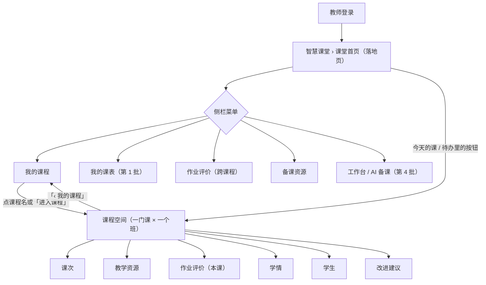
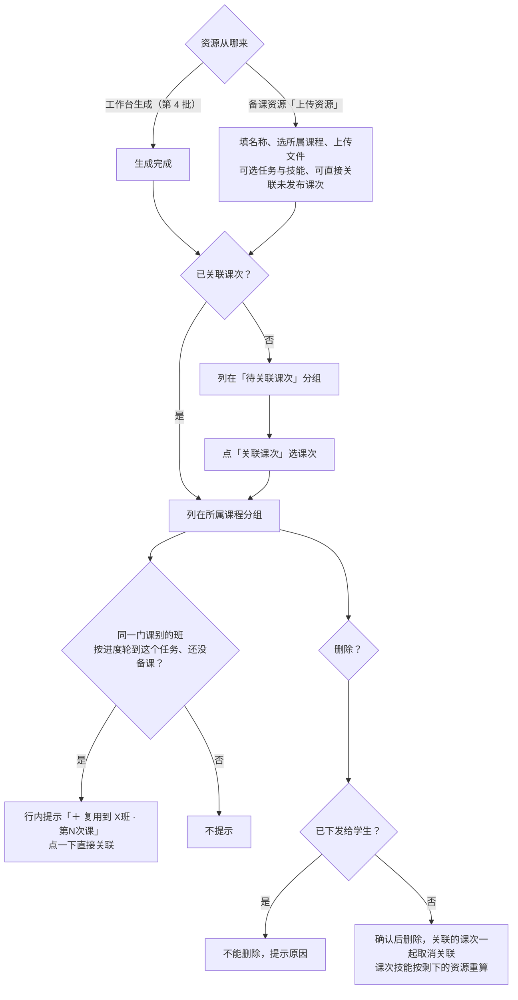
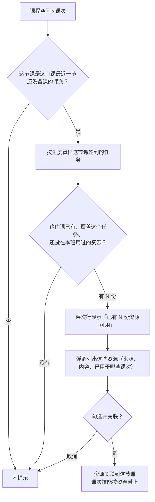

# PRD · 第三批：教师端「智慧课堂」框架

版本：v1.0　｜　日期：2026-11-11　｜　所属：AIGC 智慧课堂平台 · 第一阶段教学闭环
演示对照：教师端 `李老师`（三门课：旅行策划 1 班 / 2 班、旅行社经营与管理 1 班）；`王老师`（没有课程计划，看空状态）

---

## 1. 背景与目标

原来老师的所有操作都挤在「任务中心」一个页面里：看课表、备课、发布、评价、看学情都在一起，老师不清楚从哪里开始。实际上，老师在平台上做的就是一个「智慧课堂」的事：看课程安排、准备资源、发布任务、评价作业、看学情。

本批把「任务中心」重组为「智慧课堂」：
- 拆成几个二级菜单，每个菜单只做一类事；
- 按「一门课 × 一个班」组织课程空间，进入一门课就能完成这门课的全部事情；
- 备课资源按课程整理，支持上传自己的资源，并提示在别的班复用。

## 2. 范围

| 本批包含 | 不在本批 |
|---|---|
| 智慧课堂菜单结构、教师登录落地页 | 课次时间线、编辑课次、新建额外课次、我的课表（第 1 批） |
| 课堂首页 | 去备课、工作台、备课范围（第 4 批） |
| 我的课程（课程面板） | 发布学习内容、评价抽屉、追加资源（第 5 批） |
| 课程空间框架与页签：课次 / 教学资源 / 作业评价 / 学情 / 学生 / 改进建议 | 学情、补训、改进建议的具体内容（第 6 批） |
| 作业评价列表（跨课程） | 知识库与备课资源统一为「资源」（后续阶段） |
| 学生页签 | |
| 备课资源：列表、上传、编辑、删除、详情、复用提示 | |

## 3. 角色与权限

| 角色 | 本批能做什么 |
|---|---|
| 任课教师 | 只看、只操作自己负责的课程计划及其下的课次、资源；备课资源里看到自己生成 / 上传的资源，以及关联在自己课次上的资源 |
| 没有课程计划的教师 | 能进入智慧课堂，各页面显示空状态说明「课程计划由管理端维护，排课后课次会自动出现」 |

## 4. 业务流程

### 4.1 页面结构与导航

### 4.2 备课资源：从生成 / 上传到用到课次

### 4.3 课次上推荐已有资源

## 5. 功能需求

### 5.1 菜单与落地页

- 教师端侧栏：工作台 / 能力地图 / **智慧课堂**（课堂首页 / 我的课程 / 我的课表 / 作业评价 / 备课资源）/ 图谱中心 / 教师成长中心 / 教师档案。
- 教师登录后进入「课堂首页」；工作台仍放在菜单最上面，一键可达。
- 原「任务中心」的叫法全部改为「智慧课堂」。

### 5.2 课堂首页

- 标题「X的智慧课堂」，旁边「✦ AI 备课」按钮（到工作台）；右侧周期切换：本周 / 本月 / 本学期。
- **四个统计卡**：

| 卡片 | 口径 |
|---|---|
| 备课资源 | 周期内新生成（或上传）完成的资源数 |
| 发布学习内容 | 周期内发布的课次数 |
| 待评价作业 | 当前学生已提交、等老师评价的份数（不按周期） |
| 待查看课程反馈 | 当前未读的学生课程反馈条数（不按周期） |

- **今天的课**：按时间列出今天的课次（时间、课次名、课程 · 班级、状态、操作）；今天没课时写「今天没有课。下一次：X月X日 HH:MM《课次》」并列出那一节。
- **待办**（按类型标签）：
  - 评价：某课次 N 份作业待评价 → 去评价；
  - 发布：3 天内要上、还没发布的课次 → 发布；
  - 反馈：某课次 N 条课程反馈未读 → 查看；
  - 建议：专业负责人发来的课程改进建议 → 查看。
- 首页**不重复**「我的课程」「我的课表」的内容，不放问候语。
- 没有课程计划时显示空状态说明。

### 5.3 我的课程

- 一门课 × 一个班一整行面板（一个老师通常带 2～3 门课）。
- **标题行**：课程名 · 班级 · 人数 · 学期 · 知识体系关联标签（已关联 / 未关联 / 公共基础课）+ 快捷入口（课次 / 教学资源 / 作业评价 / 学生）+「进入课程 ›」。
- **三栏**：

| 栏 | 内容 |
|---|---|
| 教学进度 | 已上 / 总课次（进度条）、已发布 / 未发布次数、下次课（时间、名称、状态）+「去备课」「发布」 |
| 学习效果 | 技能达成率、知识点掌握率（进度条）、需关注的技能（未达成人数最多的 2 个）、「看学情 ›」；公共基础课显示「不统计技能和知识点，按任务完成和评价等级看」 |
| 待处理 | 待评价作业、3 天内上课未发布、补训 / 辅导还有学生未达成、改进建议有新动态、课程未关联知识体系；没有时写「没有待处理的事」 |

- 没排课、课都上完两种状态见第 1 批 PRD 5.6（「还没排课」「已结束的课程」）。

### 5.4 课程空间

- 入口：我的课程的课程名 /「进入课程」、各快捷入口、首页按钮。地址带课程和页签，刷新后停在原页签。
- **顶部**：「‹ 我的课程」返回；课程名、班级、学期、任课老师、知识体系关联情况；右侧三个数字：课次已发布 x / 总数、待评价、技能达成率。
- **页签**：课次 / 教学资源 / 作业评价（有待评价时带红点数字）/ 学情 / 学生 / 改进建议。
  - 课次：第 1 批（时间线、编辑课次、新建额外课次）。
  - 教学资源：同 5.7 备课资源的列表，只显示这门课用到的资源，**不分组、没有课程筛选**。
  - 作业评价：同 5.5，限定这门课。
  - 学情、改进建议：第 6 批。
  - 学生：5.6。

### 5.5 作业评价

- 跨课程集中批改，待评价排在前面，可以连续评。
- 顶部：状态分段（待评价 / 已退回 / 已评分 / 全部，带数量）+ 课程筛选 + 班级筛选（课程空间里不显示这两个筛选）。
- 列表：学生 / 课程（跨课程时显示）/ 课次 / 任务 / 提交时间（逾期标记）/ 状态 / AI 初评等级 / 老师评价等级 / 操作（评价 / 查看）。
- 点「评价」打开评价抽屉（抽屉内容见第 5 批）。

### 5.6 学生（课程空间页签）

- 这个班的在读学生，每人一行：学生 / 技能达成（已达成 / 已评价技能）/ 未达成数 / 待评价 / 未提交 / 知识点掌握 / 未达成的技能名称。
- 口径同学情（第 6 批）；学生名单只算在读学生。

### 5.7 备课资源

**只显示已生成完成的资源**；生成中、生成失败的在工作台左侧任务列表里查看（第 4 批）。

**顶部工具栏**：「全部 / 待关联课次」分段（带数量）+ 课程 / 内容类型 / 来源（AI 生成、上传）筛选 + 搜索（名称、任务名、技能名）；右侧「上传资源」「✦ 去工作台备课」。

**分组**：待关联课次（排最前，说明「已生成但还没关联到课次，学生看不到；关联后随课次发布」）→ 各课程（按我的课程顺序）。同一门课多个班共用的资源只出现一次。

**列表列**：

| 列 | 内容 |
|---|---|
| 资源 | 名称 + 来源标签（AI 生成 / 上传）；下一行「任务：××· N 个技能」（悬停看技能名），没记技能时写「未记技能」；生成 / 上传时间 |
| 内容 | 文件类型标签：课件 / 教案 / 图片 / 视频 / 情景互动游戏（同类多个显示 ×N） |
| 关联课次 | 「1班 · 第3次课」形式的标签（悬停看课程计划、课次名、时间），最多显示 3 个；没关联写「未关联课次」；下方可能出现复用提示（见下） |
| 使用情况 | 「已下发 N 次 · 学习 M 人」；没下发写「未下发」 |
| 操作 | 只露一个主操作：没关联 →「关联课次」；已关联 →「查看」；其余放在「⋯」菜单：关联课次 / 查看（另一个）、编辑、下载、删除 |

- 「⋯」同一时间只展开一个，点页面其他地方收起。

**上传资源**（右侧弹窗）：
- 资源名称 *、所属课程 *（带搜索的下拉，只列本人任教的课程）、文件 *（可多个）。
- 任务与技能（可不选）：按所选课程的知识体系列出「任务 N + 技能」，勾选技能；课程没关联知识体系时说明「没有可选的任务和技能」。
- 关联课次（可不选）：列出这门课未发布的课次（班级 · 第几次课 · 日期），勾选后直接关联。
- 文件类型按扩展名识别：PPT 类为课件，图片、视频各归一类，HTML / 压缩包为情景互动游戏，其余为教案。
- 上传后来源标「上传」；关联到课次后，课次技能按资源带上。

**编辑**：改名称、所属课程、文件（增删）、任务与技能；已关联课次的技能随之重算。

**删除**：已经下发给学生（任一关联课次发布时下发了它的文件）的资源**不能删除**，提示「这份资源已经下发给学生，不能删除」；没下发的确认后删除，提示中写明会取消几个课次的关联，删除后这些课次的技能按剩余资源重算。

**详情**（右抽屉）：
- 顶部：名称 + 来源；「编辑」「关联课次」「下载全部」。
- 基本信息：来源、所属课程、生成 / 上传时间、创建人。
- 任务与技能：按任务列出所含技能；没有时提示「可以在编辑里补上，关联课次后课次才能带上技能」。
- 关联课次表：班级 · 第几次课 / 课次名称 / 上课时间 / 下发（已下发 / 未下发）/ 学习情况（学过的学生 / 班级人数）；下方显示可复用到的课次。
- 文件：按类型分组，每个文件可下载、预览，课件和教案可在线编辑。

**复用提示**：
- 资源行（和详情里）显示「＋ 复用到 X班 · 第N次课」，点一下直接关联到那节课。
- 出现条件：同一门课的其他课程计划（别的班），按这门课的进度**下一个任务正是这份资源的任务**，并且那个班**最近一节课还没备课**（未发布、没挂资源、还没上）。
- 课程空间课次页上，最近一节待备课的课次如果这门课已有覆盖下一个任务的资源，显示「已有 N 份资源可用」，点开选资源关联（流程见 4.3）。

## 6. 数据口径与规则汇总

1. 老师只看到自己负责的课程计划及其课次；备课资源 = 自己生成 / 上传的 + 关联在自己课次上的。
2. 课程进度：已发布的课次按发布时确认的考查技能算教过哪个任务，未发布但已挂资源的按资源带上的技能算；「下一个任务」= 最近一次教过的任务的下一个，没有则取还没教过的第一个任务。
3. 资源使用情况：「已下发」= 关联课次发布时下发了这份资源的文件；「学习人数」= 学过其中任一文件的学生数（去重）。
4. 资源只能在没下发前删除；删除、编辑后，关联课次的技能按剩余资源重算（老师在发布时确认过的考查技能不受影响）。
5. 首页统计：备课资源、发布学习内容按所选周期；待评价、未读反馈为当前数量。

## 7. 显示 / 不显示

- 不再出现「任务中心」叫法。
- 课堂首页不放问候语，不重复我的课程、我的课表的内容。
- 备课资源不显示生成中、生成失败的资源，也不显示「状态」列。
- 课程空间「教学资源」页签不分组、不显示课程筛选。
- 页面不出现「示例数据」「待确认」类标注。

## 8. 验收标准

| # | 场景 | 预期 |
|---|---|---|
| 1 | 李老师登录教师端 | 直接进入课堂首页；侧栏「智慧课堂」下有 5 个二级菜单，工作台在最上面 |
| 2 | 首页切换本周 / 本月 / 本学期 | 备课资源、发布学习内容随周期变化；待评价、未读反馈不变 |
| 3 | 首页今天没课 | 显示「今天没有课」和下一次课 |
| 4 | 首页待办 | 有待评价、3 天内未发布、未读反馈、负责人建议时分别列出，按钮能直达对应页面 |
| 5 | 我的课程 | 每门课一整行三栏；公共基础课的学习效果栏写明不统计技能 |
| 6 | 进入课程空间切换页签后刷新 | 停在原课程原页签；「‹ 我的课程」能返回 |
| 7 | 作业评价跨课程筛选「2 班」 | 只剩 2 班的提交；课程空间里的作业评价没有课程、班级筛选 |
| 8 | 学生页签 | 只列在读学生，每人一行技能、知识点、待评价、未提交情况 |
| 9 | 备课资源 | 只有已完成的资源；按课程分组，1 班、2 班共用的资源只出现一次；有表头 |
| 10 | 上传资源并关联 2 班第 2 次课 | 资源标「上传」，归到所属课程分组；该课次带上所选技能 |
| 11 | 删除已下发的资源 | 被拦下并提示原因；删除未下发的资源时写明取消几个课次的关联 |
| 12 | 2 班按进度轮到「策划方案呈现」且下节课没备课 | 「策划方案」那份资源行出现「＋ 复用到 2班 · 第2次课」，点击后关联成功、提示消失 |
| 13 | 2 班课次页 | 最近一节待备课的课次显示「已有 N 份资源可用」，弹窗关联后提示移到下一节 |
| 14 | 资源行「⋯」 | 只露一个主操作，其余在菜单里；同一时间只展开一个 |
| 15 | 资源详情 | 显示来源、所属课程、任务与技能、每个关联课次的下发和学习人数 |
| 16 | 王老师（没有课程计划）登录 | 各页面显示空状态说明，不报错 |
