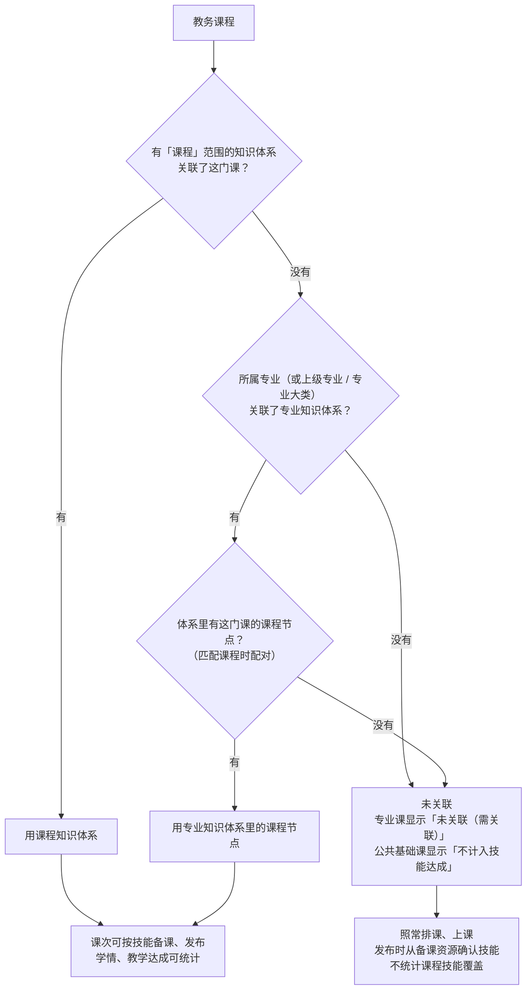
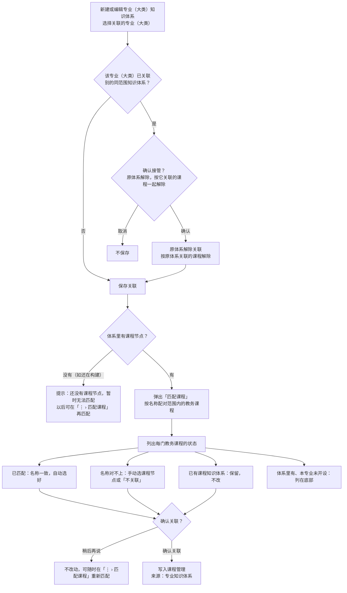
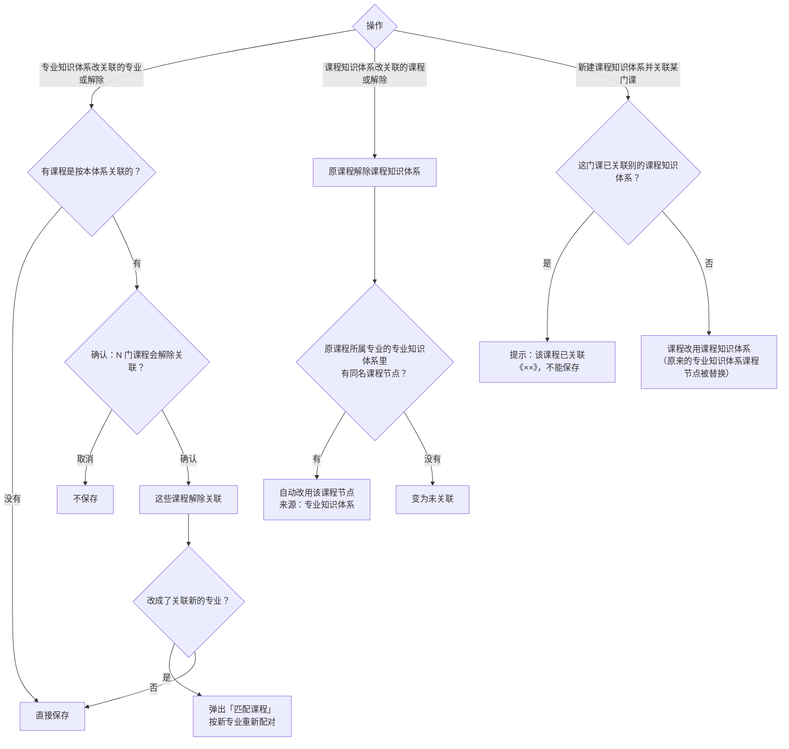
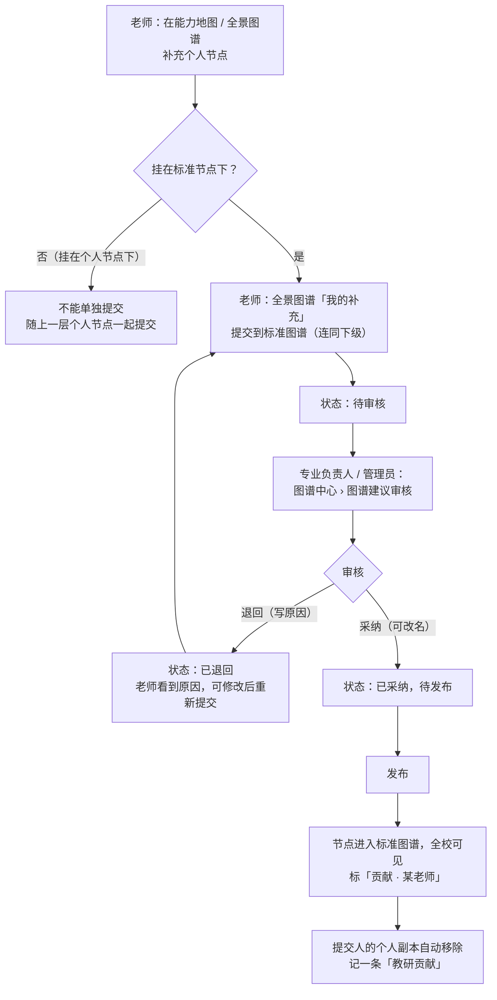

# PRD · 第二批：知识体系与课程关联、标准图谱反哺

版本：v1.0　｜　日期：2026-11-11　｜　所属：AIGC 智慧课堂平台 · 第一阶段教学闭环
演示对照：管理端 `何老师`（专业负责人）/ `周教务`（课程管理）；教师端 `李老师`（全景图谱 › 我的补充）

---

## 1. 背景与目标

闭环里的任务、评价、证据都挂在**技能**上，技能来自知识体系。教务的课程只有关联到知识体系，老师备课、发布时才能按技能走，学情和教学达成才能统计到技能和能力。

现状问题：
1. 只有「课程」范围的知识体系能关联课程。学校如果只建了专业知识体系（里面本来就有课程），教务的课程大多关联不上，只能每门课再建一份课程知识体系，内容重复、两边各改各的。
2. 老师在图谱上补充的好内容，没有渠道进入标准图谱，全校用不上。

本批目标：
- 教务课程可以直接关联专业（大类）知识体系里的**课程节点**，一次匹配就能把一个专业的课程关联上；
- 技能下的知识点数据完整，供后续发布、评价使用；
- 闭环只用已确认的能力—技能映射；
- 老师的个人节点可以提交到标准图谱，审核发布后全校可用。

**关联不强制**：没关联的课程照常排课、上课，只是统计不完整（见第 6 节）。

## 2. 范围

| 本批包含 | 不在本批 |
|---|---|
| 课程关联课程节点的规则（课程知识体系 / 专业 / 专业大类知识体系） | 课程类型、排课、课次（第 1 批） |
| 专业（大类）知识体系「匹配课程」 | 备课时如何用知识体系（第 4 批） |
| 课程管理里的关联状态显示、筛选、补选 | 发布时勾选考查技能和知识点（第 5 批） |
| 技能下的知识点数据（名称、类型、核心内容） | 知识库与备课资源统一为「资源」（后续阶段） |
| 闭环只用已确认的映射 | 老师自建整套知识体系申请设为专业标准（后续优化） |
| 标准图谱反哺（节点级） | |

知识体系、能力图谱、映射审核的基础维护沿用图谱中心已有功能，本批只写改动点。

## 3. 角色与权限

| 角色 | 本批能做什么 |
|---|---|
| 专业负责人 | 建专业 / 专业大类 / 课程知识体系并关联；匹配课程；审核图谱建议审核（只看本专业） |
| 管理员（超管、组织管理员） | 同上，范围为全校 |
| 教务 | 在课程管理里查看关联状态、补选或更正 |
| 任课教师 | 只能为自己课程计划里的课程建课程知识体系；在全景图谱「我的补充」里提交个人节点 |

新增权限：**图谱建议审核**，默认给超管、组织管理员、专业负责人。

## 4. 业务流程

### 4.1 课程关联知识体系（整体）

### 4.2 专业（大类）知识体系关联与匹配课程

### 4.3 改关联、解除关联与回落

### 4.4 标准图谱反哺

## 5. 功能需求

### 5.1 关联规则

教务课程关联的是「知识体系里的一个课程节点」，有两种来源：

| 来源 | 说明 |
|---|---|
| 课程知识体系 | 「课程」范围的知识体系，整体对应一门课 |
| 专业 / 专业大类知识体系里的课程节点 | 专业知识体系「专业 › 课程 › 任务 › 技能」中的某个课程节点 |

规则：
1. **一个课程节点可被多门教务课程关联**（如「旅游概论」在导游、旅游管理两个专业都开）。课程知识体系仍只对应一门课：一门课已关联某个课程知识体系时，别的课程知识体系不能再关联它。
2. **课程知识体系优先**：一门课有课程知识体系时用课程知识体系；课程知识体系解除后，自动改用所属专业知识体系里的同名课程节点，没有则变为未关联。
3. **专业大类知识体系**按大类下所有专业的课程匹配；专业知识体系按该专业及其下级专业的课程匹配。
4. **一个专业（大类）同一时间只关联一个专业（大类）知识体系**。关联已被占用的专业时提示接管，确认后原体系解除关联，按原体系关联的课程一起解除。

### 5.2 专业（大类）知识体系：关联与匹配课程（图谱中心 › 知识体系）

- 新建或编辑「专业」「专业大类」范围的知识体系时，可选择关联的专业 / 专业大类（选填，可在编辑里补、改、解除）。
- 关联成功后自动弹出「匹配课程」。卡片「⋮」菜单增加「**匹配课程**」（只在已关联专业 / 专业大类的知识体系上显示），可随时重新匹配。

**「匹配课程」弹窗**
- 标题：匹配课程 ·《知识体系名称》。
- 汇总一句：按名称把体系里的课程和「××」（含下级专业 / 下所有专业）的课程配对：已匹配 N 门，名称对不上 M 门，已有课程知识体系 K 门；确认后写入「教务管理 › 课程管理」。
- 表格：教务课程（名称 + 所属专业 · 课程类型）/ 关联到体系中的课程（下拉：不关联 + 体系里的全部课程节点）/ 状态。排序：名称对不上 → 已匹配 → 已有课程知识体系。

| 状态 | 判定 | 显示 |
|---|---|---|
| 已匹配 | 课程名称与体系里某课程节点名称完全一致，或此前已关联到本体系 | 下拉自动选好，可改 |
| 名称对不上，请手动选 | 没有同名课程节点 | 下拉默认「不关联」 |
| 已有课程知识体系，保留 | 课程已关联课程知识体系 | 不可改，显示课程知识体系名称 |

- 底部：「体系里有、本专业暂未开设的课程（N）：……」。
- 范围内没有启用的教务课程：提示「××下还没有启用的教务课程」。
- 体系还没有课程节点：提示「《××》还没有课程节点，暂时无法匹配课程。构建出课程后，可在卡片『⋮ › 匹配课程』中再匹配」，只有「知道了」按钮。
- 按钮：「稍后再说」（不改动）/「确认关联」（写入，提示「已更新 N 门课程的关联」）。下拉改成「不关联」的，原来按本体系关联的课程解除。

### 5.3 课程知识体系关联课程

- 「课程」范围的知识体系关联课程时，课程从「课程管理」里选：管理员、专业负责人可选全部启用课程；任课教师只能选自己课程计划里的课程。
- 关联后，课程改用这个课程知识体系（覆盖原来的专业知识体系课程节点），来源记「图谱中心」。
- 改关联或解除时按 4.3 处理原课程。

### 5.4 课程管理里的关联显示与补选（教务管理 › 课程管理）

- 列表「知识体系」列：
  - 已关联：显示「专业知识体系名称 › 课程节点名称」或课程知识体系名称，下方小字写来源（专业知识体系 / 图谱中心 / 管理端补选 · 操作人 · 日期）；
  - 未关联的专业课：「未关联（需关联）」；
  - 未关联的公共基础课：「不计入技能达成」。
- 筛选「知识体系」：全部 / 已关联 / 未关联（需关联）/ 不计入技能达成。
- 编辑课程里「知识体系（补选）」：下拉列出可选的课程节点和课程知识体系，可补选、更正或改为不关联。已被别的课程关联的**课程知识体系**置灰并标「已被其他课程关联」；专业知识体系的课程节点不受此限制。说明：「一般由专业负责人在图谱中心建知识体系时选择课程完成关联，这里可补选或更正」。
- 课程管理页、知识体系页都**不显示**顶部「N 门专业课还没关联知识体系」提示条。

### 5.5 知识点数据

- 知识体系里，每个技能下可挂知识点，字段：名称、类型、**核心内容**。
- 知识点在图谱中心知识体系详情里维护（新增、编辑、停用），被已发布任务引用的不能删除，只能停用。
- 用途（后续批次）：发布任务时作为考查知识点的候选；核心内容作为「知识点判定依据」的默认值。
- 知识点只用于学情和补训，不进学习证据、不汇总到能力。

### 5.6 映射只用已确认的

- 能力—技能映射在「映射审核」里状态为「已审核 / 已调整」的才进入闭环（教学达成、专业建设测评、学生能力测评）；AI 生成的初稿和待审核的不计入，也没有「计入待审核」开关。
- 只统计「直接支撑」「部分支撑」两种映射类型。

### 5.7 标准图谱反哺（第一阶段只做节点级）

**老师提交（全景图谱 › 我的补充）**
- 列出老师在能力地图 / 全景图谱里补充的个人节点，以及每个节点的提交状态。
- 只有**挂在标准节点下**的个人节点能提交，连同其下级一起提交；挂在个人节点下的不能单独提交。
- 提交时可填一句说明。提交后状态「待审核」；被退回的显示退回原因，可修改后重新提交（替换原提交）。
- 能力地图里只显示状态，并提供「去全景图谱提交」跳转。

**审核（管理端 › 图谱中心 › 图谱建议审核，新菜单）**
- 列表：节点名称、挂在哪个标准节点下（路径）、下级节点数、提交人、提交时间、说明、状态；可按状态筛选。专业负责人只看本专业相关的建议。
- 操作：**采纳**（可改名，写审核意见）→ 进入待发布；**退回**（必须写原因）；已采纳的可**发布**。
- 发布后：节点进入标准图谱，全校可见，标「贡献 · 某老师」；详情写提交人、审核人、发布时间；提交人本机的个人副本自动移除；提交人的教师成长中心记一条「教研贡献」。
- 发布后的节点按标准节点处理，老师不能再删改。
- 「只分享给部分人、不提交」用图谱中心已有的分享功能，不另做。

## 6. 数据口径与规则汇总

1. 课程关联的对象是课程节点；一门课同一时间只关联一个课程节点（课程知识体系优先）。
2. 关联不强制。未关联的专业课：可以排课、上课、发布，技能从备课资源确认，不统计课程技能覆盖；公共基础课默认不计入技能达成。
3. 专业建设测评的「开设课程」= 课程管理中已启用、且已关联知识体系的课程（见第 7 批）。
4. 只用已确认映射，只统计直接支撑、部分支撑。
5. 已发布的标准图谱贡献节点按标准节点对待，保留贡献人署名。

## 7. 显示 / 不显示

- 课程管理和知识体系页不显示「未关联」提示条；关联状态只在列表列和筛选里体现。
- 「匹配课程」菜单项只在已关联专业 / 专业大类的知识体系卡片上显示。
- 体系没有课程节点时，不显示配对表格，只给提示。
- 页面不出现「示例数据」「待确认」类标注。

## 8. 验收标准

| # | 场景 | 预期 |
|---|---|---|
| 1 | 把「旅游类-导游」专业知识体系关联到「导游」专业 | 自动弹出「匹配课程」；同名的课程全部显示「已匹配」；确认后课程管理里这些课程显示「旅游类-导游 › 课程名」，来源「专业知识体系」 |
| 2 | 匹配时有一门课名称对不上 | 该行排在最前，默认「不关联」，可手动选课程节点；确认后按选择写入 |
| 3 | 再把另一个专业知识体系关联到「导游」 | 出现接管提示；确认后原体系解除关联，原来按它关联的课程全部解除；取消则不保存 |
| 4 | 某课程已有课程知识体系，再做专业匹配 | 该课程显示「已有课程知识体系，保留」，确认后不变 |
| 5 | 解除这门课的课程知识体系 | 课程自动改用所属专业知识体系里的同名课程节点；没有同名节点则变为未关联 |
| 6 | 同一个课程节点被两个专业的同名课程关联 | 两门课都显示已关联同一课程节点，互不影响 |
| 7 | 体系还在构建、没有课程节点时点「匹配课程」 | 提示暂时无法匹配，不显示表格 |
| 8 | 任课教师新建课程知识体系 | 关联课程下拉只有自己课程计划里的课程 |
| 9 | 课程管理按「未关联（需关联）」筛选 | 只列出未关联的专业课；页面顶部没有提示条 |
| 10 | 映射里有一条「待审核」 | 教学达成、专业建设测评都不计入这条 |
| 11 | 老师提交一个挂在标准节点下的个人节点 | 图谱建议审核里出现待审核记录；退回后老师看到原因并可重新提交 |
| 12 | 专业负责人采纳（改名）并发布 | 节点全校可见并标「贡献 · 老师名」；提交人的个人副本消失，教师成长中心多一条「教研贡献」 |
| 13 | 没有「图谱建议审核」权限的角色 | 看不到「图谱建议审核」菜单 |
