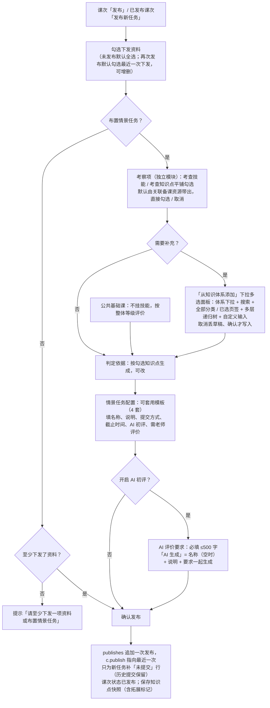
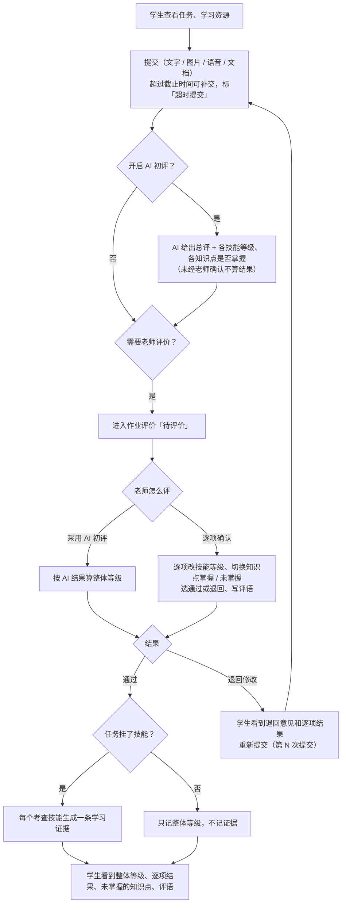
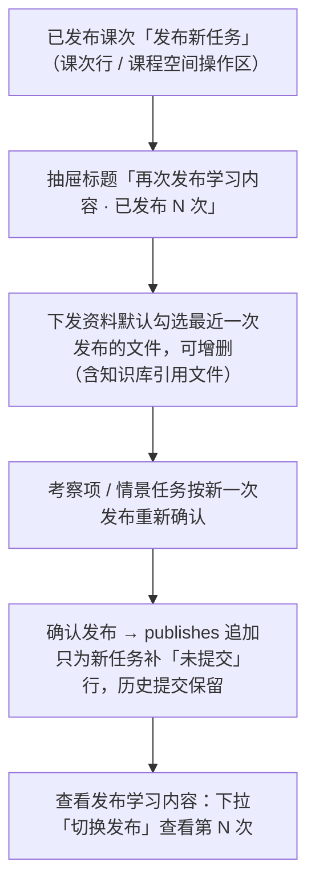

# PRD · 第五批：发布、学生作答、评价与证据

版本：v1.6　｜　日期：2026-11-25（v1.5：2026-11-19；v1.4：2026-11-18 排课改名口径；v1.3 / v1.2 / v1.1：2026-11-18；v1.0：2026-11-11）　｜　所属：AIGC 智慧课堂平台 · 第一阶段教学闭环
演示对照：教师端 `李老师`（旅行策划 1 班 / 2 班、旅行社经营与管理 1 班）；学生端 `林同学`（旅行策划 1 班）

> v1.5 变更（2026-11-19，知识点两维独立口径，覆盖 v1.0 §5.1/§5.4/§5.5/§5.6 相关描述）：
> ① 发布抽屉「考查技能」默认勾选改为**备课资源关联的技能**（不再是「默认全选」），可从本课程知识体系补选；「考查知识点」候选改为**课程匹配的知识点平铺全集**（与所选技能无关、不随技能增减联动），默认勾选 = 备课资源关联的知识点，没配置则默认不勾；候选为空分别有对应提示。
> ② 学生端「考查的技能和知识点」为技能标签 + 知识点标签**平铺并列**，不再按技能分组。
> ③ 评价抽屉「技能和知识点达标情况」拆为两个独立区块：技能表逐项等级（行内不再嵌知识点 ✓/✗）；知识点区独立展示 AI 标注与老师切换（掌握 / 未掌握），标注按**提交级** `kpMarks` 存储（`{kpId:'ok'|'miss'}`，存量 `items[].kps` 并集兼容读取），与考查技能相互独立。
> ④ 批量采用 AI 时知识点标注取 AI 任务级标注；未标注时按演示规则生成。
> ⑤ 学情知识点统计平铺（详见《计算PRD.md》v1.1）；学情页「按技能分组看知识点掌握」分析视图与各处「所属技能」列移除。
>
> v1.6 变更（2026-11-25，发布抽屉重构 + 一课次多次发布，覆盖 §2 / §4.1 / §4.3 / §5.1 / §5.2 / §5.3 / §6 / §7 / §8 相关描述）：
> ① **发布抽屉结构重排**：「考察项」独立成模块、排在「情景任务配置」之前（随任务开关显隐）；考查技能 / 考查知识点 = **平铺勾选区**（默认由关联备课资源带出，直接勾选 / 取消，空态有引导文案）+「+ 从知识体系添加，或自定义输入」**下拉多选面板**（交互同备课资源上传：体系下拉 + 搜索 + 全部分类 / 已选(n) 页签 + 多层递归树 + 自定义输入 + 全选 / 取消 / 确认；取消丢草稿、确认才并入平铺区）。原内嵌「从本课程知识体系补选」任务树（「还没教 / 已在第 N 次课」）移除；平铺勾选即时联动评价标准表与判定依据。
> ② **自定义技能 / 知识点**：面板确认时先注册运行时视图（评价标准 / AI 评价要求即时显示名称），点「确认发布」才落库；取消发布不残留。
> ③ **发布模板**：4 套（实操练习型 / 情景对话型 / 调研报告型 / 课堂问答型）只填任务初值（名称 / 说明 / 提交方式 / AI 初评 / 需老师评价 / 截止时间），不碰考察项与下发资料；占位符 {课程名} / {技能名} / {知识点名} 取第一个勾选项全局替换，替换不到填 XX；默认预填的课程名不算「已填内容」，手动填过内容（或模板填入后改过）再切模板需确认；**再点同一模板 = 清除模板**（另有「清除模板」按钮）。
> ④ **「AI 生成」扩展**：任务名称（仅空时按课次名 + 第一个考查技能补）+ 任务说明（按当前考察项与下发资料拼装结构化说明）+ AI 评价要求，一次生成、均可再改。
> ⑤ **一课次多次发布**：已发布课次可「发布新任务」（课次行 / 课程空间操作区），抽屉标题「再次发布学习内容 · 已发布 N 次」；发布记录为 `publishes[]` 数组（每次含发布时间 / 下发文件 / 任务 / 反馈开关），`c.publish` 恒指向最近一次作镜像兜底（工作台 / 首页 / 学生端旧视图）；提交记录挂 `taskId` 归属所属发布，确认发布只**为新任务补「未提交」行**、历史提交保留；下发资料默认勾选最近一次发布下发的文件；「查看发布学习内容」可下拉切换历史发布。
> ⑥ **「追加资源」功能移除**：向已发布课次加资料统一走「再次发布」（或发布前的课次「添加资料」）。
> ⑦ **下发资料放开知识库文件**：课次引用的知识库文档可勾选下发（标识 `kb:库:文档`），与资源包文件同列。
> ⑧ **学生端本批仅补「提交挂 taskId」**；学生端任务列表按多次发布展开为 P1（当前学生仍看最近一次任务镜像）。

---

## 1. 背景与目标

备课完成后，老师要把资源和任务发给学生，学生提交后老师评价，评价结果再变成「学生 × 技能 × 等级」的学习证据，供学情（第 6 批）和教学达成（第 7 批）使用。原来的问题：

- 考查技能靠课次上选的任务带出，和老师实际备课、实际讲的对不上；
- 选了技能就默认考它下面的全部知识点，但一节课往往只讲其中几个；
- AI 评价要求按技能逐个写三档描述，老师写不过来；
- 知识体系后来改了，已发布任务的知识点、学生的结果跟着变，前后对不上。

本批要做到：
- 发布时由老师确认考查技能和考查知识点，候选来自课次和备课资源，可从知识体系补选；
- AI 评价要求一个任务一份，可一键生成；
- 发布时保存知识点快照，之后作答、评价、统计都按发布时的内容；
- AI 初评只是参考，老师确认后才算结果；通过后每个考查技能记一条学习证据。

## 2. 范围

| 本批包含 | 不在本批 |
|---|---|
| 发布学习内容：下发资料、情景任务（含 4 套发布模板）、考察项（考查技能 / 考查知识点，平铺勾选 + 知识体系添加）、判定依据、AI 评价要求、课程反馈开关 | 课次的创建、编辑（第 1 批） |
| 知识点快照（含拓展标记） | 去备课、资源包生成（第 4 批） |
| 已发布课次：查看发布内容（历史发布切换）、**再次发布新任务**（v1.6） | 发布后编辑 / 撤回已发布内容；「追加资源」（v1.6 移除）；发布后追加任务（后续） |
| 学生端「我的任务」中与本批相关的内容：考查技能与知识点、判定依据、新增资源标记、逐项结果 | 学生端列表、成长值、课程反馈表单本身（已有功能） |
| AI 初评、老师评价（采用 AI / 逐项确认）、通过 / 退回 | 学情、补训 / 辅导的发起（第 6 批） |
| 学习证据的生成规则 | 教学达成、专业建设测评（第 7 批） |
| 操作日志：发布课次（含第 N 次）、评价通过 / 退回 | |

## 3. 角色与权限

| 角色 | 本批能做什么 |
|---|---|
| 任课教师 | 发布本人课程计划下的课次（含已发布课次再次发布）；查看已发布内容（含历史发布）；评价本人课次的学生提交 |
| 学生 | 只看到发给自己班级（补训 / 辅导课次只看到发给自己）的已发布内容；学习资源、提交任务、填课程反馈、查看评价结果 |

## 4. 业务流程

### 4.1 发布学习内容（含再次发布）

### 4.2 学生作答、评价与证据

### 4.3 已发布课次再次发布（v1.6，替代原「追加资源」）

## 5. 功能需求

### 5.1 发布学习内容（右抽屉）

入口：课次行「发布」、我的课程「发布」、课堂首页待办「发布」。

**发布对象**：课程计划（课程 · 班级）、接收人数；补训课次显示「补训对象（学情中该技能未达成的学生）」，辅导课次显示「辅导对象」，只发给这些学生。补训 / 辅导功能本期隐藏（2026-11-19，v1.3）：发起入口不露出，已有定向课次的发布抽屉统一显示「定向对象」。

**下发资料**（模块名「下发资料」）：
- 列出课次关联的备课资源文件 + 课次引用的知识库文档（文件名、归属资源包 /「知识库 · 库名」、类型、大小）；未发布课次**默认全选**；已发布课次（再次发布）默认勾选**最近一次发布下发的文件**，其余可增选（v1.6）；右上角「已选 N 项」。
- 说明「资源由您编辑后下发，下发即视为已确认；未下发的资源学生看不到」。
- 课次没有关联资料时：「该课次还没有添加资料。去添加（打开课次「添加资料」）或 去备课」。

**考察项**（v1.6 独立成模块，排在「情景任务配置」之前；随任务开关显隐）：

- **考查技能**：
  - **平铺勾选区**（v1.6）：候选池 = 课次已有的技能（存量课次选过的任务 / 补训技能）+ 关联备课资源（文件标注并集）记下的技能；默认勾选 = 关联资源带出的技能，资源没记则显示「暂无默认考查技能，可从下方添加」；每项直接勾选 / 取消，**即时联动评价标准表**。
  - 「+ 从知识体系添加，或自定义输入」打开**下拉多选面板**（v1.6，交互同备课资源上传）：知识体系下拉（预置体系与图谱体系均保留原始层级）+ 搜索 +「全部分类 / 已选(n)」页签 + 多层递归树（分类节点 / 技能徽标，逐层 ▸/▾）+ 自定义输入 + 底栏「全选 / 取消 / 确认」；**取消丢弃草稿、点「确认」才把新增并入平铺区**。原「从本课程知识体系补选」任务树（「还没教 / 已在第 N 次课」）移除。
  - 自定义技能不进标准体系、天然标「拓展」；发布时按课程标准体系判定并固化到任务（`skillExt`），之后体系变更不影响本次发布。
  - 没有候选技能时仍可发布：按整体等级评价，不记学习证据（公共基础课固定如此，考察项只显示说明不显示面板）。
  - 发布后，课次技能 = 本次确认的考查技能（公共基础课除外）；课程进度、学情按它统计。

- **考查知识点**（两维独立，v1.6 同为平铺勾选 + 下拉多选面板）：
  - 候选 = 课程匹配的知识点平铺全集（课程关联知识体系匹配到的全部知识点，名称 + 类型标签）+ 关联备课资源带来的拓展知识点（按 id 去重）；与所选技能相互独立——技能增减不联动知识点勾选。
  - 默认勾选 = 备课资源关联的知识点，资源未配置则默认不勾；平铺区每项直接勾选 / 取消；补充勾选、自定义输入走与考查技能同款的面板（取消丢草稿、确认才写入）。
  - 候选为空提示：已关联知识体系「本课程知识体系没有匹配到知识点」；未关联「本课程还没关联知识体系，没有可勾选的知识点」。不勾的知识点不评、不统计。

**判定依据**（折叠「判定依据（N 项）· 作答中体现以下内容即算掌握，可修改」）：
- 只列勾选的知识点，每个一条，默认取知识体系里该知识点的核心内容，老师可改；清空时按默认。
- 自定义技能 / 知识点在面板「确认」时先注册运行时视图（评价标准、AI 评价要求即时显示名称），点「确认发布」才落库；取消发布不残留（v1.6）。

**情景任务配置**（开关，默认开）：

| 字段 | 规则 |
|---|---|
| 任务名称 * | 默认课次名 |
| 任务说明 * | 写清任务要求和交付物 |
| 提交方式 * | 多选：文字 / 语音 / 图片 / 文档 / 视频，默认文字、文档 |
| 截止时间 * | 日期时间 |
| 开启 AI 初评 | 默认开；说明「学生提交后 AI 先初评，老师复核确认」 |
| 是否需要老师评价 | 默认开；说明「开启后，老师确认的结果才记为学习证据」 |

- **套用模板**（v1.6，chips 行在表单前）：4 套模板——实操练习型 / 情景对话型 / 调研报告型 / 课堂问答型。套用只填任务初值（名称、说明、提交方式、AI 初评、需老师评价、截止时间 = 今天 + N 天 18:00），**不碰考察项与下发资料**；占位符 {课程名} / {技能名} / {知识点名} 取第一个勾选项全局替换，替换不到填 XX；默认预填的课程名不算「已填内容」，手动填过内容（或模板填入后改过名称 / 说明）再切模板需确认「套用模板将覆盖已填写的任务内容，继续？」；**再点同一模板 = 清除模板**；填入后仍可修改，另有「清除模板」按钮。

**AI 评价要求**（开启 AI 初评时显示，必填）：
- 一个任务一份，不再按技能逐个写三档描述；最多 500 字，带字数。
- 默认按任务名称、考查技能、考查知识点自动生成（整体完成度 / 逐项判断考查技能 / 考查知识点按判定依据 / 等级规则 / 评语要求）；老师改过后，技能、知识点变化不再覆盖；点「AI 生成」重新生成。
- 「AI 生成」（v1.6 扩展）一次生成三样：任务名称（仅空时按「课次名：第一个考查技能」补）+ 任务说明（按当前考察项与下发资料拼装结构化说明）+ AI 评价要求；toast 提示「已按考察项和下发资源生成任务说明与 AI 评价要求」。
- 说明「AI 按这份要求给出一份总评；展开可看各考查技能是否达到、各知识点是否掌握，老师可调整」。

**学生课程反馈**（开关，默认开）：「收集学生对课程资源与任务难度的反馈」。

**确认发布**：
- 校验：资料和任务至少有一项（「请至少下发一项资料或布置情景任务」）；任务必填项；开启 AI 初评时 AI 评价要求必填。
- **一课次多次发布（v1.6）**：发布记录追加进 `publishes[]`（发布时间 / 下发文件 / 任务 / 反馈开关），`c.publish` 恒指向最近一次（镜像给工作台 / 首页 / 学生端旧视图）；**只为新任务补「未提交」行，历史提交保留**；自定义技能 / 知识点此时才落库；提示「已发布给 N 名学生（第 N 次）」。
- 发布后课次状态「已发布」；记教师成长；写操作日志「发布课次」（状态：未发布 / 已发布（再次发布）、第 N 次发布、学生数、资料数、情景任务名）。

### 5.2 知识点快照

- 发布时把本次考查知识点的**名称、类型、核心内容**和判定依据存进任务；快照带**拓展标记**（不在课程标准体系内的知识点 / 技能按发布时判定固化，之后体系变更不影响本次发布，v1.6）。
- 之后学生端任务详情、AI 初评、老师评价、学生看到的逐项结果、学情、教学达成都按快照显示和统计。
- 发布后知识体系里的知识点改名、改内容、删除，**不影响**已发布任务；新发布的任务用新内容。

### 5.3 已发布课次（v1.6）

- 入口：课次行「查看」；已发布课次操作区有「发布新任务」（再次发布，见 4.3 / 5.1）。
- **查看发布学习内容**（右抽屉）：已发布标记 + 发布时间、发布人 + **第 x / N 次**（v1.6）；发布对象；已下发资料（**该次发布**的文件，每个「已下发」、可预览）；情景任务（名称、提交方式、截止时间、AI 初评、是否需要老师评价、说明、考查技能（拓展标）、考查知识点「N 个，发布时勾选」+ 判定依据、AI 评价要求；存量数据无 AI 要求时只读展示评价标准表）；课程反馈是否开启。
- **切换历史发布（v1.6）**：一课次多次发布时，抽屉顶部「切换发布」下拉（第 N 次 · 时间 · 任务名），切换后整个抽屉按所选发布重新渲染。
- 已发布的内容**不能修改或撤回**。
- **「追加资源」已移除（v1.6）**：向已发布课次加资料统一走「再次发布」；发布前的加资料走课次「添加资料」。

### 5.4 学生端「我的任务」（本批相关部分）

- **学习资源**：本次任务发布下发的文件（一课次多次发布时，各任务带各自的下发文件）；学生端任务列表按多次发布展开为 P1（当前仍展示最近一次发布镜像，v1.6）。
- **情景任务**：名称、说明、提交方式、截止时间；
  - 「考查的技能和知识点」（v1.5）：技能标签 + 考查知识点标签平铺并列（按快照，名称 + 类型标签），不按技能分组；
  - 「知识点怎样算掌握」（折叠）：每个知识点的判定依据；
  - 「评价要求」：老师填写的 AI 评价要求（没有时不显示）。
- **提交**：按老师允许的方式分页签提交：

| 方式 | 规则 |
|---|---|
| 文字 | 最多 3000 字 |
| 图片 | JPG / PNG / GIF，单张 ≤10MB，最多 20 张 |
| 语音 | 实时录音或上传 MP3 / WAV / WebM / OGG / M4A，1 个，≤50MB |
| 文档 | PDF / Word / PPT / Excel，1 个，≤50MB |

  - 什么都没添加时不能提交；超过截止时间可以补交，提示「补交后将标记为超时提交」；
  - 被退回时显示老师退回意见，提交记为「第 N 次提交」。
- **我的提交与评价记录**：每次提交一条（最新的展开）：提交内容、超时标记；
  - 退回：退回时间、意见、逐项结果；
  - 通过：整体等级、评价时间、逐项结果（每个技能的等级 + 「未掌握：××、××」，只列考查知识点）、老师评语；
  - 还没评：「待评价，等待老师评价」。
- 有新评价时任务卡片标「新评价」，打开详情后消失。

### 5.5 AI 初评

- 学生提交后，开启了 AI 初评的任务由 AI 按「AI 评价要求」给出：
  - 一份**总评**：整体等级 + 完成情况 / 主要亮点 / 存在问题 / 改进意见；
  - 逐项：每个考查技能的等级和理由，每个考查知识点是否掌握（按判定依据）。
- AI 结果**未经老师确认不算结果**，不进证据、不进学情，学生端不显示。

### 5.6 老师评价（右抽屉）

入口：作业评价列表「评价」、课次详情、学情里的学生提交。

- **任务信息**：名称、说明、提交方式、截止时间、AI 评价要求（折叠）。
- **学生提交**：第 N 次提交、超时提交标记、提交时间；文件可预览（文字直接显示）；此前退回过时显示退回次数和最近一次退回意见。
- **AI 初评**：整体等级 + 四段总评，标「按「AI 评价要求」评价，需老师确认」。
- 「技能和知识点达标情况」（v1.5 拆为两个独立区块，默认收起）：标题行写「N 项技能 · N 个知识点；AI 判定未达到 N 项、未掌握 N 个」。技能区块为表格：考查技能 / AI 初评（等级、理由）/ 老师确认（行内不再嵌知识点 ✓/✗）；知识点区块独立展示每个考查知识点的 AI 标注与老师切换（掌握 / 未掌握，可看判定依据），按提交级 `kpMarks` 存储，与考查技能相互独立。
- 任务没挂技能时提示「本次任务未挂技能，按整体等级评价，不记学习证据」；公共基础课提示「公共基础课，按整体等级评价，不记学习证据」。
- **两种评法**：

| 评法 | 交互 | 结果 |
|---|---|---|
| ✓ 采用 AI 初评 | 一键完成 | 逐项等级、知识点标注取 AI 任务级标注（未标注时按演示规则生成，v1.5）；评语取 AI 改进意见；整体等级为需改进时结果为「退回修改」，否则「通过」 |
| 逐项确认 | 达标情况自动展开；每个技能选 优秀 / 合格 / 需改进（默认取 AI）；知识点区逐个点切换掌握 / 未掌握（可看判定依据，与技能独立）；最终结果 通过 / 退回修改（默认按整体等级，可改）；评语 | 必须每项都选了等级；没挂技能时选整体等级 |

- **整体等级规则**：全部优秀为优秀；需改进超过一半为需改进；其余为合格。
- 完成后提示「已完成评价：学生 · 等级，生成 N 条学习证据」；写操作日志「评价通过 / 评价退回」（等级、逐项、证据数、采用 AI 还是老师逐项确认）。
- 已评价的提交打开为只读：整体等级、最终结果、学习证据「已生成 N 条 / 不记证据」、评语。

### 5.7 学习证据

- **通过**且任务挂了技能：每个考查技能记一条证据：学生 / 技能 / 等级（优秀 / 合格 / 需改进）/ 课次 / 提交时间 / 评价人 / 确认时间。
- 退回的那次只作为过程记录，不记证据；没挂技能、公共基础课不记证据。
- 知识点掌握情况只用于学情和补训，**不进证据**、不汇总到能力。
- 同一学生同一技能有多条证据时，学情按最近一条（第 6 批）。
- 学生自评不进证据。

## 6. 数据口径与规则汇总

1. 考查技能候选池 = 课次已有技能 + 关联资源记下的技能（文件标注并集），平铺勾选、默认勾选 = 备课资源关联的技能；考查知识点候选 = 课程匹配的知识点平铺全集 + 拓展知识点，默认勾选 = 备课资源关联的知识点（v1.5 / v1.6）；补充勾选走「从知识体系添加」下拉多选面板；发布后课次技能 = 确认的考查技能。
2. ~~「还没教 / 已在第 N 次课」补选标注~~（v1.6 废止：内嵌补选树移除，改为「从知识体系添加」面板，无教学进度标注）。
3. 考查知识点只算发布时勾选的；判定依据默认取知识点核心内容。
4. 发布后作答、评价、统计都按知识点快照（含拓展标记）。
5. 整体等级：全部优秀 → 优秀；需改进超过一半 → 需改进；其余 → 合格。
6. 证据 = 老师确认通过 × 每个考查技能一条；AI 结果、退回、自评都不进证据。
7. 已下发 = 各次发布下发文件的**并集**（含知识库引用文件）；已下发文件不能删除（第 3 批）。
8. 一课次多次发布（v1.6）：提交记录挂 `taskId` 归属所属发布；教师端聚合（学情 / 评价 / 教学达成分析）按各次发布展开，口径见《计算PRD.md》与《PRD-数据概览-教学达成分析》；学生端任务视图当前仍按最近一次发布镜像展示（展开为 P1）。

## 7. 显示 / 不显示

- 发布抽屉里不再有「评价标准」三档表；AI 评价要求只有一份。
- 发布抽屉不再有内嵌「从本课程知识体系补选」任务树（v1.6 改为「从知识体系添加」下拉多选面板）；「追加资源」入口不再出现（v1.6）。
- 套用模板只预填任务初值，考察项与下发资料不受模板影响（v1.6）。
- 未勾选的知识点不评、不显示在学生端和评价结果里。
- AI 初评未经老师确认前，学生端不显示任何评价结果。
- 已发布课次没有「编辑发布内容」「撤回」。
- 页面不出现「示例数据」「待确认」类标注。

## 8. 验收标准

| # | 场景 | 预期 |
|---|---|---|
| 1 | 给挂了资源的课次发布 | 考察项平铺区默认勾选资源带出的技能 / 知识点；AI 评价要求已自动生成 |
| 2 | 从「从知识体系添加」补选一个技能 | 面板「确认」后技能进入平铺区并勾选，评价标准、判定依据、AI 评价要求随之更新（老师改过 AI 评价要求的不覆盖）；面板「取消」不写入 |
| 3 | 套用模板 | 名称 / 说明 / 提交方式 / AI 初评 / 需老师评价 / 截止时间按模板填入，考察项与下发资料不变；再点同一模板 = 清除；手动填过内容切模板弹确认 |
| 4 | 取消两个知识点后发布 | 学生端、评价抽屉都只显示剩下的知识点 |
| 5 | 开启 AI 初评但清空 AI 评价要求 | 不能发布，提示填写 |
| 6 | 不勾资源、关掉情景任务 | 不能发布，提示至少一项 |
| 7 | 没有技能的课次发布 | 可以发布；评价时按整体等级，不记证据 |
| 8 | 发布后在知识体系里修改某知识点名称 | 该任务的学生端、评价抽屉仍显示发布时的名称 |
| 9 | 已发布课次「发布新任务」 | 抽屉标题「再次发布学习内容 · 已发布 N 次」，下发资料默认勾选最近一次下发；发布后历史提交保留、只为新任务补「未提交」行；「查看发布学习内容」可下拉切换第 N 次 |
| 10 | 林同学提交，超过截止时间 | 标「超时提交」；老师评价抽屉也显示 |
| 11 | 学生提交后、老师评价前 | 学生端显示「待评价」，看不到 AI 结果 |
| 12 | 老师「采用 AI 初评」，AI 整体为合格 | 结果通过，按考查技能数生成证据，提示生成条数 |
| 13 | 老师逐项确认，把两个技能改为需改进（共 3 项） | 整体等级需改进，默认结果「退回修改」；学生看到退回意见和逐项结果，重新提交为「第 2 次提交」 |
| 14 | 逐项确认时有技能没选等级 | 不能确认，提示逐项选择 |
| 15 | 评价通过后学生查看 | 看到整体等级、每个技能等级、「未掌握：××」、评语；卡片「新评价」打开后消失 |
| 16 | 公共基础课任务评价 | 选整体等级，不记证据 |
| 17 | 操作日志 | 有发布课次（含「第 N 次发布」）、评价通过 / 退回记录 |
