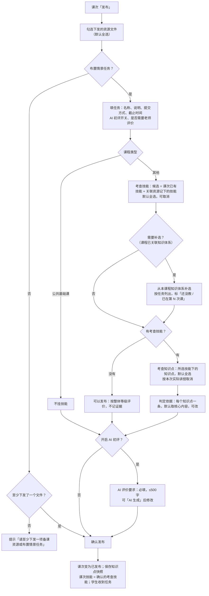
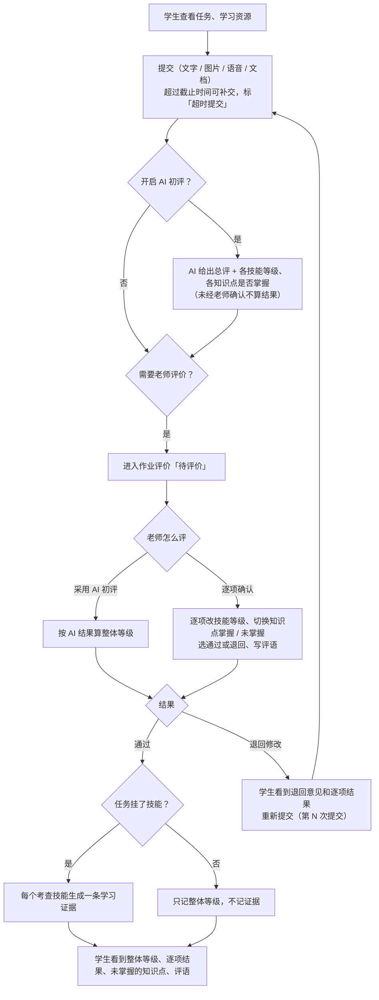
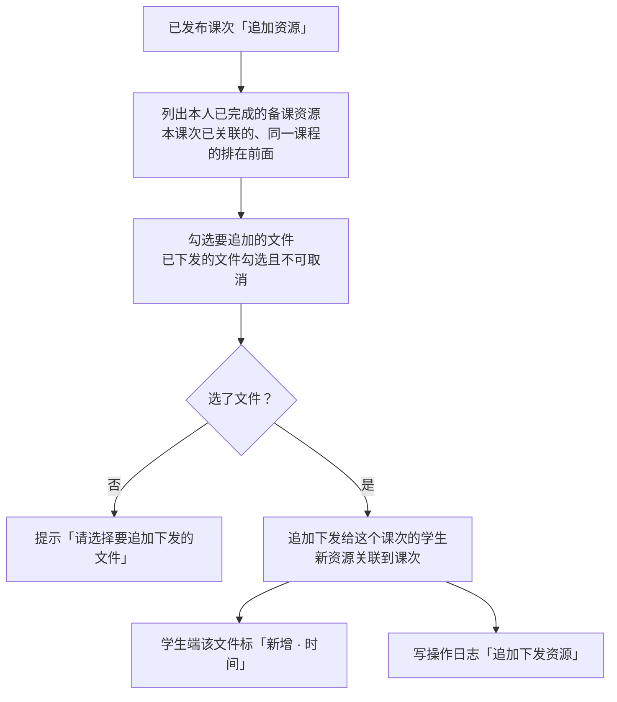

# PRD · 第五批：发布、学生作答、评价与证据

版本：v1.0　｜　日期：2026-11-11　｜　所属：AIGC 智慧课堂平台 · 第一阶段教学闭环
演示对照：教师端 `李老师`（旅行策划 1 班 / 2 班、旅行社经营与管理 1 班）；学生端 `林同学`（旅行策划 1 班）

---

## 1. 背景与目标

备课完成后，老师要把资源和任务发给学生，学生提交后老师评价，评价结果再变成「学生 × 技能 × 等级」的学习证据，供学情（第 6 批）和教学达成（第 7 批）使用。原来的问题：

- 考查技能靠课次上选的任务带出，和老师实际备课、实际讲的对不上；
- 选了技能就默认考它下面的全部知识点，但一节课往往只讲其中几个；
- AI 评价要求按技能逐个写三档描述，老师写不过来；
- 知识体系后来改了，已发布任务的知识点、学生的结果跟着变，前后对不上。

本批要做到：
- 发布时由老师确认考查技能和考查知识点，候选来自课次和备课资源，可从知识体系补选；
- AI 评价要求一个任务一份，可一键生成；
- 发布时保存知识点快照，之后作答、评价、统计都按发布时的内容；
- AI 初评只是参考，老师确认后才算结果；通过后每个考查技能记一条学习证据。

## 2. 范围

| 本批包含 | 不在本批 |
|---|---|
| 发布学习内容：下发资源、情景任务、考查技能、考查知识点、判定依据、AI 评价要求、课程反馈开关 | 课次的创建、编辑（第 1 批） |
| 知识点快照 | 去备课、资源包生成（第 4 批） |
| 已发布课次：查看发布内容、追加资源 | 发布后追加任务（后续） |
| 学生端「我的任务」中与本批相关的内容：考查技能与知识点、判定依据、新增资源标记、逐项结果 | 学生端列表、成长值、课程反馈表单本身（已有功能） |
| AI 初评、老师评价（采用 AI / 逐项确认）、通过 / 退回 | 学情、补训 / 辅导的发起（第 6 批） |
| 学习证据的生成规则 | 教学达成、专业建设测评（第 7 批） |
| 操作日志：发布课次、追加下发资源、评价通过 / 退回 | |

## 3. 角色与权限

| 角色 | 本批能做什么 |
|---|---|
| 任课教师 | 发布本人课程计划下的课次；查看已发布内容、追加资源；评价本人课次的学生提交 |
| 学生 | 只看到发给自己班级（补训 / 辅导课次只看到发给自己）的已发布内容；学习资源、提交任务、填课程反馈、查看评价结果 |

## 4. 业务流程

### 4.1 发布学习内容

### 4.2 学生作答、评价与证据

### 4.3 已发布课次追加资源

## 5. 功能需求

### 5.1 发布学习内容（右抽屉）

入口：课次行「发布」、我的课程「发布」、课堂首页待办「发布」。

**发布对象**：课程计划（课程 · 班级）、接收人数；补训课次显示「补训对象（学情中该技能未达成的学生）」，辅导课次显示「辅导对象」，只发给这些学生。

**下发备课资源**：
- 列出课次关联的所有备课资源文件（文件名、所属资源包、类型、大小），默认全选；右上角「已选 N 项」。
- 说明「资源由您编辑后下发，下发即视为已确认；未下发的资源学生看不到」。
- 课次没有关联资源时：「该课次还没有关联备课资源。去关联 或 去备课」。

**情景任务**（开关，默认开）：

| 字段 | 规则 |
|---|---|
| 任务名称 * | 默认课次名 |
| 任务说明 * | 写清任务要求和交付物 |
| 提交方式 * | 多选：文字 / 语音 / 图片 / 文档 / 视频，默认文字、文档 |
| 截止时间 * | 日期时间 |
| 开启 AI 初评 | 默认开；说明「学生提交后 AI 先初评，老师复核确认」 |
| 是否需要老师评价 | 默认开；说明「开启后，老师确认的结果才记为学习证据」 |

**考查技能**：
- 候选 = 课次已有的技能 + 关联备课资源记下的技能，**默认全选**，可取消；右侧说明「来自关联的备课资源，默认全选」。
- 课程已关联知识体系时，下方「从本课程知识体系补选技能」（折叠；没有候选时默认展开）：按任务列出（任务 N · 名称 · N 个技能 · 「还没教」或「已在第 N 次课」），勾选技能加入候选并选中，标「补选」；取消补选的技能会从候选中移除。
- 没有候选技能时的说明：
  - 已关联知识体系：「还没有技能：备课资源没记下技能，或这节课没用平台备课。可以在下面从本课程知识体系补选，也可以不挂技能发布（按整体等级评价、不记学习证据）」；
  - 未关联知识体系：「备课资源里没有记下技能。可以不挂技能发布，按整体等级评价、不记学习证据；或先去备课」；
  - 公共基础课：「不挂技能：任务按整体等级评价，不记学习证据」，不显示补选。
- 发布后，课次技能 = 老师确认的考查技能（公共基础课除外）；课程进度、学情按它统计。

**考查知识点**：
- 按所选技能分组列出其下知识点（名称 + 类型标签），**默认全选**，老师按本次实际讲授取消。技能 ≠ 知识点集合，不勾的知识点不评、不统计。
- 技能增减时知识点随之刷新；所选技能下没有知识点写「所选技能下没有知识点」，没挂技能写「未挂技能，没有考查知识点」。

**判定依据**（折叠「判定依据（N 项）· 作答中体现以下内容即算掌握，可修改」）：
- 只列勾选的知识点，每个一条，默认取知识体系里该知识点的核心内容，老师可改；清空时按默认。

**AI 评价要求**（开启 AI 初评时显示，必填）：
- 一个任务一份，不再按技能逐个写三档描述；最多 500 字，带字数。
- 默认按任务名称、考查技能、考查知识点自动生成（整体完成度 / 逐项判断考查技能 / 考查知识点按判定依据 / 等级规则 / 评语要求）；老师改过后，技能、知识点变化不再覆盖；点「AI 生成」重新生成。
- 说明「AI 按这份要求给出一份总评；展开可看各考查技能是否达到、各知识点是否掌握，老师可调整」。

**学生课程反馈**（开关，默认开）：「收集学生对课程资源与任务难度的反馈」。

**确认发布**：
- 校验：资源和任务至少有一项；任务必填项；开启 AI 初评时 AI 评价要求必填。
- 发布后课次状态「已发布」，提示「已发布给 N 名学生」；记教师成长；写操作日志「发布课次」（学生数、资源数、情景任务名）。

### 5.2 知识点快照

- 发布时把本次考查知识点的**名称、类型、核心内容**和判定依据存进任务。
- 之后学生端任务详情、AI 初评、老师评价、学生看到的逐项结果、学情、教学达成都按快照显示和统计。
- 发布后知识体系里的知识点改名、改内容、删除，**不影响**已发布任务；新发布的任务用新内容。

### 5.3 已发布课次

- **查看发布学习内容**（右抽屉）：已发布标记 + 发布时间、发布人；发布对象；已下发备课资源（每个文件「已下发」、可预览）；情景任务（名称、提交方式、截止时间、AI 初评、是否需要老师评价、说明、考查技能、考查知识点「N 个，发布时勾选」+ 判定依据、AI 评价要求）；课程反馈是否开启。
- 已发布的内容**不能修改或撤回**。
- **追加资源**（弹窗）：说明「已发布的内容不能修改或撤回；可以把更多资源下发给这个课次的 N 名学生，学生端会标「新增」」。按资源包列出文件，已下发的勾选且不可改；底部「已选 N 个文件」+「追加下发」。追加后提示「已追加下发 N 个文件给 N 名学生」，写操作日志。
- 发布后追加情景任务不在本批。

### 5.4 学生端「我的任务」（本批相关部分）

- **学习资源**：按资源包分组；发布后追加的文件标「新增 · 月-日 时:分」。
- **情景任务**：名称、说明、提交方式、截止时间；
  - 「考查的技能和知识点」：技能标签 + 按技能分组的考查知识点（按快照）；
  - 「知识点怎样算掌握」（折叠）：每个知识点的判定依据；
  - 「评价要求」：老师填写的 AI 评价要求（没有时不显示）。
- **提交**：按老师允许的方式分页签提交：

| 方式 | 规则 |
|---|---|
| 文字 | 最多 3000 字 |
| 图片 | JPG / PNG / GIF，单张 ≤10MB，最多 20 张 |
| 语音 | 实时录音或上传 MP3 / WAV / WebM / OGG / M4A，1 个，≤50MB |
| 文档 | PDF / Word / PPT / Excel，1 个，≤50MB |

  - 什么都没添加时不能提交；超过截止时间可以补交，提示「补交后将标记为超时提交」；
  - 被退回时显示老师退回意见，提交记为「第 N 次提交」。
- **我的提交与评价记录**：每次提交一条（最新的展开）：提交内容、超时标记；
  - 退回：退回时间、意见、逐项结果；
  - 通过：整体等级、评价时间、逐项结果（每个技能的等级 + 「未掌握：××、××」，只列考查知识点）、老师评语；
  - 还没评：「待评价，等待老师评价」。
- 有新评价时任务卡片标「新评价」，打开详情后消失。

### 5.5 AI 初评

- 学生提交后，开启了 AI 初评的任务由 AI 按「AI 评价要求」给出：
  - 一份**总评**：整体等级 + 完成情况 / 主要亮点 / 存在问题 / 改进意见；
  - 逐项：每个考查技能的等级和理由，每个考查知识点是否掌握（按判定依据）。
- AI 结果**未经老师确认不算结果**，不进证据、不进学情，学生端不显示。

### 5.6 老师评价（右抽屉）

入口：作业评价列表「评价」、课次详情、学情里的学生提交。

- **任务信息**：名称、说明、提交方式、截止时间、AI 评价要求（折叠）。
- **学生提交**：第 N 次提交、超时提交标记、提交时间；文件可预览（文字直接显示）；此前退回过时显示退回次数和最近一次退回意见。
- **AI 初评**：整体等级 + 四段总评，标「按「AI 评价要求」评价，需老师确认」。
- **技能和知识点达标情况**（默认收起）：标题行写「N 项技能 · N 个知识点；AI 判定未达到 N 项、未掌握 N 个」；展开为表格：考查技能 / AI 初评（等级、理由、知识点 ✓ / ✗）/ 老师确认。
- 任务没挂技能时提示「本次任务未挂技能，按整体等级评价，不记学习证据」；公共基础课提示「公共基础课，按整体等级评价，不记学习证据」。
- **两种评法**：

| 评法 | 交互 | 结果 |
|---|---|---|
| ✓ 采用 AI 初评 | 一键完成 | 逐项等级、知识点按 AI；评语取 AI 改进意见；整体等级为需改进时结果为「退回修改」，否则「通过」 |
| 逐项确认 | 达标情况自动展开；每个技能选 优秀 / 合格 / 需改进（默认取 AI）；知识点点一下切换掌握 / 未掌握（可看判定依据）；最终结果 通过 / 退回修改（默认按整体等级，可改）；评语 | 必须每项都选了等级；没挂技能时选整体等级 |

- **整体等级规则**：全部优秀为优秀；需改进超过一半为需改进；其余为合格。
- 完成后提示「已完成评价：学生 · 等级，生成 N 条学习证据」；写操作日志「评价通过 / 评价退回」（等级、逐项、证据数、采用 AI 还是老师逐项确认）。
- 已评价的提交打开为只读：整体等级、最终结果、学习证据「已生成 N 条 / 不记证据」、评语。

### 5.7 学习证据

- **通过**且任务挂了技能：每个考查技能记一条证据：学生 / 技能 / 等级（优秀 / 合格 / 需改进）/ 课次 / 提交时间 / 评价人 / 确认时间。
- 退回的那次只作为过程记录，不记证据；没挂技能、公共基础课不记证据。
- 知识点掌握情况只用于学情和补训，**不进证据**、不汇总到能力。
- 同一学生同一技能有多条证据时，学情按最近一条（第 6 批）。
- 学生自评不进证据。

## 6. 数据口径与规则汇总

1. 考查技能候选 = 课次已有技能 + 关联资源记下的技能；发布后课次技能 = 确认的考查技能。
2. 「还没教 / 已在第 N 次课」：按这门课其他课次判断——已发布的看考查技能，未发布已挂资源的看资源带上的技能；补训课次不计。
3. 考查知识点只算发布时勾选的；判定依据默认取知识点核心内容。
4. 发布后作答、评价、统计都按知识点快照。
5. 整体等级：全部优秀 → 优秀；需改进超过一半 → 需改进；其余 → 合格。
6. 证据 = 老师确认通过 × 每个考查技能一条；AI 结果、退回、自评都不进证据。
7. 已下发 = 发布或追加时下发的文件；已下发的资源不能删除（第 3 批）。

## 7. 显示 / 不显示

- 发布抽屉里不再有「评价标准」三档表；AI 评价要求只有一份。
- 未勾选的知识点不评、不显示在学生端和评价结果里。
- AI 初评未经老师确认前，学生端不显示任何评价结果。
- 已发布课次没有「编辑发布内容」「撤回」。
- 页面不出现「示例数据」「待确认」类标注。

## 8. 验收标准

| # | 场景 | 预期 |
|---|---|---|
| 1 | 给挂了资源的课次发布 | 考查技能默认带出资源记下的技能并全选；知识点默认全选；AI 评价要求已自动生成 |
| 2 | 从知识体系补选一个技能 | 技能标「补选」，知识点、判定依据、AI 评价要求随之更新（老师改过 AI 评价要求的不覆盖） |
| 3 | 补选区 | 每个任务显示「还没教」或「已在第 N 次课」 |
| 4 | 取消两个知识点后发布 | 学生端、评价抽屉都只显示剩下的知识点 |
| 5 | 开启 AI 初评但清空 AI 评价要求 | 不能发布，提示填写 |
| 6 | 不勾资源、关掉情景任务 | 不能发布，提示至少一项 |
| 7 | 没有技能的课次发布 | 可以发布；评价时按整体等级，不记证据 |
| 8 | 发布后在知识体系里修改某知识点名称 | 该任务的学生端、评价抽屉仍显示发布时的名称 |
| 9 | 已发布课次追加 1 个文件 | 学生端该文件标「新增 · 时间」；已下发的文件不能取消；操作日志有记录 |
| 10 | 林同学提交，超过截止时间 | 标「超时提交」；老师评价抽屉也显示 |
| 11 | 学生提交后、老师评价前 | 学生端显示「待评价」，看不到 AI 结果 |
| 12 | 老师「采用 AI 初评」，AI 整体为合格 | 结果通过，按考查技能数生成证据，提示生成条数 |
| 13 | 老师逐项确认，把两个技能改为需改进（共 3 项） | 整体等级需改进，默认结果「退回修改」；学生看到退回意见和逐项结果，重新提交为「第 2 次提交」 |
| 14 | 逐项确认时有技能没选等级 | 不能确认，提示逐项选择 |
| 15 | 评价通过后学生查看 | 看到整体等级、每个技能等级、「未掌握：××」、评语；卡片「新评价」打开后消失 |
| 16 | 公共基础课任务评价 | 选整体等级，不记证据 |
| 17 | 操作日志 | 有发布课次、追加下发资源、评价通过 / 退回记录 |
