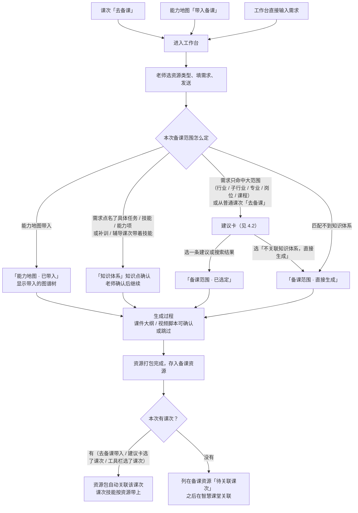
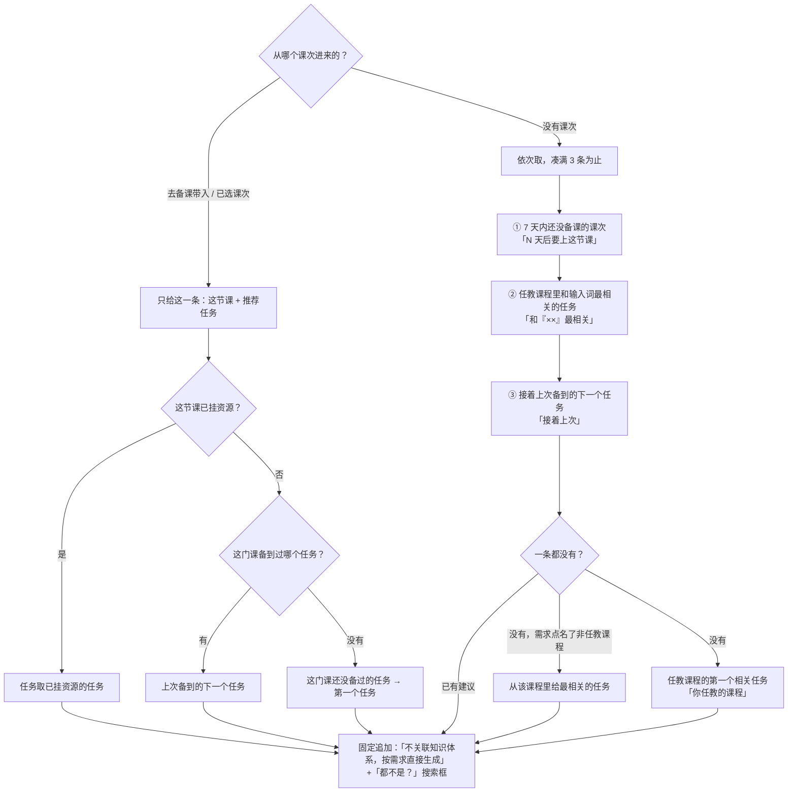
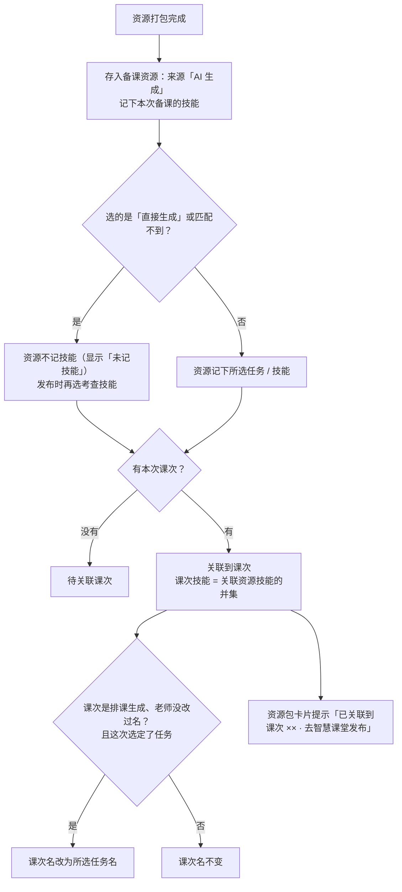

# PRD · 第四批：备课（工作台、能力地图带入）

版本：v1.0　｜　日期：2026-11-11　｜　所属：AIGC 智慧课堂平台 · 第一阶段教学闭环
演示对照：教师端 `李老师`（任教旅行策划 1 班 / 2 班、旅行社经营与管理 1 班，专业知识体系为导游 540102）

---

## 1. 背景与目标

老师备课的出发点不一样：有的从课表上的一节课开始，有的在能力地图上看到某个能力想备，有的直接在工作台打一句需求。原来的工作台不管从哪来，都要老师在一棵完整的知识体系树上勾知识点，选择成本高，老师常常直接跳过，生成的资源也就记不上技能，后面发布、评价、学情都接不上。

本批要做到：
- 三个入口都能进工作台备课，进来时尽量带上已知的信息，老师少选；
- 需求范围太大（行业、专业、整门课）时，不给整棵树，只给一张建议卡：最多 3 条建议 + 直接生成 + 搜索；
- 只在系统按名称猜的时候才停下让老师确认知识点，其余情况选定即生成；
- 生成的资源包记下本次备课的技能，关联到课次后课次自动带上技能，供第 5 批发布、评价使用。

## 2. 范围

| 本批包含 | 不在本批 |
|---|---|
| 三个备课入口：课次「去备课」、能力地图「带入备课」、工作台直接输入 | 能力地图本身的浏览、编辑、AI 延展（已有功能） |
| 工作台：需求输入、资源类型与参数、参考文件、课次选择 | 课次时间线、编辑课次（第 1 批） |
| 备课范围匹配与建议卡、搜索 | 备课资源列表、上传、复用提示（第 3 批） |
| 知识点确认规则 | 发布课次、确认考查技能、知识点快照（第 5 批） |
| 生成过程、过程中的人工确认、资源包 | 补训 / 辅导课次的发起（第 6 批） |
| 资源包与课次的关联、课次自动改名 | 知识库与备课资源统一为「资源」（后续阶段） |
| 工作台左侧任务列表 | |
| 外部依赖：课件生成服务失败兜底、AI Key 由使用者填写 | |

## 3. 角色与权限

| 角色 | 本批能做什么 |
|---|---|
| 任课教师 | 使用工作台备课；建议卡、课次选择只涉及本人负责、未结束的课程计划；搜索可以搜到本专业其他课程的任务和技能（标明「非任教课程」） |
| 没有课程计划的教师 | 可以使用工作台按需求直接生成；没有课次可选，建议卡只有「直接生成」和搜索 |

## 4. 业务流程

### 4.1 三个入口到生成完成

### 4.2 建议卡：怎么给建议

### 4.3 生成完成后：资源包、课次、技能

## 5. 功能需求

### 5.1 三个入口

| 入口 | 位置 | 带到工作台的内容 |
|---|---|---|
| 课次「去备课」 | 智慧课堂课次行、我的课程「下次课」 | 这节课（课程 · 班级 · 课次名）；补训 / 辅导课次另带上它针对的技能 |
| 能力地图「带入备课」 | 能力地图页面底部通栏 | 选定的节点及其上级链路、整棵下级、所属专业知识体系 |
| 工作台直接输入 | 侧栏「工作台」、首页「✦ AI 备课」、备课资源「✦ 去工作台备课」 | 无，按输入的需求匹配 |

- 课次「去备课」不再先跳知识点确认：进入工作台后输入框上方显示本次课次，提示「生成完成后资源包自动关联到该课次」。
- 课次所属课程**没有关联知识体系**时，按需求直接生成，资源包仍关联到该课次。

### 5.2 能力地图带入

- 行业、子行业、岗位**不能带入备课**：详情里不显示带入按钮，多选时不能勾选（范围太大）。能力项及以下（能力项、技能、技能下的各级节点）可以带入。
- 「带入备课」统一放在页面**底部通栏**，单选、多选都在这里操作：
  - 单选：通栏写「备课范围：××（类型）及下级 N 个节点」+「带入备课 · 生成课件」；
  - 多选：点「多选备课」后勾选节点，通栏写「已选 N 个节点」+ 每个节点一个可移除的标签 +「清空」+「带入备课 · 生成课件」；勾了上级，下级自动包含；同一节点挂在多处只算一次；
  - **没有可带入的内容时不显示通栏**（刚进入页面、选中行业 / 子行业 / 岗位、多选还没勾）。
- 点「带入备课」：页面有未保存的调整时**自动保存**后跳到工作台，不弹确认框。
- 工作台上方显示「带入备课」卡片：带入的图谱树（横向，上级链路虚线框、当前节点高亮，可逐级展开，「全部展开」「收起到一级」），所属知识体系名称。
- 生成过程中这一步叫「**能力地图**」，标签「已带入」，内容为带入的图谱树：
  - 横向树，可逐级展开，**不显示节点数量**；
  - 右上角全屏图标，全屏时只保留「退出全屏」；
  - **不再确认知识点**（老师在图谱上已经选定）。

### 5.3 工作台输入区

- 欢迎区：标题「让 AI 助您更快完成一节课的教学准备」+ 一句说明；开始生成后收起。
- **资源类型**（可多选）：课件生成 / 教案生成 / 情景互动游戏生成 / 图片素材生成 / 视频素材生成。输入框提示语随第一个选中的类型变化。
- **类型参数**（选了对应类型才出现）：

| 类型 | 参数 |
|---|---|
| 教案 | 教案结构：精简（教学目标、教学重难点、教学过程、作业设计）/ 标准（9 项：教学目标、学情分析、教学重难点、教学方法、教学准备、教学过程、板书设计、作业设计、教学反思）/ 完整（标准 + 课程思政、拓展资源）；也可逐项勾选，显示「自定义」 |
| 图片素材 | 生成数量 1～4 张；风格：默认 / 写实 / 卡通 / 国风 / 扁平 / 水彩；比例：16:9 / 4:3 / 1:1 / 9:16 |

- **参考文件**（「＋」）：本地上传或从平台参考文件中选，最多 3 个；只支持 PDF、PPT、Word，单个不超过 20MB，不符合的给出提示并跳过。
- **课次**（工具栏下拉，默认「课次：暂不关联」）：按课程计划分组列出本人的课次；选了课次，生成后资源包关联到它。从课次「去备课」进来时已选好。
- 输入框下「试试」：给 3 条示例需求，点一下填入（只在生成课件、没有带入内容时显示）。
- 需求为空、或建议卡还没选定时，发送按钮不可用；回车发送，Shift+回车换行。
- 从备课资源「重新生成」过来时，输入框预填原来的需求。

### 5.4 备课范围匹配

发送时，系统先判断本次备课范围：

| 情况 | 结果 | 生成过程里这一步 |
|---|---|---|
| 能力地图带入 | 按带入的节点生成 | 能力地图 · 已带入 |
| 需求点名了具体的任务 / 技能 / 能力项（系统按名称匹配到） | 带上匹配到的技能，**停下让老师确认** | 知识体系 · 知识点确认 → 已确认 |
| 补训 / 辅导课次带着技能进来 | 带上这些技能，**停下让老师确认** | 知识体系 · 知识点确认 → 已确认 |
| 需求只命中大范围（行业 / 子行业 / 专业 / 岗位 / 课程） | 不生成，先出建议卡 | 选定后：备课范围 · 已选定 |
| 从普通课次「去备课」，需求没点名具体任务 / 技能 | 不生成，先出建议卡（只一条：这节课） | 选定后：备课范围 · 已选定 |
| 匹配不到知识体系里的内容 | 按需求直接生成 | 备课范围 · 直接生成 |

- 同时命中大范围和具体任务 / 技能时，以具体的为准。
- 匹配只在本次要生成**课件**时进行；只生成教案、游戏、图片、视频时按需求直接生成。
- **知识点确认**卡：显示匹配到的知识体系树（专业 › 课程分类 › 课程 › 任务 › 技能 › 知识点），与能力地图带入同一种横向树、可全屏；按钮「确认知识体系，继续生成」；说明「范围不对可以修改需求后重新发送」。
- 工作台上方「已按需求匹配知识范围」卡片可以点「×」移除：本条需求不再匹配，按原样直接生成。

### 5.5 建议卡

- 位置：输入框上方，标题「选择备课范围」。
- **一句提示**：
  - 需求命中大范围：「「××」范围较大，一节课用不完。这次想备哪部分？」
  - 从课次进来：「这节课只关联了课程《××》，一节课用不完。这次想备哪部分？」
- **建议**：最多 3 条，单选；每条两行（第一行课次或课程，第二行「任务：××」）+ 右侧推荐理由标签。建议来源和顺序见 4.2：

| 来源 | 第一行 | 推荐理由标签 |
|---|---|---|
| 已选 / 带入的课次（有就只给这一条） | 课程 · 班级 · 第几次课 · 日期 | 本次课次（第二行注明「接着上次备到的『××』」「这门课还没备过的任务」「从第一个任务开始」） |
| 7 天内还没备课的课次 | 同上 | N 天后要上这节课 |
| 任教课程里和输入词最相关的任务 | 课程名 | 和「××」最相关 |
| 接着上次备到的下一个任务 | 课程名 | 接着上次 |
| 需求点名了非任教课程 | 该课程名 | 和「××」最相关 |

- 固定最后一条「**不关联知识体系，按需求直接生成**」，说明「适合行业动态、时事类内容；生成的资源不记技能，发布任务时再选考查技能」。一条建议都给不出时，写明「你任教的课程里没有找到和「××」相关的内容，可以搜索，或直接生成」，并默认选中直接生成。
- **「都不是？」搜索**：输入任务或技能名称，先搜任教课程再搜本专业，最多 8 条，平铺显示（类型标签 + 名称 + 所在课程，非任教课程标明）；点一条加入建议列表并选中，标签「搜索选中」。
- 底部说明「选定后直接生成，生成的资源记下所选任务或技能」+「开始生成」。
- 选定后**直接生成，不再确认知识点**；选了带课次的建议，生成后资源包关联到该课次。
- 「×」关闭建议卡：清空本次带入内容和需求，回到输入状态。

### 5.6 生成过程

- 发送后页面切到生成过程：顶部为本次标题 +「＋ 新建对话」+ 右侧任务进度开关；中间是时间线，右侧是任务进度。
- **时间线步骤**（按顺序，每步带状态标签：等待中 / 进行中 / 等待确认 / 已完成 / 失败）：
  1. 启动；
  2. 需求分析：识别教学主题和要生成的资源；
  3. 范围（能力地图 / 知识体系 / 备课范围，见 5.4）；
  4. 知识检索；
  5. 参考文件解析（没有参考文件时写「无参考文件，跳过」）；
  6. 各类资源生成：

| 资源 | 步骤 | 产出 |
|---|---|---|
| 课件 | 课件大纲生成 → **等待确认大纲** → 课件生成 | 课件（PPT）+ 课件讲稿（Word） |
| 课件（能力地图带入） | 直接按带入的知识体系生成，不经过大纲确认 | 课件 |
| 教案 | 按所选结构生成 | 教案（Word） |
| 情景互动游戏 | 设计情景与角色 → 生成互动关卡 | 情景互动游戏（网页） |
| 图片素材 | 按数量、风格、比例生成 | N 张图片 |
| 讲解视频 | 视频脚本生成 → **等待确认脚本** → 合成视频 | 讲解视频 + 视频脚本 |

  7. 资源打包。
- **大纲确认**：可以调整顺序、增删改各级标题（最多 3 级）、添加一级；按钮「确认大纲，继续生成」「跳过全部资源确认」（之后的大纲、脚本确认都跳过，标签「已跳过确认」）。视频脚本确认同理。知识点确认不能被「跳过全部」跳过。
- **右侧任务进度**：需求分析 / 各资源（每个资源下列出已生成的文件）/ 资源打包，状态同时间线。
- **资源包卡片**：「××· 资源包」共 N 个文件；每个文件可预览、下载；「全部下载」。下方提示：
  - 已关联课次：「已关联到课次「××」，记录了来源技能。去智慧课堂发布 ›」
  - 没关联：「已存入备课资源，暂未关联课次，可在智慧课堂的课次里关联。去智慧课堂 ›」
  - 课件来自课件生成服务时：「课件下载链接 N 分钟内有效」。
- 生成失败：在失败的步骤写明原因，给「重新生成」。

### 5.7 资源包与课次

- 生成完成即存入备课资源，来源「AI 生成」，名称「《课次名或主题》备课资源包」，创建人为当前老师。
- 资源包记下**本次备课选定的技能**：能力地图带入的节点下的技能 / 知识点确认后的技能 / 建议卡选定的任务或技能。直接生成、匹配不到时不记技能。
- 有本次课次时自动关联：课次技能 = 关联资源技能的并集（规则同第 3 批）。
- **课次自动改名**：排课生成的课次，老师没改过名称、还没发布，本次选定了任务时，课次名改为所选任务名；老师改过名的不动。
- 记一条教师成长记录「备课：生成课件、教案…」。

### 5.8 工作台左侧任务列表

- 侧栏菜单下方「任务 N」：每次发送是一个任务，另外列出本人已有、但不是在工作台生成的资源包。置顶的在前，其余按时间倒序。
- 只有**生成中、待确认、失败**的显示状态点；已完成的不显示。
- 点一条回到那次的生成过程和结果；没完成的接着生成；不是在工作台生成的资源包按内容还原成只读的生成过程。
- 「⋯」菜单：置顶 / 取消置顶、重命名（就地编辑，回车保存，Esc 取消，不能为空）、在智慧课堂查看资源包、查看关联课次、删除。删除任务不删资源包（提示「生成的备课资源包仍保留在智慧课堂」）；资源包本身不能在这里删除。
- 生成中、失败的只在这里看，备课资源列表里不显示（第 3 批）。

### 5.9 外部依赖

- **课件生成服务**：能力地图带入且要生成课件时，按带入的知识体系调用课件生成服务。服务连不上（6 秒内无响应）、超过 5 分钟没返回、返回异常时**不报错**，改为给出平台生成的课件和讲稿，流程照常完成。
- **AI Key**：页面不内置任何 AI Key。能力地图里首次使用 AI 功能时提示「请先在「AI 设置」里填写你的 API Key，再使用 AI 生成」；Key 只保存在使用者本机。

## 6. 数据口径与规则汇总

1. 范围匹配：按名称匹配知识体系里的行业、子行业、专业、岗位、课程、能力项、任务、技能；同时命中时具体的优先；只命中大范围时出建议卡。
2. 「7 天内还没备课的课次」= 本人未结束课程计划里，7 天内要上、未发布、没挂资源的课次，取最近一节。
3. 「上次备到的任务」= 这门课最近一节已发布或已挂资源的课次对应的任务；「下一个」按知识体系里的任务顺序。
4. 资源包记下的技能 = 本次选定范围内的技能；直接生成、匹配不到时为空。
5. 课次技能 = 关联资源技能的并集；老师发布时确认的考查技能以发布时为准（第 5 批）。
6. 建议卡、课次下拉只涉及本人负责、未结束的课程计划。

## 7. 显示 / 不显示

- 行业、子行业、岗位不显示「带入备课」，多选时不能勾选。
- 能力地图没有可带入内容时不显示底部通栏；带入时不弹确认框。
- 建议卡不展示整棵知识体系树；带入的图谱树不显示节点数量。
- 以下情况不出现知识点确认：能力地图带入、建议卡选定、选「直接生成」、匹配不到知识体系、从普通课次「去备课」后在建议卡选定。
- 已完成的任务不显示状态点。
- 页面不出现「示例数据」「待确认」类标注；页面不内置 AI Key。

## 8. 验收标准

| # | 场景 | 预期 |
|---|---|---|
| 1 | 能力地图选中「岗位」节点 | 详情里没有带入按钮，底部不出现通栏；多选时岗位不能勾选 |
| 2 | 能力地图选中一个能力项 | 底部通栏显示「备课范围：××及下级 N 个节点」+「带入备课 · 生成课件」 |
| 3 | 多选勾 3 个节点后带入（页面有未保存调整） | 不弹框，自动保存后进入工作台；上方显示带入的图谱树 |
| 4 | 带入后生成课件 | 时间线有「能力地图 · 已带入」，图谱树可展开、可全屏，全屏只有「退出全屏」；不出现知识点确认、不出现大纲确认 |
| 5 | 李老师输入「给我讲讲旅游行业的发展趋势，做个课件」 | 出现建议卡（下次课、接着上次、直接生成等，最多 3 条 + 直接生成）；选一条点「开始生成」，不出现知识点确认，这一步显示「备课范围 · 已选定」 |
| 6 | 建议卡选「不关联知识体系，按需求直接生成」 | 直接生成，这一步显示「备课范围 · 直接生成」；资源包「未记技能」 |
| 7 | 建议卡搜索「讲解」 | 最多 8 条任务 / 技能，任教课程在前，非任教课程有标注；点一条后标「搜索选中」 |
| 8 | 输入「帮我做一个规范化导游讲解与服务流程执行的课件」 | 匹配到具体技能，停在「知识体系 · 知识点确认」，确认后继续 |
| 9 | 输入和知识体系无关的需求 | 直接生成，显示「备课范围 · 直接生成」 |
| 10 | 从智慧课堂 2 班某课次「去备课」，输入「做个课件」发送 | 建议卡只有这一节课一条（+ 直接生成）；生成完成后资源包自动关联到该课次，课次带上技能 |
| 11 | 第 10 条的课次是排课生成、没改过名 | 备课后课次名变为所选任务名；改过名的不变 |
| 12 | 工具栏选「课次」后直接生成 | 生成后关联到所选课次；不选则列在备课资源「待关联课次」 |
| 13 | 生成课件 + 视频，大纲确认时点「跳过全部资源确认」 | 视频脚本确认自动跳过，标签「已跳过确认」 |
| 14 | 参考文件选 4 个 / 上传 30MB 文件 / 上传图片 | 最多 3 个；超 20MB、非 PDF / PPT / Word 的提示并跳过 |
| 15 | 课件生成服务不可用时从能力地图带入生成课件 | 不报错，给出课件和讲稿，资源包正常生成 |
| 16 | 左侧任务列表 | 只有生成中 / 待确认 / 失败有状态点；置顶、重命名、删除可用；删除任务后资源包仍在备课资源里 |
| 17 | 王老师（没有课程计划）在工作台输入大范围需求 | 建议卡只有「直接生成」和搜索，可以正常生成 |
