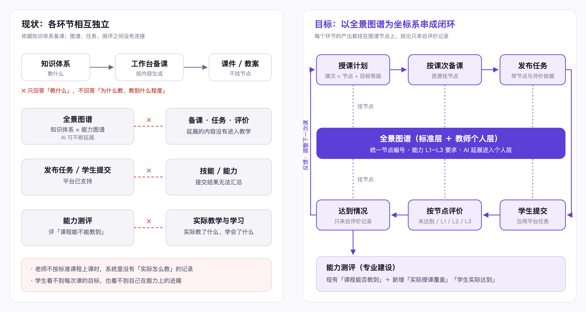

# 图谱驱动的教学 / 学习链路 · 方案

> 版本：2026-10-23（v2）· 作者角色：产品 · 状态：方案讨论稿
> 原型：`teach-plan.html`（未加入菜单，打开方式见第 12 节）
> 关联：双图谱结构 `双图谱结构说明.md`；能力图谱 `PRD-能力图谱.md`；能力测评 `docs/能力测评/`

**一句话**：以全景图谱为坐标系，把「备课 → 上课 → 任务 → 评价 → 学生进展 → 专业改进」串成一条链路；每个环节的产出都挂在图谱节点上，结论只来自真实的评价记录。

---

## 1. 背景与问题

| 现状 | 问题 |
|---|---|
| 教师在工作台备课，主要依据知识体系 | 只回答「教什么」，不回答「为什么教、要教到什么程度」 |
| 知识体系 × 能力图谱已生成全景图谱，AI 可以不断延展 | 延展的内容停留在图谱里，没有进入备课、任务与评价 |
| 平台可以发布任务、学生可以提交 | 任务与图谱无关，提交结果无法汇总到技能和能力 |
| 能力测评评价「课程能不能教到」 | 不知道「实际教了什么、学生学会了什么」 |

### 1.1 现状与目标对比



> 可编辑源文件：[现状与目标对比.drawio](现状与目标对比.drawio)（用 diagrams.net 打开编辑；改完「文件 › 导出为 › PNG」覆盖同目录的 `现状与目标对比.png`，方案里的图随之更新）

| 维度 | 现状 | 目标 |
|---|---|---|
| 备课依据 | 知识体系：只有「教什么」 | 全景图谱：节点 + 目标等级，同时回答「为什么教、教到什么程度」 |
| 教学安排 | 没有记录；老师不按标准课程上课时无从体现 | 授课计划：以标准课程为底，调整处可见，未覆盖的技能有提示 |
| AI 延展 | 停留在全景图谱里 | 进入老师的个人层，可加入课次、备课、任务 |
| 资源 | 课件、教案与图谱无关 | 资源挂到课次与节点上，可按节点检索、复用 |
| 任务 | 能发布、能提交，但与图谱无关 | 任务自动带上节点、目标等级与评价依据 |
| 评价 | 结果无法汇总到技能和能力 | 按节点记录达到等级，可沿图谱汇总 |
| 学生 | 看不到每次课目标与能力进展 | 看到授课进度、每次课目标与个人图谱 |
| 教学改进 | 凭经验 | 班级在各节点的达到情况 → 决定下一次课补什么 |
| 专业建设 | 能力测评只评「课程能不能教到」 | 增加「实际授课覆盖」「学生实际达到」 |

## 2. 已确认的前提

| # | 前提 | 来源 |
|---|---|---|
| F1 | 全景图谱 = 知识体系 × 能力图谱，平台已有（图谱中心 › 知识图谱 › 全景图谱） | 平台现状 |
| F2 | AI 延展的内容进入**老师自己的**全景图谱；该能力正在实现，尚未上线 | 产品确认 |
| F3 | 平台已支持给学生发布任务、学生提交 | 产品确认 |
| F4 | 课程仍以知识体系为准，但老师上课不一定完全按标准课程体系 | 产品确认 |
| F5 | 前置（先修）关系暂不考虑 | 产品确认 |

## 3. 目标与非目标

**目标**

| 角色 | 得到什么 |
|---|---|
| 教师 | 按「节点 + 目标等级」安排课程、备课、布置任务；看到班级在每个节点上的达到情况，据此调整下一次课 |
| 学生 | 清楚每次课学什么、要达到什么程度；看到自己在图谱上的进展与对应资源 |
| 管理者 | 在「课程能不能教到」之外，看到「实际教了什么、学生达到了什么」 |

**非目标（本方案不做）**

- 不改变知识体系与能力图谱的构建方式，不改变映射规则。
- 不做前置关系推导与自适应学习路径（F5）。
- 不替代现有任务系统，只在任务上增加节点与评价依据。
- 不对没有评价记录的节点做任何估算。

## 4. 设计原则

| # | 原则 |
|---|---|
| P1 | **产出挂节点**：资源、任务、评价记录都带「节点编号 + 目标等级」，可沿图谱往上汇总、往下追溯 |
| P2 | **标准为底，允许调整**：课程以知识体系为准，老师通过「授课计划」调整实际教学，调整处可见 |
| P3 | **个人内容不进标准**：AI 延展与老师补充的节点只在老师自己的全景图谱中，始终挂在一个标准节点下 |
| P4 | **结论只来自证据**：达到情况只来自已评价的任务；无记录显示「未评价」 |
| P5 | **等级贯穿**：能力的 L1–L3 行为要求同时作为教学目标与评价的等级说明 |
| P6 | **默认可用、少操作**：授课计划、目标等级、评价依据都自动生成，老师只需调整 |

---

## 5. 整体结构

```
能力图谱（平台·行业） × 知识体系（平台·专业）
                  ↓
   全景图谱 · 标准层（共享）  ＋  全景图谱 · 教师个人层（AI 延展 / 人工补充，仅本人）
                  ↓
   授课计划（教师 × 课程）：课次 = 一组节点 + 目标等级
                  ↓
   ① 备课 → ② 上课 → ③ 发布任务 → ④ 学生提交 → ⑤ 按节点评价 → ⑥ 达到情况
                  ↑                                             │
                  └──────────── ⑦ 反馈：调整下一次课；汇总到能力测评 ←┘
```

### 5.1 两层全景图谱

| | 标准层 | 教师个人层 |
|---|---|---|
| 内容 | 知识体系（课程、任务、操作流程、技能规范、步骤、知识点、标准、案例）× 能力图谱（岗位、能力、等级） | AI 延展节点、老师人工补充的节点 |
| 可见 | 全体教师 | 仅本人（以后可考虑教研组共享） |
| 挂载 | — | 每个个人节点都有一个「标准上级」 |
| 汇总 | 直接参与 | 用到个人节点的任务评价，汇总到其标准上级，再沿映射汇总到能力 |

### 5.2 与平台现有全景图谱的衔接

平台全景图谱现状（2026-10-23）：按「映射任务」组织（一个能力图谱 × 一组知识体系），另有「全部」总图谱；力导向关系网络图，可按专业 / 类型筛选、搜索、按链路查找；点节点弹出环形菜单「展开」，底部显示节点路径；节点类型含「操作流程」「属性」。

| # | 衔接点 | 做法 |
|---|---|---|
| J1 | 节点编号 | 授课计划、资源、任务、评价记录统一引用全景图谱的节点编号 |
| J2 | 个人层字段 | 正在实现的个人全景图谱，节点需带：**来源**（原始 / AI 延展 / 人工）、**所有者**、**标准上级**；老师看到标准层 + 本人个人节点 |
| J3 | 入口 | 节点环形菜单在「展开」之外增加「带入备课」「加入授课计划」 |
| J4 | 选节点 | 授课计划中添加节点时，复用「搜索节点」「按链路查找」 |
| J5 | 层级 | 课次默认按「任务」划分；课次内按「操作流程 › 技能规范」展示 |

---

## 6. 端到端场景（示例）

王老师本学期教导游专业 2 个班的《模拟导游》：

1. **建授课计划**：选《模拟导游》，系统按知识体系的 3 个任务生成 3 个课次，每个课次带上技能规范和目标等级（如「接待计划编制」默认 L2，来自已确认映射）。
2. **按实际调整**：王老师把「食宿服务」挪到最后、跳过「购物服务」，在第 1 次课加入自己在全景图谱里延展出的「接待计划常见漏项」。页面提示「购物服务引导与维权」未覆盖。
3. **备课**：点第 1 次课「备课」，工作台带入该课次的节点与目标等级，生成课件；课件挂到这些节点上。
4. **布置任务**：从第 1 次课发布任务给 1 班、2 班，任务自动带上节点、目标等级 L2 和评价依据（达成结果 + 对应能力的 L2 行为描述）。
5. **评价**：学生提交后，王老师按节点评定等级（默认整份一个等级，可逐节点改）。
6. **看达到情况**：1 班「接待计划编制」8 人已评价、5 人达到 L2；「个性化需求处理」只有 1 人达到 → 第 2 次课开头补讲。
7. **期末**：专业负责人在能力测评中看到《模拟导游》实际覆盖了标准课程的多少技能，以及学生在相关能力上的实际达到情况。

---

## 7. 链路设计

### 7.1 授课计划（一期核心）

| 项 | 规则 |
|---|---|
| 归属 | 一位教师 × 一门标准课程一份授课计划；可用于多个班级（任务按班级发布） |
| 生成 | 默认按知识体系「任务」生成课次，课次内为该任务下的技能规范 |
| 课次 | 一组节点（标准节点或本人个人节点）+ 目标等级 + 名称 |
| 目标等级默认值 | 课次内技能经已确认映射所服务的最高等级；没有映射的技能不给默认值，由老师选 |
| 老师可以 | 调整课次顺序；跳过课次或节点；加入个人节点；改名称、目标等级；新增空白课次；拆分 / 合并课次 |
| 对照提示 | 列出「标准课程中有、授课计划未覆盖」的技能，只提示、不强制 |
| 课次状态 | 未备课 / 已备课；已发布任务数 |
| 标准变化 | 知识体系出新版本、引用的节点被删除或改动时，课次中该节点标「需复核」，由老师处理；不自动删除 |

### 7.2 备课

| 项 | 规则 |
|---|---|
| 入口 | 授课计划的课次「备课」；全景图谱节点菜单「带入备课」（J3）；能力图谱「带入备课」（已有） |
| 带入内容 | 课程 › 课次 › 课次内节点（含个人节点）、目标等级 |
| 生成 | 沿用工作台现有流程；找到所属专业知识体系时，课件由课件生成接口生成（规则见 `PRD-能力图谱.md` 第 9 节） |
| 资源归属 | 生成的资源挂到课次与节点上，进入备课中心，可按节点检索、复用到其他班级 |

### 7.3 任务与评价（二期）

| 项 | 规则 |
|---|---|
| 发布 | 从课次发布，自动带上课次节点、目标等级；可增减节点、改等级；按班级发布 |
| 评价依据 | 自动带出并对学生可见：技能的「达成结果」「可观察能力要求」；关联能力在目标等级的行为描述；知识体系中该技能的「标准」作为评分要点 |
| 评价方式 | 按节点记录「达到等级」（未达到 / L1 / L2 / L3）+ 评语 |
| 减轻评价负担 | 默认「整份提交一个等级」自动应用到所有节点，老师只改个别节点；支持按节点批量评定；后续可加 AI 预评，老师确认后生效 |
| 记录 | 学生、任务、班级、节点、达到等级、评语、评价人、时间 |

### 7.4 达到情况

| 层级 | 口径 |
|---|---|
| 学生 × 节点 | 已评价记录中的最高达到等级；无记录为「未评价」 |
| 班级 × 节点 | 已评价人数、达到目标等级人数；未评价的学生不计入分母 |
| 个人节点 | 计入其标准上级节点，并注明「含个人节点」 |
| 学生 × 能力 | 沿已确认映射由节点达到情况汇总；具体口径二期定（候选：所有支撑技能都达到才算达到，或取多数） |
| 显示 | 「未评价」明确显示，不显示推测值 |

### 7.5 学生端（三期）

- 按授课计划看到课程进度与每次课的目标（节点 + 等级）。
- 查看任务、评价依据与评价结果（按节点的等级与评语）。
- 个人图谱：已达到 / 未达到 / 未评价的节点；按节点查看老师挂上的资源。

### 7.6 反馈与专业建设（四期）

- 教师：班级在各节点的达到情况 → 调整下一次课；可把未达到的节点加入后续课次。
- 能力测评新增两个维度，与现有「课程能否教到」并列：
  - **实际授课覆盖**：授课计划覆盖了标准课程多少技能（跳过 / 未覆盖的列出）。
  - **学生实际达到**：相关能力上学生的实际达到情况（只计已评价）。
- 个人节点：在教研组共享，或提交审核进入标准层（机制待定）。

---

## 8. 数据对象

| 对象 | 关键字段 |
|---|---|
| 节点（全景图谱） | 编号、类型、名称、层（标准 / 个人）、来源、所有者、标准上级、版本、状态 |
| 授课计划 | 编号、教师、标准课程、知识体系版本、课次列表 |
| 课次 | 编号、序号、名称、节点列表、目标等级、跳过标记、备课状态 |
| 资源 | 类型、课次、节点列表、目标等级、作者 |
| 任务 | 平台现有字段 + 课次、班级、节点列表、目标等级 |
| 评价记录 | 学生、任务、班级、节点、达到等级、评语、评价人、时间 |

---

## 9. 分期

| 期 | 交付 | 验收要点 | 依赖 |
|---|---|---|---|
| 一期 | 授课计划；按课次备课；资源挂节点 | 能按标准课程生成并调整授课计划；从课次进入工作台生成课件，资源能按节点找到 | 全景图谱节点编号（J1） |
| 二期 | 任务挂节点；按节点评价；班级达到情况 | 任务自动带出节点与评价依据；能按节点评价；达到情况只来自评价记录 | 现有任务系统 |
| 三期 | 学生端进度、个人图谱、按节点看资源 | 学生能看到每次课目标、自己的节点达到情况 | 二期评价记录 |
| 四期 | 能力测评新增两个维度；个人节点共享 / 进标准层 | 测评报告出现「实际授课覆盖」「学生实际达到」 | 数据积累；个人全景图谱（J2） |

## 10. 怎么判断有效

只看行为数据，不设没有依据的目标值：

| 指标 | 说明 |
|---|---|
| 授课计划使用率 | 开课教师中建立授课计划的比例 |
| 按课次备课占比 | 工作台备课中从课次进入的比例 |
| 挂节点任务占比 | 发布的任务中带节点的比例 |
| 评价覆盖率 | 已提交任务中按节点完成评价的比例 |
| 调整幅度 | 授课计划相对标准课程的跳过 / 新增比例（了解老师实际教学与标准的差异） |

## 11. 风险与应对

| 风险 | 应对 |
|---|---|
| 按节点评价增加老师负担 | 默认整份一个等级自动应用；批量评定；后续 AI 预评 |
| 评价记录少，达到情况大面积「未评价」 | 如实显示；以「评价覆盖率」推动；不做估算 |
| 个人节点质量参差 | 只在本人范围使用；进入标准层前需审核 |
| 知识体系更新导致计划失效 | 节点标「需复核」，不自动删除 |
| 老师不愿改变备课习惯 | 授课计划自动生成、可直接用；原有备课入口保留 |

## 12. 待确认

| # | 问题 | 原型中的默认做法 |
|---|---|---|
| Q1 | 评价粒度：按节点记等级，还是沿用总分 | 按节点记「达到等级」；不做总分 |
| Q2 | 个人节点的可见范围 | 仅本人 |
| Q3 | 授课计划的单位：课次还是单元 | 课次，默认每个任务一个课次 |
| Q4 | 学生 × 能力的汇总口径（二期） | 原型未做 |
| Q5 | 个人全景图谱的字段（来源 / 所有者 / 标准上级）能否在当前实现中预留 | 原型在授课计划里直接添加个人节点模拟 |

---

## 13. 原型说明

| 项 | 说明 |
|---|---|
| 打开 | 本地服务启动后，浏览器打开 `http://localhost:8765/teach-plan.html?u=ACC-WANG`（王老师，教师端）。未加入任何菜单 |
| 数据 | 导游（540102）知识体系、已确认映射、能力 L1–L3 行为描述（与能力测评同一份）；学生与提交为演示数据 |
| 覆盖 | 一期：授课计划、课次调整、个人节点、未覆盖提示、按课次备课（进入工作台）；二期：发布任务、按节点评价、班级达到情况 |
| 未覆盖 | 多班级、整份默认等级、知识体系版本变化、学生端、能力测评闭环、资源归档到备课中心 |
| 保存 | 只保存在本机浏览器；页面右上角「重置演示数据」 |
| 注意 | 从课次进入工作台后选「课件生成」并点生成，会真实调用课件生成接口 |
