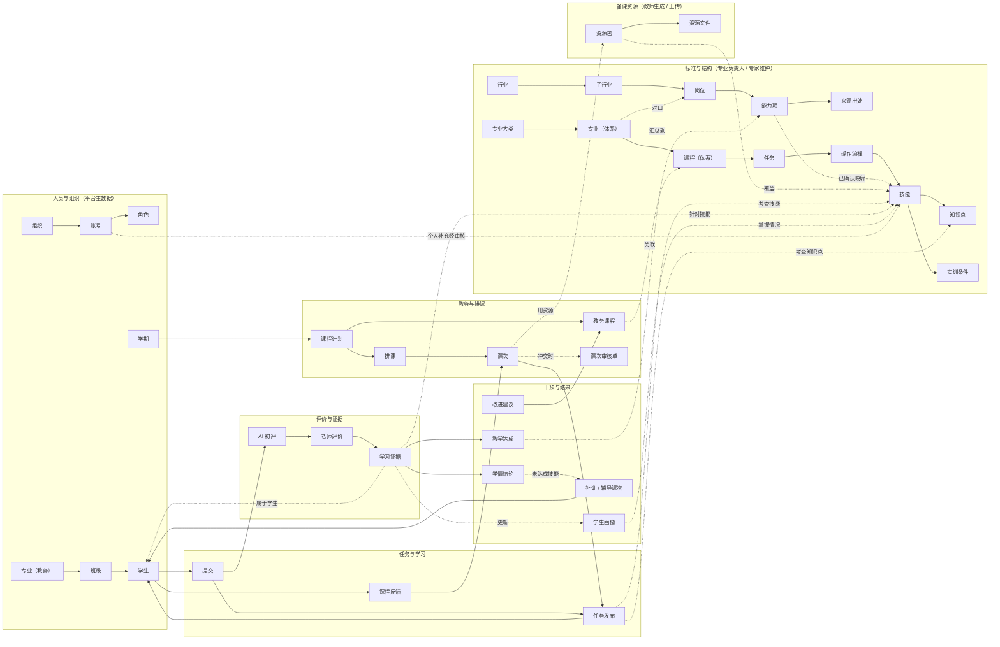

# 教学闭环 · 全要素图谱（业务模型）

> 2026-11-23 · 面向业务的全量梳理：上课、学习、评价过程中涉及的**所有业务对象及其关系**，作为平台「图谱」承载的完整业务模型。图谱不再只是知识体系与能力图谱，而是把教、学、评、改全链路串起来的一张网。
>
> 本文只讲业务：对象是什么、谁维护、关系怎么产生、服务于什么业务场景。技术实现另议。

---

## 一、这张图谱要回答的业务问题

业务人员不需要关心"图谱"两个字，他们关心的是这些问题有据可查：

1. **课教得怎么样**：这门课考了哪些技能，学生达成如何，哪几项薄弱？
2. **专业培养达标吗**：岗位要求的能力，课程覆盖了多少，毕业生证据支撑了多少？
3. **学生为什么没学会**：哪个知识点没掌握，判定依据是什么，需要补训还是个别辅导？
4. **这节课是怎么上的**：用了什么资源，资源覆盖了哪些知识点，任务怎么布置的？
5. **改了标准会牵动什么**：知识体系修订会影响哪些课程关联、哪些在评任务、哪些统计？
6. **老师的好经验怎么沉淀**：个人补充的教学内容如何经审核进入全校标准？

图谱的定位：**所有业务对象的"关系台账"**——每个对象之间的关联有明确出处（谁在什么操作里建立的），每条结论能顺藤摸瓜查到源头（哪个证据、哪次评价、哪份标准）。

---

## 一·五、业务全景图

把七类对象按业务流串起来：**标准是起点，教与学是主线，评价产生证据，证据回流到标准形成闭环**。实线 = 业务主线，虚线 = 引用 / 支撑关系。

**读图顺序**：① 标准结构定好"岗位要什么能力、专业教什么技能"→ ② 教务把课关联到体系、排课生成课次 → ③ 老师备课挂资源、发布任务（考查技能与知识点在发布时定稿）→ ④ 学生学、提交、反馈 → ⑤ AI 初评→老师评价→证据 → ⑥ 证据回流：学情（老师补训）、教学达成（汇总到能力项）、改进建议（优化课程）、学生画像（随评价更新）→ 老师的好经验经审核并入标准，回到 ①。

> 完整关系清单见第三节；图中只画业务主线和关键支撑关系。

---

## 二、业务对象清单

按业务职责分七类。**维护者**指谁能建立/修改这个对象；**用途**指它服务哪些业务。

### 1. 人员与组织

| 对象 | 说明 | 维护者 | 用途 |
|---|---|---|---|
| 组织 | 学校、院系、教研室等层级结构 | 管理员 | 数据权限隔离、人员归属 |
| 账号 | 平台使用者（学生、教师、教务、专业负责人、管理员） | 管理员 | 登录、操作留痕、职责划分 |
| 角色 | 账号在平台上的职责（含能看什么、能做什么） | 管理员 | 权限控制 |
| 专业（教务） | 学校开设的专业（树形：大类→专业→方向） | 教务 | 班级、课程、课程计划的归属 |
| 班级 | 某专业某年级的教学班 | 教务 | 排课、下发任务、学情统计的范围 |
| 学生 | 班级成员（含学籍状态：在读/休学/毕业） | 教务 | 学习、提交、评价、成长 |
| 教师 | 有任教课程的账号 | 管理员/教务 | 备课、上课、发布、评价 |
| 学期 | 学年+学期，有起止日期 | 教务 | 课程计划、排课、统计的时间范围 |

### 2. 标准与结构（图谱核心，专业负责人/专家维护）

| 对象 | 说明 | 维护者 | 用途 |
|---|---|---|---|
| 行业 | 产业分类（如旅游业） | 图谱管理员 | 能力图谱的根 |
| 子行业 | 行业细分 | 图谱管理员 | 定位岗位 |
| 岗位 | 行业中的职业岗位 | 图谱管理员 | 能力要求的挂载点 |
| 能力项 | 岗位要求的能力，分 L1–L3 三级行为化描述，有来源出处 | 图谱管理员 | 测评、覆盖率、毕业标准 |
| 专业大类 | 知识体系最顶层（如旅游类） | 专业负责人 | 知识体系分类 |
| 专业（体系） | 知识体系中的专业范围（如导游） | 专业负责人 | 与教务专业对应 |
| 课程（体系节点） | 知识体系中的一门课的定义 | 专业负责人 | 教务课程关联的对象 |
| 任务 | 课程下的教学任务（描述性，非作业） | 专业负责人 | 技能分组、备课范围 |
| 操作流程 | 任务下的流程环节（部分课程类型无此层） | 专业负责人 | 技能归属路径 |
| 技能 | **教学闭环核心**：能做什么的最小单位，任务、评价、证据都挂在它上面 | 专业负责人 | 备课、发布、评价、达成、补训 |
| 知识点 | 技能下"要知道什么"：名称、类型、核心内容。**记来源**：谁建立（专业负责人直接建 / 老师补充经审核并入）、经谁审核、何时 | 专业负责人 + 教师（补充经审核） | 判定依据默认值、学情、补训 |
| 操作步骤/标准/案例 | 与知识点平级，挂在技能下 | 专业负责人 | 教学参考 |
| 实训条件 | 技能对实训环境的要求（必需/建议）。**与映射共用一套审核状态**：已审核/已调整/待审核，待审核不生效 | 专业负责人 | 实训资源差距分析 |
| 能力来源出处 | 能力项的国家/行业标准依据 | 图谱管理员 | 出处可查、不显示无出处数字 |
| 赛项 / 证书 | 技能大赛赛项、职业资格证书标准 | 预留（第一阶段不建） | 备赛、考证场景 |

### 3. 教务与排课

| 对象 | 说明 | 维护者 | 用途 |
|---|---|---|---|
| 教务课程 | 学校实际开设的课（公共基础/专业基础/专业核心/专业拓展/其他五类），**关联知识体系中的一个课程节点** | 教务 | 课程计划、统计口径 |
| 课程计划 | 某学期、某班、某门课由哪位老师上 | 教务 | 排课、课次的归属 |
| 节次时间 | 全校统一的一张节次表 | 教务 | 排课、课表 |
| 排课 | 课程计划的具体上课时间（一次或按周批量） | 教务 | 自动生成课次 |
| 课次 | 一次课：时间、来源（教务排课/老师自建/补训/辅导）、状态（未发布/待审核/已发布/标记未上） | 教务+教师 | 备课、发布、上课、评价的载体 |
| 课次审核单 | 老师建的课次与教务排课时间冲突时，提交教务处理的申请 | 教师发起，教务处理 | 冲突协调（调时间/允许重叠/替换/驳回） |

### 4. 备课资源

| 对象 | 说明 | 维护者 | 用途 |
|---|---|---|---|
| 资源包 | 一次备课的产出：名称、来源（AI 生成/上传）、涉及任务与技能、配置的知识点 | 教师 | 挂到课次、发布下发 |
| 资源文件 | 包内的课件/教案/游戏/图片/视频 | 教师 | 学生学习的材料 |
| 知识库资料 | 沉淀的文档/音视频资料，可挂到技能节点 | 图谱管理员/教师 | 检索、备课时参考 |

### 5. 任务与学习

| 对象 | 说明 | 维护者 | 用途 |
|---|---|---|---|
| 任务发布 | 课次发布给学生的学习任务：任务要求、提交方式、截止时间、考查技能、**考查知识点（含判定依据）**、AI 评价要求、反馈开关。**发布时固化内容，之后不可改不可撤** | 教师 | 学生作答与评价的依据 |
| 追加下发 | 已发布课次补发的资源文件 | 教师 | 学生端标「新增」 |
| 学习记录 | 学生学习了哪个文件的记录 | 系统自动 | 学习情况统计 |
| 提交 | 学生对任务的作答：内容（文字/图片/语音/文档/视频）、是否超时、第几次提交 | 学生 | 评价对象 |
| 课程反馈 | 学生对这节课资源与任务难度的反馈 | 学生 | 老师改进教学 |

### 6. 评价与证据

| 对象 | 说明 | 维护者 | 用途 |
|---|---|---|---|
| AI 初评 | 学生提交后 AI 按「AI 评价要求」给出的总评+逐项判断，**未经老师确认不算结果** | 系统自动 | 减轻老师工作量 |
| 老师评价 | 老师采用 AI 或逐项确认后给出：逐项技能等级、知识点掌握、整体等级、通过/退回、评语 | 教师 | 结果的唯一来源 |
| 学习证据 | 老师评价**通过**后，每个考查技能记一条「学生×技能×等级」。退回、AI 结果、学生自评都不产生证据 | 系统按评价生成 | 学情、教学达成、能力测评 |
| 知识点掌握 | 学生每个知识点的掌握/未掌握（按最近一次老师确认的评价，含退回那次） | 系统按评价推导 | 学情分析、补训——不进证据、不汇总到能力 |
| 整体等级 | 未挂技能任务、公共基础课的评价等级 | 教师 | 任务完成情况的记录 |

### 7. 干预与结果

| 对象 | 说明 | 维护者 | 用途 |
|---|---|---|---|
| 补训课次 | 针对某个薄弱技能、发给未达成学生的课 | 教师发起 | 补齐短板 |
| 辅导课次 | 勾选个别学生的单独辅导 | 教师发起 | 个体帮扶 |
| 课程改进建议 | 老师对课程提出的改进意见（类型/涉及技能/内容） | 教师发起，专业负责人处理 | 课程优化 |
| 学情结论 | 课程按技能/知识点两个维度的达成统计与需要处理的事 | 系统按证据计算 | 老师看班、发起补训 |
| 教学达成 | 证据经能力—技能映射汇总到能力项的结果 | 系统按证据+映射计算 | 校领导、专业负责人看培养质量 |
| 学生画像 | **图谱的一部分**：学生在技能上的达成与知识点掌握情况，随评价更新 | 系统按证据生成 | 图谱上看学生、补训与辅导的依据 |
| 教研贡献 | 老师的个人补充内容经审核进入标准图谱的记录 | 专业负责人审核后生成 | 教师成长档案 |
| 操作日志 | 发布、评价、补训、建议、导出、审核等关键操作的记录 | 系统自动 | 追溯与审计 |

---

## 三、业务关系清单

关系 = 业务上谁和谁因为什么操作产生了关联。按六条业务链路组织，每条注明**怎么产生**和**服务什么**。

### 链路 1 · 标准结构（建立标准时产生）

| 关系 | 谁 → 谁 | 业务含义与产生时机 | 服务什么 |
|---|---|---|---|
| 要求 | 岗位 → 能力项 | 建图时确定岗位要求哪些能力、要求到几级（L1–L3） | 测评、覆盖诊断 |
| 支撑（映射） | 能力项 → 技能 | 专家审核确认"技能支撑能力"后才建立，待审核的不算 | 教学达成汇总、专业建设测评 |
| 包含 | 课程 → 任务 → 技能 → 知识点 | 建知识体系时搭建的层级 | 备课范围、发布时带出知识点 |
| 覆盖 | 课程 → 能力项 | 由映射推导：课里的技能支撑哪些能力 | 课程覆盖率统计 |
| 需要实训条件 | 技能 → 实训条件 | 专业负责人给技能配置实训需求，**与映射共用一套审核状态**（已审核/已调整/待审核），待审核不生效 | 实训资源差距分析 |
| 有出处 | 能力项 → 标准依据 | 建能力项时记录来源 | 出处可查 |
| 对口 | 专业 → 岗位 | 专业对口的岗位清单（已确认数据） | 全景视图、测评范围 |
| 对应（赛证） | 赛项/证书 → 能力项、知识点 | 入图后建立，**同样走审核确认**，待审核不生效 | 备赛、考证场景（第二阶段） |
| 前置 | 知识点 → 知识点 | 预留：知识点的学习先后顺序 | 学习路径（后续） |
| 安全约束 | 知识点 → 技能（实操） | 预留：安全类知识点未达标不允许上实操课 | 实训安全门禁（后续） |
| 贡献署名 | 教师补充内容 → 教师 | 老师的个人补充经审核进入标准后保留署名 | 教研贡献 |

### 链路 2 · 人员组织（账号与业务数据建立时产生）

| 关系 | 谁 → 谁 | 业务含义 | 服务什么 |
|---|---|---|---|
| 上级组织 | 组织 → 组织 | 组织树 | 数据权限 |
| 属于 | 账号 → 组织 | 一人可属多组织，有主组织 | 数据范围 |
| 担任 | 账号 → 角色 | 一人多角色、跨端 | 功能权限 |
| 开设专业 | 班级 → 专业 | 班级归属 | 数据隔离 |
| 在班 | 学生 → 班级 | 只算在读学生 | 下发、统计范围 |
| 任教 | 教师 → 课程计划 | 老师负责的课 | 教师端范围 |
| 在学期 | 课程计划 → 学期 | 计划归属学期 | 时间范围 |

### 链路 3 · 上课过程（排课与发布时产生）

| 关系 | 谁 → 谁 | 业务含义与产生时机 | 服务什么 |
|---|---|---|---|
| 关联知识体系 | 教务课程 → 体系课程节点 | 教务在课程管理/图谱中心把课程关联到知识体系；有课程级体系时优先用课程级；解除后回落到专业体系的同名课程 | 统计口径（关联了统计才完整） |
| 计划 | 课程计划 → 教务课程 | 建课程计划时确定班×课×师 | 排课归属 |
| 排课 | 排课 → 课程计划 | 教务排课（一次/按周批量） | 自动生成课次 |
| 按节次 | 排课 → 节次时间 | 排课选第几节到第几节 | 时间冲突检查 |
| 生成课次 | 排课 → 课次 | 排课即课次；未发布随排课变化，已发布锁定 | 教师端课次列表 |
| 属于计划 | 课次 → 课程计划 | 自建/补训课次也挂在计划下 | 学情归属 |
| 用资源 | 课次 → 资源包 | 备课资源关联到课次；课次技能=资源技能的并集 | 发布候选、教学资源页签 |
| 发布 | 课次 → 任务发布 | 老师发布学习内容（一次课最多一个任务） | 学生收到任务 |
| 考查 | 任务发布 → 技能 | 发布时老师确认考查技能（发布时固化） | 评价范围、课程进度 |
| 考查知识点 | 任务发布 → 知识点（含判定依据） | 发布时勾选、判定依据默认取知识点核心内容（发布时固化，之后知识体系改了不影响） | 评价、学情的依据 |
| 下发 | 任务发布 → 资源文件 | 发布时勾选下发的文件；追加的标「新增」 | 学生可见范围 |
| 时间冲突 | 课次 ↔ 课次 | 同一天同班或同师时间重叠；老师课次与教务排课冲突时提交审核单 | 冲突协调 |
| 审核 | 审核单 → 课次 | 教务处理：调时间通过/允许重叠/替换原排课/驳回 | 教务对时间的最终决定权 |
| 替换 | 老师课次 → 原排课课次 | 教务选"替换排课"：原排课标"已被替换，不计入进度" | 冲突的最终解决 |
| 标记未上 | 课次 → 状态标记 | 老师标记调课/停课（评价记录保留） | 教学进度口径 |
| 补训目标 | 补训/辅导课次 → 技能 | 发起补训时针对某薄弱技能 | 补训发布 |
| 发给 | 补训/辅导课次 → 学生 | 补训只发未达成学生；辅导发勾选学生 | 定向帮扶 |

### 链路 4 · 学习过程（学生端操作时产生）

| 关系 | 谁 → 谁 | 业务含义与产生时机 | 服务什么 |
|---|---|---|---|
| 布置给 | 任务发布 → 学生 | 发布时确定接收人（全班或补训目标） | 学生任务列表 |
| 学习了 | 学习记录 → 资源文件 | 学生打开学习资源 | 学习情况 |
| 提交了 | 提交 → 任务发布 | 学生提交；退回后重交记为第 N 次 | 待评价队列 |
| 谁交的 | 提交 → 学生 | 提交归属 | 学情 |
| 超时标记 | 提交 → 超时 | 截止后补交标超时 | 评价参考 |
| 反馈了 | 课程反馈 → 课次 | 学生填课程反馈 | 老师待办、教学改进 |

### 链路 5 · 评价过程（评价操作时产生）

| 关系 | 谁 → 谁 | 业务含义与产生时机 | 服务什么 |
|---|---|---|---|
| AI 初评 | AI 结果 → 提交 | 开启 AI 初评的任务，提交后自动生成；未经老师确认不算结果 | 老师参考 |
| 老师评价 | 评价结果 → 提交 | 老师采用 AI 或逐项确认，给出通过/退回 | 结果认定 |
| 产生证据 | 评价 → 学习证据 | **通过**后每个考查技能记一条证据；退回不记 | 学情、达成的数据源 |
| 证据针对 | 学习证据 → 技能 | 证据挂在具体技能上 | 按技能统计 |
| 证据是谁的 | 学习证据 → 学生 | 证据归属学生 | 按学生统计 |
| 在哪节课 | 学习证据 → 课次 | 证据来自哪次课 | 按课次/课程统计 |
| 知识点判定 | 知识点掌握 → 评价 | 按最近一次老师确认的评价（含退回）推导 | 学情、补训——不进证据 |
| 按什么评 | 评价 → AI 评价要求 | 一份任务一份评价要求 | AI 初评依据 |
| 判定标准 | 判定依据 → 知识点 | 发布时默认取知识点核心内容，老师可改 | 评价与学生对标 |

### 链路 6 · 干预与回流（学情与改进时产生）

| 关系 | 谁 → 谁 | 业务含义与产生时机 | 服务什么 |
|---|---|---|---|
| 补短板 | 补训课次 → 薄弱技能 | 学情中未达成人数最多的技能发起 | 补训闭环：补训评价通过后达成自动更新 |
| 提建议 | 改进建议 → 教务课程 | 老师在学情页对课程提建议 | 专业负责人处理 |
| 处理结果 | 改进建议 → 处理意见 | 专业负责人采纳/暂不处理+说明，结果回老师学情页 | 建议闭环 |
| 汇总到能力 | 教学达成 → 能力项 | 证据经已确认映射汇总 | 校领导总览、专业负责人看专业 |
| 掌握情况 | 学生 → 技能 | 学生画像：学生在技能上的当前达成状态，由证据计算，随评价更新 | 图谱上的学生画像 |
| 掌握知识点 | 学生 → 知识点 | 学生画像：知识点掌握（按最近一次确认评价，含退回），不进证据 | 学生画像、补训依据 |
| 缺口 | 课程标准 → 缺口清单 | 课程标准技能与实际考查对比 | 补资源决策 |
| 审核并入 | 教师补充 → 标准图谱 | 老师提交→专业负责人审核（可改名）→发布全校可见 | 反哺标准、教研贡献 |
| 留痕 | 操作日志 → 操作者/对象 | 关键操作自动记录 | 审计 |

---

## 四、业务规则（关系的成立与解除条件）

1. **审核状态统一，确认过才生效**：能力—技能映射、技能实训条件、赛证对应关系共用一套审核状态（已审核 / 已调整 / 待审核）。只有"已审核 / 已调整"才参与统计与展示；AI 初稿、待审核的不算。谁审核的、什么时候确认的，都要能查到。
2. **标准内容记来源，无主次之分**：知识点等标准内容记录"谁建立的（专业负责人直接建 / 老师补充经审核并入）、经谁审核、何时"；建立人不同不影响内容地位，审核通过即标准内容。
3. **发布即定稿**：任务发布时把考查技能、考查知识点、判定依据、AI 评价要求全部固定下来。之后知识体系改了，已发布任务照旧；新发布任务用新内容。学生看到的和老师评的就是发布时那一版。
4. **证据是结果的唯一凭证**：只有老师确认通过才产生证据；AI 结果、学生自评、退回的提交都不是证据。知识点掌握只用于学情和补训，不进证据、不汇总到能力。
5. **学生画像是图谱的一部分，随评价更新**：画像展示学生在技能上的达成与知识点掌握，数据只来自老师确认通过的证据（口径与学情一致：技能达成看证据、知识点掌握看最近一次确认评价）；AI 结果、自评、退回不进画像。
6. **被用的不能删，只能停用**：课程节点被教务课程关联、技能被任务考查、知识点被任务快照引用后，只能停用（保留历史），不能删除。
7. **课次状态是业务过程，不是图谱结构**：未发布/待审核/已发布/标记未上，是课次的状态变化，记录在课次上，不影响技能、知识点这些标准内容。
8. **统计口径的三层归属**：教学进度（上了几次、考查了几项技能）看课次与任务发布；技能达成率看证据与已评价技能；标准达成率看证据与课程标准全集。图谱提供"课程标准全集"和"技能—能力映射"作为分母与汇总的依据，数字本身按业务规则算。
9. **版本是标准的版本**：标准图谱修订经审核发布后，全校按新版本看；旧版本保留可查、可回看当时的统计口径。
10. **老师内容进标准要过审核**：老师的个人补充挂在标准节点下提交→专业负责人审核（可改名）→发布后全校可见，保留贡献人署名，计入教研贡献。审核通过的补充内容与直接建立的内容无主次之分，只记来源。

---

## 五、业务场景验证（图谱要能回答）

| 场景 | 问题 | 图谱的答法 |
|---|---|---|
| 校领导看质量 | 导游专业这学期培养质量怎么样？ | 专业→对口岗位→能力项→（映射）→技能→证据：每个能力项有多少学生达成 |
| 教务问覆盖 | 哪些岗位能力没有课程支撑？ | 岗位要求的能力项 − 课程技能经映射覆盖的能力项 = 缺口 |
| 老师看班 | 旅行社经营这门课学生学得怎么样？ | 课程→任务→技能→证据：达成率、薄弱技能、未掌握知识点 |
| 老师补短板 | 讲解技能 8 个学生没达成，怎么办？ | 技能→未达成学生→发起补训→补训课次→补训评价通过→达成更新 |
| 学生看结果 | 我为什么这个技能没通过？ | 学生→证据→技能→判定依据：哪条知识点没掌握、怎么算掌握 |
| 专业负责人改标准 | 停用一个知识点会牵动什么？ | 知识点→被哪些任务快照引用→哪些课受影响；停用只影响新发布 |
| 教务换体系 | 导游专业换一套知识体系会怎样？ | 旧体系课程关联解除→按新体系重新匹配课程→统计从新体系算起 |
| 审计 | 这个学生的合格是谁评的、什么时候？ | 证据→评价→课次→操作日志：完整链路 |

---

## 六、第一阶段边界

- **建**：行业/子行业/岗位/能力项（含出处）、专业大类/专业/课程/任务/技能/知识点（记来源）、实训条件（共用审核状态）、能力—技能已确认映射、教务课程关联、教师补充经审核并入、**学生画像（学生×技能的达成与知识点掌握，随评价更新）**。
- **只挂不建**：备课资源挂到技能（记录资源覆盖了哪些技能、知识点）。
- **记录但不进标准**：排课、课次、任务发布、提交、评价、证据、补训、建议——它们引用标准内容（技能、知识点），本身是可追溯的业务记录；图谱上体现的是"标准内容被谁用了、结果如何"。
- **预留**：赛项、证书、知识点前置关系、安全约束（第二阶段）。赛项/证书入图后，与能力项、知识点的对应关系**走审核确认**。

---

## 七、产品决策记录（2026-11-24 确认）

| # | 事项 | 结论 |
|---|---|---|
| 1 | 学生画像是否作为图谱的一部分 | **是**：学生画像入图谱，展示学生在技能上的达成与知识点掌握，随评价更新；数据只来自老师确认通过的证据（见业务规则 4） |
| 2 | 实训条件与映射的审核状态 | **共用一套**：已审核 / 已调整 / 待审核，待审核不生效 |
| 3 | 老师补充并入的内容与直接建立的主次 | **无主次**：审核通过即标准内容；记录来源（谁建立、经谁审核、何时） |
| 4 | 赛项/证书与能力项、知识点的对应关系是否走审核 | **是**：入图后同样走审核确认，待审核不生效 |
